# Индивидуальная работа

**Дисциплина:** Dezvoltarea aplicațiilor Server-Side
**Тема:** Система управления учебными курсами: CRUD-приложение на PostgreSQL и Sequelize с аутентификацией, авторизацией и защитой
**Объединяет:** лабораторную работу №4 «Разработка CRUD-приложения с базой данных и Sequelize» и лабораторную работу №5 «Аутентификация, авторизация и защита Express-приложения»
**Студент:** Alina Zabolotnaia (Korsakova)
**Группа:** IAFR2302
**Преподаватель:** Вишневски Влада

**Код проекта:** [lab5_alina_zabolotnaia](../lab5_alina_zabolotnaia/) (итоговая версия, включает всё из работы №4)
**Отдельные отчёты:** [лабораторная №4](../lab4_alina_zabolotnaia/README.md), [лабораторная №5](../lab5_alina_zabolotnaia/README.md)

## Содержание

1. [Цель и задачи](#1-цель-и-задачи)
2. [Используемые технологии](#2-используемые-технологии)
3. [Архитектура приложения](#3-архитектура-приложения)
4. [База данных](#4-база-данных)
5. [Функциональность](#5-функциональность)
6. [Безопасность](#6-безопасность)
7. [Обработка ошибок и логирование](#7-обработка-ошибок-и-логирование)
8. [Уведомления в реальном времени](#8-уведомления-в-реальном-времени)
9. [Тестирование](#9-тестирование)
10. [Демонстрация работы](#10-демонстрация-работы)
11. [Запуск проекта](#11-запуск-проекта)
12. [Выводы](#12-выводы)

## 1. Цель и задачи

**Цель:** разработать веб-приложение «Система управления учебными курсами», которое хранит данные в PostgreSQL, работает с ними через ORM Sequelize, разграничивает доступ пользователей по ролям и защищено от типичных ошибок и атак.

**Задачи:**

| № | Задача | Работа |
|---|---|---|
| 1 | Подключить приложение к PostgreSQL, вынести параметры в `.env` | №4 |
| 2 | Создать модели `Teacher` и `Course` и связь «один ко многим» | №4 |
| 3 | Реализовать CRUD для курсов и преподавателей | №4 |
| 4 | Реализовать поиск, фильтрацию и статистику средствами базы данных | №4 |
| 5 | Проверять данные и защищать связи (нельзя удалить преподавателя с курсами) | №4 |
| 6 | Добавить модель `User`, регистрацию, вход, выход и профиль | №5 |
| 7 | Хранить пароли в виде bcrypt-hash и работать с сессиями | №5 |
| 8 | Разграничить права ролей `user` и `admin` и защитить маршруты | №5 |
| 9 | Проверять все формы через express-validator и централизованно обрабатывать ошибки | №5 |
| 10 | Логировать запросы и действия администратора | №5 |
| 11 | Отправлять WebSocket-уведомления о новых курсах | №5 |

Приложение продолжает лабораторную работу №3, в которой данные хранились в массиве.

## 2. Используемые технологии

| Технология | Версия | Назначение |
|---|---|---|
| Node.js | 22 LTS | Среда выполнения JavaScript на сервере |
| Express | 5.3 | Веб-фреймворк: маршруты, middleware |
| PostgreSQL | 16 | Реляционная база данных |
| Sequelize | 6.37 | ORM: модели, связи, запросы, валидация |
| pg, pg-hstore | 8.23, 2.3 | Драйвер PostgreSQL для Sequelize |
| EJS | 7 | Серверные HTML-шаблоны |
| dotenv | 18 | Загрузка `.env` в `process.env` |
| bcrypt | 6.0 | Hash-ирование паролей |
| express-session | 1.19 | Сессии пользователей |
| express-validator | 7.3 | Проверка и очистка данных форм |
| morgan | 1.12 | Логирование HTTP-запросов |
| socket.io | 4.8 | Уведомления в реальном времени (WebSocket) |

## 3. Архитектура приложения

Приложение построено по архитектуре **MVC**. В `app.js` нет маршрутов, SQL и бизнес-логики: только настройка Express, подключение middleware и запуск HTTP-сервера.

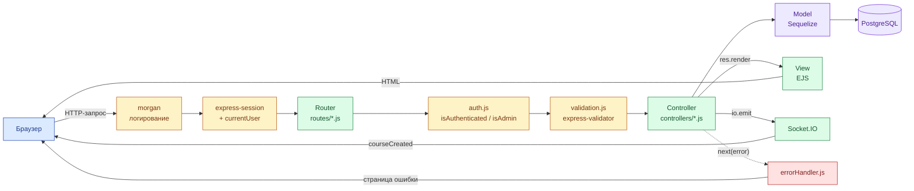

| Слой | Файлы | Ответственность |
|---|---|---|
| Model | `models/User.js`, `Teacher.js`, `Course.js`, `index.js` | Таблицы, типы, валидация, связи, запросы с подсчётом |
| View | `views/**/*.ejs` | HTML-страницы; partials для шапки, подвала и форм |
| Controller | `controllers/authController.js`, `courseController.js`, `teacherController.js` | Обработка запросов, обращение к моделям, выбор ответа |
| Router | `routes/authRoutes.js`, `courseRoutes.js`, `teacherRoutes.js` | Связь метода и URL с цепочкой middleware и контроллером |
| Middleware | `middleware/auth.js`, `validation.js`, `logger.js`, `notFound.js`, `errorHandler.js` | Права доступа, проверка данных, логирование, ошибки |
| Config | `config/database.js`, `.env` | Подключение к базе, секреты |

Структура итогового проекта:

```
lab5_alina_zabolotnaia/
├── app.js
├── config/database.js
├── models/        index.js, User.js, Teacher.js, Course.js
├── routes/        authRoutes.js, courseRoutes.js, teacherRoutes.js
├── controllers/   authController.js, courseController.js, teacherController.js
├── middleware/    auth.js, validation.js, logger.js, notFound.js, errorHandler.js
├── views/         auth/, courses/, teachers/, partials/, profile.ejs, statistics.ejs, 403.ejs, 404.ejs, error.ejs
├── public/        css/style.css, js/notifications.js
├── scripts/       seed.js
├── logs/          requests.log
├── .env, .env.example, .gitignore
└── package.json
```

## 4. База данных

База `node_courses` в PostgreSQL 16. Таблицы создаёт `sequelize.sync()` без `force: true`, поэтому при перезапуске данные сохраняются.

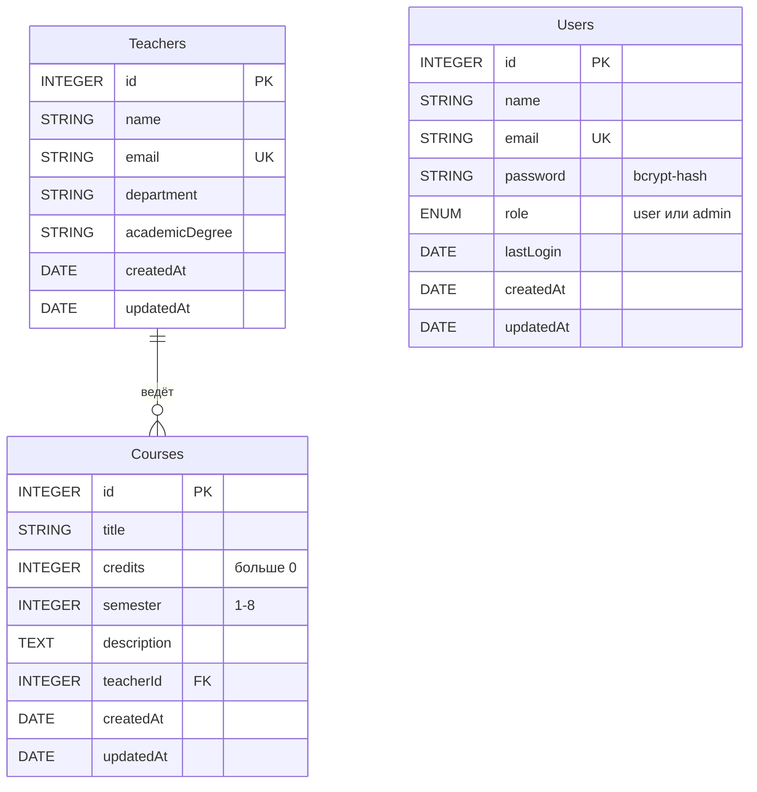

**Связь One-to-Many** задана в `models/index.js`:

```javascript
Teacher.hasMany(Course, { foreignKey: 'teacherId', onDelete: 'RESTRICT' });
Course.belongsTo(Teacher, { foreignKey: 'teacherId' });
```

- Курс хранит только `teacherId`; имя преподавателя загружается через `Course.findAll({ include: Teacher })` (JOIN).
- Курсы преподавателя загружаются через связь: `teacher.getCourses()`, количество: `teacher.countCourses()`.
- `ON DELETE RESTRICT` в базе запрещает удалить преподавателя, у которого есть курсы.

**Ограничения на уровне базы:** `NOT NULL` для обязательных полей, `UNIQUE` для `Teachers.email` и `Users.email`, внешний ключ `Courses.teacherId → Teachers.id`.

Начальные данные (6 преподавателей, 7 курсов) добавляет `npm run seed`; скрипт работает в транзакции и ничего не делает, если данные уже есть.

## 5. Функциональность

### Маршруты и права доступа

| Метод | URL | Назначение | Гость | User | Admin |
|---|---|---|---|---|---|
| GET | `/` | Перенаправление на `/courses` | да | да | да |
| GET | `/courses` | Список, поиск `?search=`, фильтры `?teacherId=`, `?semester=` | да | да | да |
| GET | `/courses/:id` | Курс и данные преподавателя | да | да | да |
| GET | `/teachers` | Преподаватели с количеством курсов | да | да | да |
| GET | `/teachers/:id` | Преподаватель и его курсы | да | да | да |
| GET, POST | `/register` | Регистрация | да | → профиль | → профиль |
| GET, POST | `/login` | Вход | да | → профиль | → профиль |
| POST | `/logout` | Выход | 401 | да | да |
| GET | `/profile` | Профиль | → /login | да | да |
| GET | `/statistics` | Статистика | → /login | да | да |
| GET, POST | `/courses/new`, `/courses` | Добавление курса | → /login / 401 | 403 | да |
| GET, POST | `/courses/:id/edit` | Редактирование курса | → /login / 401 | 403 | да |
| POST | `/courses/:id/delete` | Удаление курса | 401 | 403 | да |
| GET, POST | `/teachers/new`, `/teachers` | Добавление преподавателя | → /login / 401 | 403 | да |
| GET, POST | `/teachers/:id/edit` | Редактирование преподавателя | → /login / 401 | 403 | да |
| POST | `/teachers/:id/delete` | Удаление преподавателя | 401 | 403 | да |

### Курсы и преподаватели (работа №4)

- **CRUD** для обеих сущностей через HTML-формы. Преподаватель курса выбирается из `<select>`, список берётся из таблицы `Teachers`.
- **Поиск и фильтрация** выполняются в PostgreSQL одним запросом:
  ```javascript
  const where = {};
  if (search !== '')      where.title = { [Op.iLike]: `%${escapeLike(search)}%` };
  if (teacherId !== null) where.teacherId = teacherId;
  if (semester !== null)  where.semester = semester;
  Course.findAll({ where, include: Teacher, order: [['title', 'ASC']] });
  ```
  Условия объединяются через `AND`, `ILIKE` ищет без учёта регистра, символы `%` и `_` экранируются.
- **Удаление преподавателя с курсами** запрещено дважды: контроллер проверяет `countCourses()` и возвращает 409, а база отклонит удаление ограничением `RESTRICT`.
- **Статистика** считается запросами `COUNT ... GROUP BY`: число преподавателей и курсов, курсы по семестрам 1-8, курсы каждого преподавателя (`LEFT JOIN`, преподаватели без курсов тоже видны) и преподаватель с наибольшим числом курсов.

### Пользователи (работа №5)

- **Регистрация:** имя (≥ 2 символа), email (формат, уникальность), пароль (≥ 6 символов), подтверждение. Новый пользователь всегда получает роль `user`.
- **Вход:** поиск по email, `bcrypt.compare()`, новая сессия, обновление `lastLogin`, переход в профиль.
- **Выход:** только `POST /logout`, сессия уничтожается, cookie удаляется.
- **Профиль:** имя, email, роль, дата регистрации, последний вход и данные, хранящиеся в сессии.
- **Администратор** назначается в базе: `UPDATE "Users" SET role = 'admin' WHERE email = '...'`, затем повторный вход.
- **Навигация** зависит от роли: гость видит «Вход» и «Регистрацию», пользователь видит имя, «Профиль», «Выход» и «Статистику», администратор дополнительно видит «Добавить курс» и «Добавить преподавателя». Кнопки редактирования и удаления видит только администратор. Данные пользователя доступны всем шаблонам через `res.locals.currentUser`.

## 6. Безопасность

| Угроза | Защита |
|---|---|
| Утечка паролей из базы | Только bcrypt-hash с солью и cost 10; `defaultScope` модели не загружает поле `password`, hash читается только при входе |
| Подбор аккаунтов по сообщениям | Одно сообщение «Неверный email или пароль»; сравнение с фиктивным hash, если пользователь не найден |
| Получение роли admin при регистрации | `User.create(..., { fields: ['name', 'email', 'password'] })`, роль по умолчанию `user` |
| Действия в обход интерфейса | `isAdmin` и `isAuthenticated` стоят в маршрутах первыми; ручной POST от пользователя `user` получает 403 и не обращается к базе |
| Кража и подделка сессии | Cookie подписана `SESSION_SECRET`, `httpOnly`, срок 1 час; после входа `session.regenerate()` (защита от session fixation) |
| CSRF | Cookie с `sameSite: 'lax'`; изменения только через POST; выход только через POST |
| Лишние сессии | `saveUninitialized: false`: гостю cookie не создаётся |
| SQL-инъекции | Sequelize передаёт значения как параметры запроса |
| XSS | EJS `<%= %>` экранирует HTML; уведомления вставляются через `textContent` |
| Секреты в репозитории | Пароль БД и `SESSION_SECRET` только в `.env`, который в `.gitignore`; в git лежит `.env.example` с заглушками |
| Некорректные данные | Три уровня: express-validator, валидаторы модели Sequelize, ограничения PostgreSQL |
| Подделанный `teacherId` | Асинхронная проверка существования преподавателя в базе |
| Утечка технических деталей | Пользователь видит только код и понятный текст; stack trace, SQL и параметры подключения пишутся только в терминал |

## 7. Обработка ошибок и логирование

### Централизованная обработка

Контроллеры не показывают страницы ошибок сами: они вызывают `next(new HttpError(status, message))` или передают пойманное исключение через `next(error)`. Все асинхронные операции написаны с `async/await` и `try...catch`. `notFound.js` подключён после маршрутов, `errorHandler.js` последним.

| Код | Ситуация |
|---|---|
| 400 | Ошибки валидации форм, некорректный ID (`/courses/abc`), `ValidationError` модели |
| 401 | Гость отправляет POST на защищённый маршрут; неверный пароль |
| 403 | Пользователь без роли admin пытается изменить данные |
| 404 | Неизвестный маршрут, курс или преподаватель не найден |
| 409 | Email уже зарегистрирован или занят; удаление преподавателя с курсами |
| 500 | Прочие ошибки сервера и Sequelize |
| 503 | PostgreSQL недоступен (`ConnectionError`); сервер при этом продолжает работать |

### Логирование

- `morgan('dev')` выводит каждый запрос в терминал.
- Второй экземпляр morgan дописывает в `logs/requests.log`:
  ```
  POST /login | 302 | 77 ms | 23.11.2026 17:46
  GET /courses/new | 403 | 1 ms | 23.11.2026 17:46
  POST /courses | 302 | 7 ms | 23.11.2026 17:47
  ```
- Журнал действий администратора в терминале:
  ```
  ADMIN ACTION | admin@example.com | DELETE COURSE | Course ID: 9 | 23.11.2026 17:46
  ```
- Для ожидаемых ошибок 4xx в терминал пишется одна строка, для ошибки подключения к базе одна строка с причиной (`ECONNREFUSED`), для 500 полная ошибка.

## 8. Уведомления в реальном времени

Приложение запускается через `http.createServer(app)`, к которому подключён Socket.IO; объект `io` передаётся контроллерам через `app.set('io', io)`.

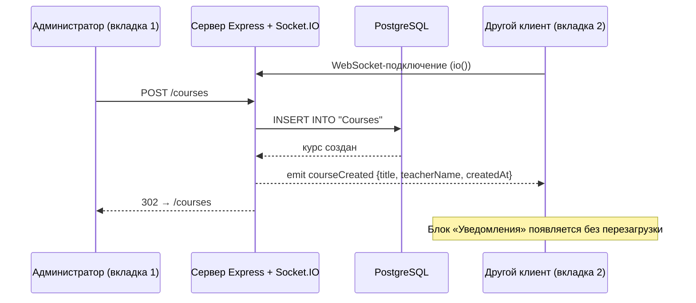

Клиент `public/js/notifications.js` подписывается на событие `courseCreated` и показывает сообщение «Добавлен новый курс: …, Преподаватель: …» с временем. Сообщение выделено цветом, закрывается кнопкой «×» и исчезает через 10 секунд.

## 9. Тестирование

Сценарии проверялись в браузере и запросами `curl` с отдельными cookie-файлами для пользователя `user` и администратора; состояние базы проверялось через `psql`.

| Сценарий | Ожидаемый результат | Получено |
|---|---|---|
| Поиск `?search=NODE` | 2 курса, без учёта регистра | 2 курса ✔ |
| Комбинированный фильтр `?search=node&teacherId=2&semester=1` | 1 курс | Node.js Fundamentals ✔ |
| Курс с `teacherId=999` | 400 «Выбранный преподаватель не существует» | ✔ |
| Удаление преподавателя с курсами | 409, запись не удалена | ✔ |
| Регистрация с некорректными данными | 400, сообщения, пароль не возвращается | ✔ |
| Регистрация с занятым email | 409 | ✔ |
| Регистрация с `role=admin` в запросе | создан пользователь с ролью `user` | ✔ |
| Пароли в таблице `Users` | `$2b$10$…`, 60 символов, открытых паролей нет | ✔ |
| Неверный пароль / несуществующий email | 401, одно и то же сообщение | ✔ |
| Гость открывает `/profile` | 302 → `/login` | ✔ |
| Гость отправляет `POST /courses` | 401 | ✔ |
| User открывает `/courses/new` | 403 | ✔ |
| User вручную отправляет `POST /courses` и `POST /courses/1/delete` | 403, данные не изменились | ✔ |
| Admin создаёт, изменяет, удаляет курс и преподавателя | 302, записи `ADMIN ACTION` в терминале | ✔ |
| Несуществующий ID `/courses/999` | 404 | ✔ |
| Некорректный ID `/courses/abc` | 400 | ✔ |
| `GET /logout` | 404, выход только через POST | ✔ |
| Гостю не выдаётся cookie сессии | нет `Set-Cookie` в ответе на `GET /courses` | ✔ |
| Добавление курса при открытой второй вкладке | уведомление без перезагрузки | ✔ |
| PostgreSQL недоступен | понятное сообщение в терминале, страница 503, сервер работает | ✔ |

## 10. Демонстрация работы

### Курсы, поиск и фильтрация

**Список курсов** (имя преподавателя получено через связь)

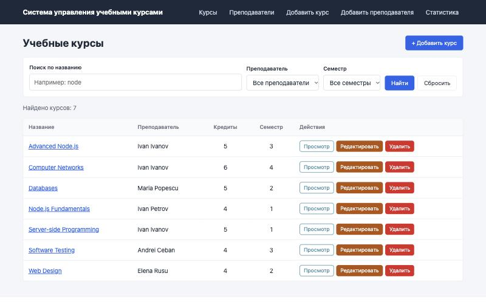

**Комбинированная фильтрация `?search=node&teacherId=2&semester=1`**

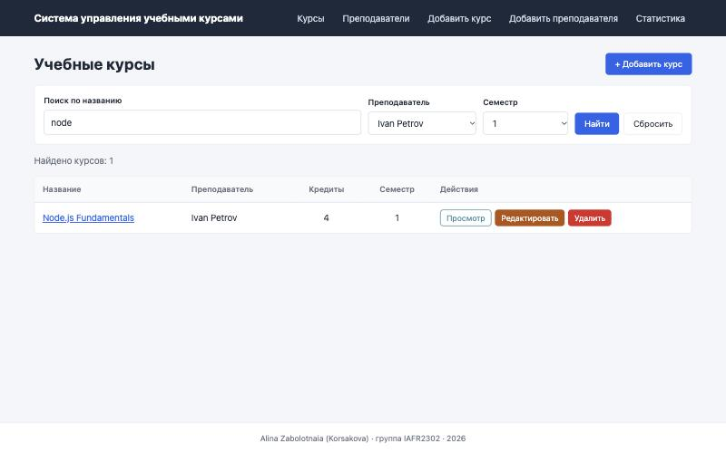

**Просмотр курса с данными преподавателя**

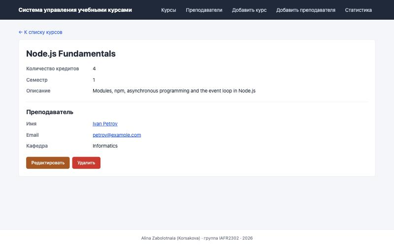

### Преподаватели и статистика

**Список преподавателей с количеством курсов**

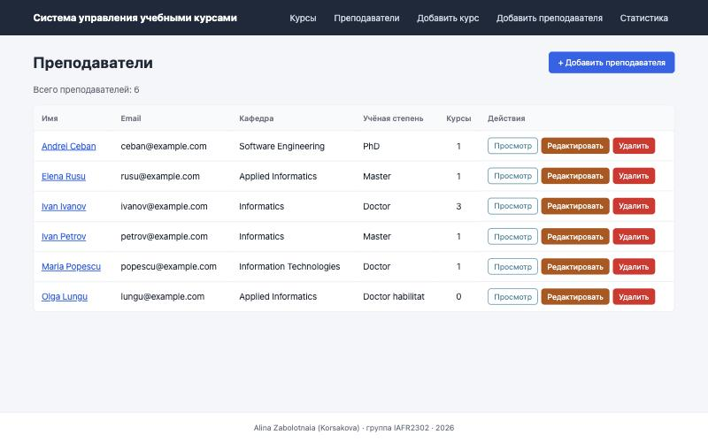

**Преподаватель и его курсы**

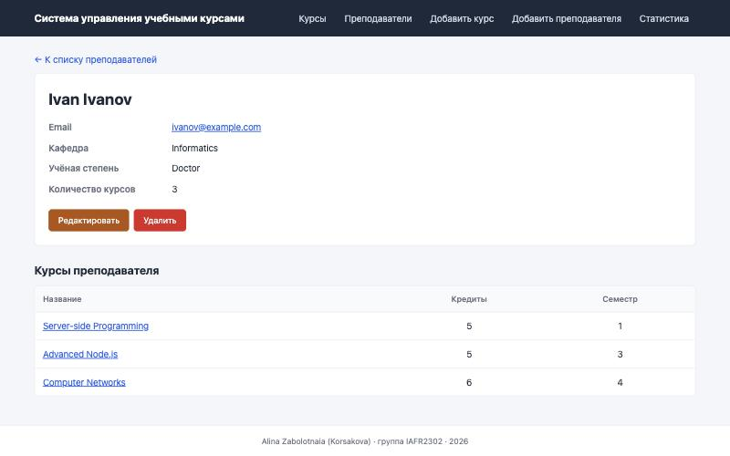

**Статистика**

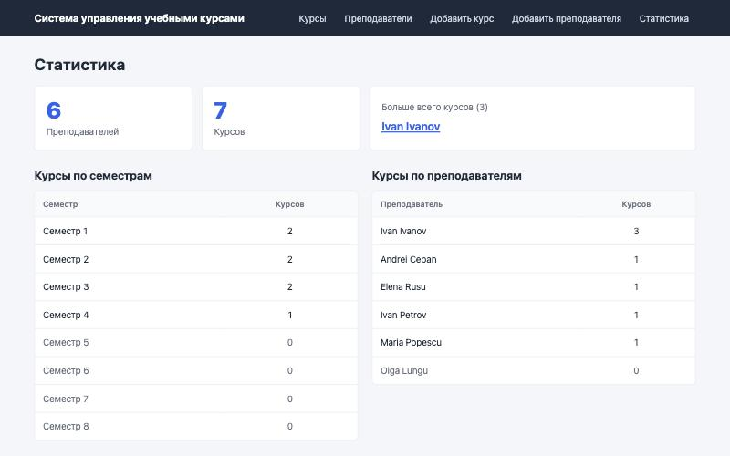

### Регистрация и вход

**Валидация регистрации** (поля паролей пустые)

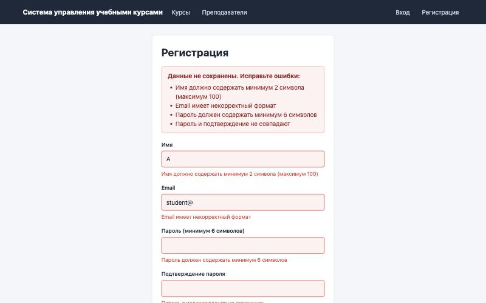

**Email уже зарегистрирован, 409**

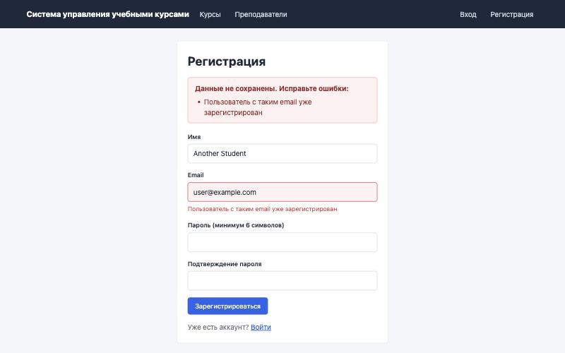

**Неверный пароль, 401**

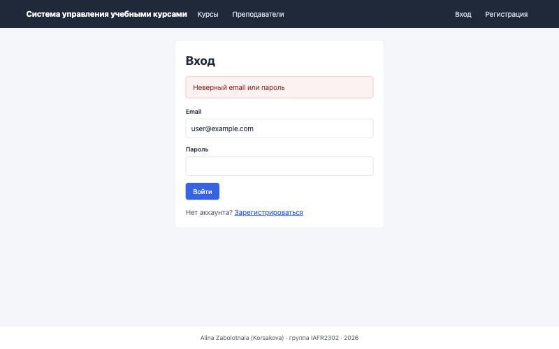

**Профиль и данные сессии**

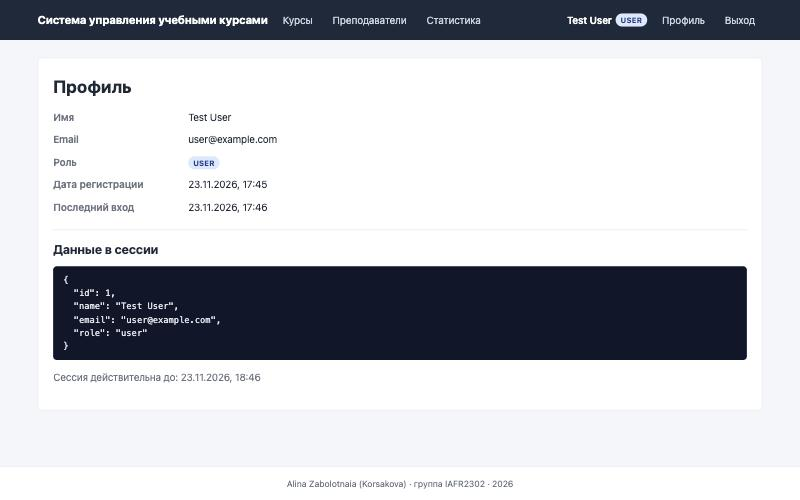

### Роли

**Гость**: только просмотр, «Вход» и «Регистрация»

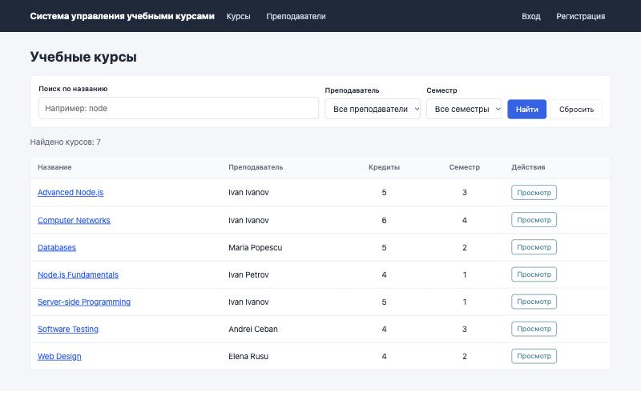

**User**: «Статистика», без кнопок изменения

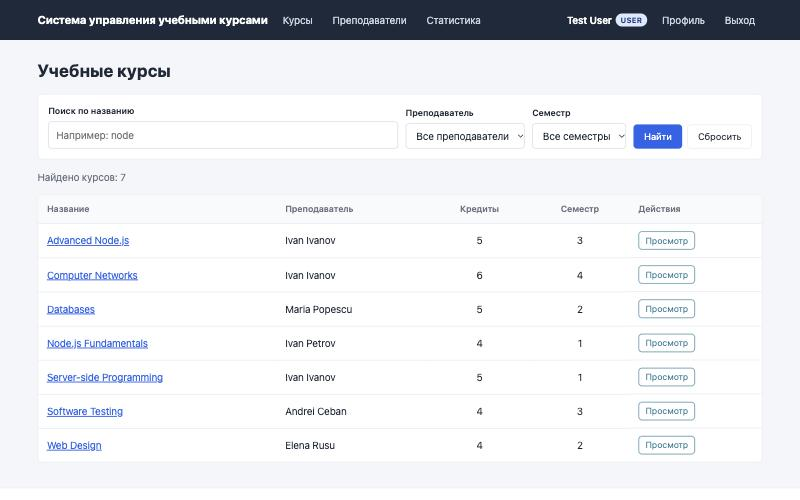

**User открывает `/courses/new`, 403**

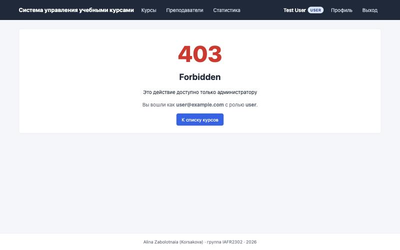

**Admin**: кнопки и пункты меню администратора

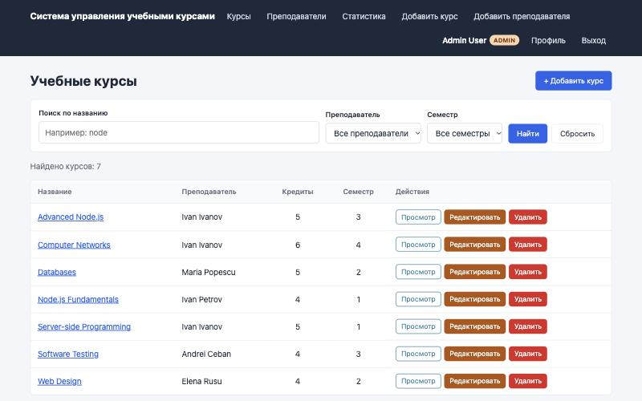

### Валидация и ошибки

**Курс с несуществующим преподавателем и некорректными данными, 400**

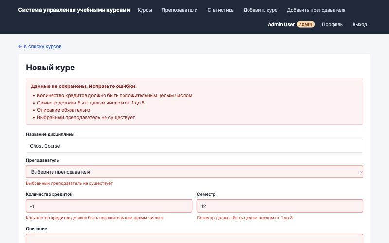

**Удаление преподавателя с курсами, 409**

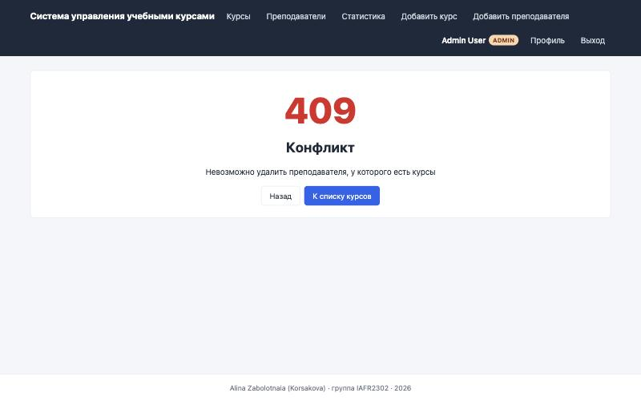

**Курс не найден, 404**

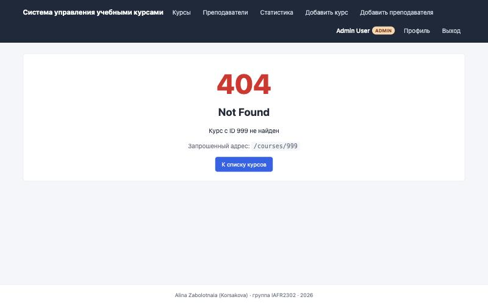

**База данных недоступна, 503**

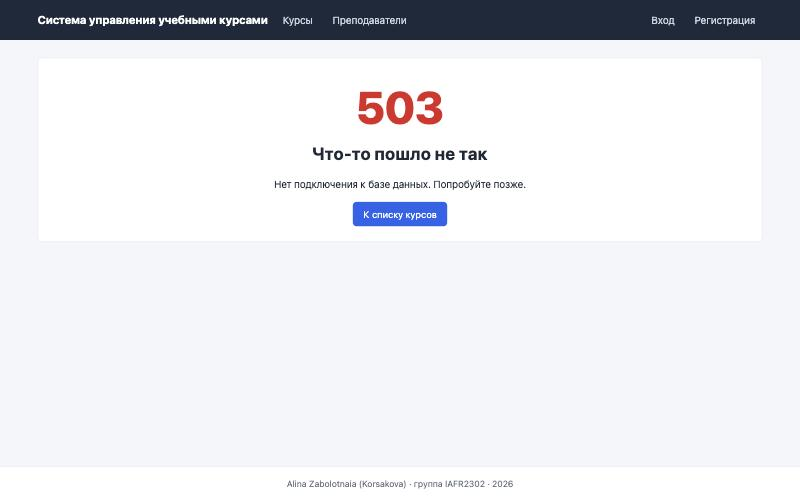

### WebSocket

**Уведомление во второй вкладке после добавления курса** (таблица не перезагружалась: в ней 8 курсов, а уведомление уже о девятом)

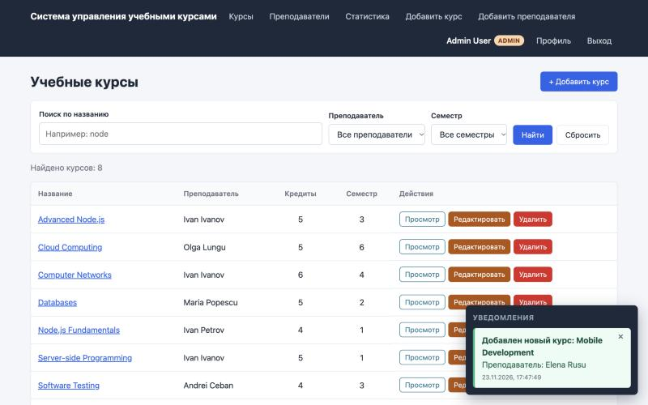

Полные наборы скриншотов: [26 для работы №4](../lab4_alina_zabolotnaia/README.md#результаты-работы) и [15 для работы №5](../lab5_alina_zabolotnaia/README.md#результаты-работы).

## 11. Запуск проекта

```bash
cd lab5_alina_zabolotnaia
npm install
cp .env.example .env          # указать DB_PASSWORD и SESSION_SECRET
createdb -h localhost -U postgres node_courses
npm run seed                  # 6 преподавателей и 7 курсов
npm start                     # http://localhost:3000
```

Назначить администратора после регистрации:

```bash
psql -h localhost -U postgres -d node_courses -c "UPDATE \"Users\" SET role = 'admin' WHERE email = 'admin@example.com'"
```

## 12. Выводы

В ходе индивидуальной работы я разработала полноценное серверное веб-приложение для управления учебными курсами.

В части работы №4 данные перенесены из массивов в PostgreSQL. С помощью Sequelize описаны модели с валидацией и связь «один ко многим» между преподавателями и курсами; связанные данные загружаются через `include` и методы связи, а поиск, фильтрация и статистика выполняются SQL-запросами в самой базе. Целостность данных обеспечивается на нескольких уровнях, вплоть до ограничений `UNIQUE` и `FOREIGN KEY ... ON DELETE RESTRICT`.

В части работы №5 добавлены пользователи и разграничение доступа. Пароли хранятся только в виде bcrypt-hash, сессии express-session содержат минимум данных и защищены настройками cookie, а права ролей проверяются middleware на сервере до обращения к данным, поэтому скрытие кнопок в интерфейсе не является единственной защитой. Все формы проверяются express-validator, ошибки обрабатываются в одном месте и не раскрывают технических деталей, запросы и действия администратора логируются, а Socket.IO мгновенно сообщает всем открытым клиентам о новых курсах.

Архитектура MVC позволила развивать проект поэтапно: при переходе от массива к базе данных менялись в основном модели, а при добавлении аутентификации поверх существующих маршрутов добавились middleware, при этом весь CRUD, поиск, фильтры и статистика продолжили работать без изменений в логике.
