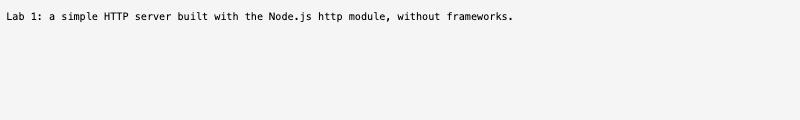
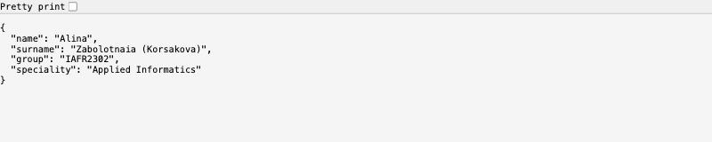
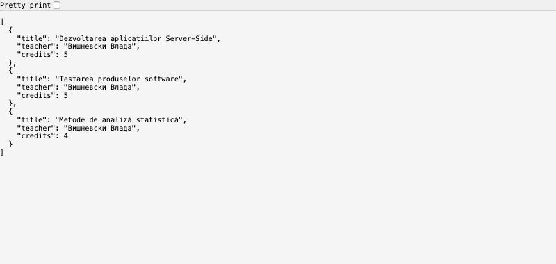

# Отчёт по лабораторной работе №1

**Дисциплина:** Dezvoltarea aplicațiilor Server-Side
**Тема:** Создание простого HTTP-сервера на Node.js
**Студент:** Alina Zabolotnaia (Korsakova)
**Группа:** IAFR2302
**Преподаватель:** Вишневски Влада

## Цель работы

Познакомиться со средой выполнения Node.js и менеджером пакетов npm, создать и запустить первый Node.js-проект, создать простой HTTP-сервер и реализовать обработку HTTP-запросов.

## Структура проекта

```
lab1_alina_zabolotnaia/
├── app.js          # HTTP-сервер
├── package.json    # описание проекта (npm init -y)
├── README.md       # отчёт
└── screenshots/    # скриншоты работы маршрутов
```

## Ход работы

### 1. Установка Node.js и npm

Установлена LTS-версия Node.js. Проверка в терминале:

```bash
$ node -v
v22.23.2
$ npm -v
10.9.8
```

**Node.js**: среда выполнения JavaScript вне браузера. **npm**: менеджер пакетов Node.js.

### 2. Создание Node.js-проекта

Создана папка `lab1_alina_zabolotnaia`, в ней выполнена команда:

```bash
npm init -y
```

Команда создала файл `package.json` с информацией о проекте. В нём указана точка входа `app.js` и добавлен скрипт запуска:

```json
{
  "name": "lab1_alina_zabolotnaia",
  "version": "1.0.0",
  "description": "Lab 1: simple HTTP server on Node.js",
  "main": "app.js",
  "scripts": {
    "start": "node app.js"
  },
  "author": "Alina Zabolotnaia",
  "license": "ISC"
}
```

Проверка работы Node.js: в `app.js` добавлена строка `console.log('Node.js is working!');` и выполнена команда `node app.js`.

```bash
$ node app.js
Node.js is working!
```

### 3. Создание HTTP-сервера

Сервер создан с помощью встроенного модуля `http`:

- `require('http')` подключает модуль;
- `http.createServer((req, res) => { ... })` создаёт сервер, функция вызывается на каждый запрос;
- `req`: объект запроса клиента, `res`: объект ответа;
- `res.end()` отправляет ответ клиенту и завершает его;
- `server.listen(3000, ...)` запускает сервер на порту 3000.

### 4. Получение информации о запросе

Метод запроса берётся из `req.method`, путь из `req.url`. Например, при открытии `http://localhost:3000/about` получаем `req.method = 'GET'`, `req.url = '/about'`.

### 5-6. Маршруты и отправка JSON

Маршрут выбирается условием `if (req.method === 'GET' && req.url === '...')`. Для JSON-ответов устанавливается заголовок `Content-Type: application/json`, а объект переводится в строку через `JSON.stringify()`.

### 7-8. Итоговые маршруты

| Метод | URL | Результат | Статус |
|---|---|---|---|
| GET | `/` | Приветствие | 200 |
| GET | `/about` | Информация о приложении | 200 |
| GET | `/student` | Имя, фамилия и группа | 200 |
| GET | `/api/student` | Данные студента в JSON | 200 |
| GET | `/time` | Текущие дата и время | 200 |
| GET | `/api/courses` | Массив из трёх дисциплин в JSON | 200 |
| GET | `/quote` | Собственный маршрут: случайная цитата о программировании | 200 |
| любой | неизвестный URL | `404 - Page not found` | 404 |

## Самостоятельная часть

1. **`GET /time`.** Текущая дата получается через `new Date()`. Функция `formatDateTime()` формирует строку вида `DD.MM.YYYY HH:MM`. Месяцы в `getMonth()` считаются с нуля, поэтому прибавляется 1; `padStart(2, '0')` добавляет ведущий ноль.
2. **`GET /api/courses`.** Возвращает JSON-массив объектов `{ title, teacher, credits }`.
3. **Собственный маршрут `GET /quote`.** Возвращает случайную цитату из массива. Индекс выбирается как `Math.floor(Math.random() * quotes.length)`.
4. **Ошибка 404.** Для неизвестного URL перед отправкой ответа устанавливается `res.statusCode = 404`. Без этого Node.js по умолчанию отправил бы статус 200, и ошибка была бы только текстом на странице. Проверка заголовков ответа:

   ```bash
   $ curl -i http://localhost:3000/test
   HTTP/1.1 404 Not Found
   Content-Type: text/plain; charset=utf-8
   ```

5. **Логирование.** Первой строкой внутри `createServer` в консоль выводится `метод URL | дата и время`, поэтому логируется каждый запрос, включая неизвестные URL.

Для устранения повторов написаны вспомогательные функции `sendText()` и `sendJson()`: они ставят статус, заголовок `Content-Type` (с `charset=utf-8` для корректного отображения символов ț, ș, ă и кириллицы) и вызывают `res.end()`.

## Код программы (`app.js`)

```javascript
// Лабораторная работа №1: простой HTTP-сервер на Node.js
// Студент: Alina Zabolotnaia (Korsakova), группа IAFR2302

const http = require('http');

const PORT = 3000;

const student = {
    name: 'Alina',
    surname: 'Zabolotnaia (Korsakova)',
    group: 'IAFR2302',
    speciality: 'Applied Informatics'
};

const courses = [
    { title: 'Dezvoltarea aplicațiilor Server-Side', teacher: 'Вишневски Влада', credits: 5 },
    { title: 'Testarea produselor software', teacher: 'Вишневски Влада', credits: 5 },
    { title: 'Metode de analiză statistică', teacher: 'Вишневски Влада', credits: 4 }
];

const quotes = [
    'First, solve the problem. Then, write the code.',
    'Simplicity is the soul of efficiency.',
    'Make it work, make it right, make it fast.'
];

// Дата и время в формате DD.MM.YYYY HH:MM
function formatDateTime(date) {
    const pad = (n) => String(n).padStart(2, '0');
    return `${pad(date.getDate())}.${pad(date.getMonth() + 1)}.${date.getFullYear()} `
         + `${pad(date.getHours())}:${pad(date.getMinutes())}`;
}

// Отправка обычного текста
function sendText(res, statusCode, text) {
    res.statusCode = statusCode;
    res.setHeader('Content-Type', 'text/plain; charset=utf-8');
    res.end(text);
}

// Отправка JSON
function sendJson(res, statusCode, data) {
    res.statusCode = statusCode;
    res.setHeader('Content-Type', 'application/json; charset=utf-8');
    res.end(JSON.stringify(data, null, 2));
}

const server = http.createServer((req, res) => {
    // Логирование каждого запроса: HTTP Method | URL | Date and Time
    console.log(`${req.method} ${req.url} | ${formatDateTime(new Date())}`);

    if (req.method === 'GET' && req.url === '/') {
        sendText(res, 200, 'Welcome! This is my first Node.js server.');
    }
    else if (req.method === 'GET' && req.url === '/about') {
        sendText(res, 200, 'Lab 1: a simple HTTP server built with the Node.js http module, without frameworks.');
    }
    else if (req.method === 'GET' && req.url === '/student') {
        sendText(res, 200, `Student: ${student.name} ${student.surname}, group ${student.group}`);
    }
    else if (req.method === 'GET' && req.url === '/api/student') {
        sendJson(res, 200, student);
    }
    else if (req.method === 'GET' && req.url === '/time') {
        sendText(res, 200, `Current date and time: ${formatDateTime(new Date())}`);
    }
    else if (req.method === 'GET' && req.url === '/api/courses') {
        sendJson(res, 200, courses);
    }
    // Собственный маршрут: случайная цитата о программировании
    else if (req.method === 'GET' && req.url === '/quote') {
        const quote = quotes[Math.floor(Math.random() * quotes.length)];
        sendText(res, 200, quote);
    }
    else {
        // Настоящий HTTP status code 404, а не только текст на странице
        sendText(res, 404, '404 - Page not found');
    }
});

server.listen(PORT, () => {
    console.log(`Server is running at http://localhost:${PORT}`);
});
```

## Результаты работы

Запуск сервера:

```bash
$ node app.js
Server is running at http://localhost:3000
```

**`GET /`**


**`GET /about`**



**`GET /student`**


**`GET /api/student`** (JSON)



**`GET /time`**


**`GET /api/courses`** (JSON)



**`GET /quote`** (собственный маршрут)


**`GET /test`** (неизвестный URL, статус 404)


### Лог запросов в терминале

```
Server is running at http://localhost:3000
GET / | 23.11.2026 16:21
GET /favicon.ico | 23.11.2026 16:21
GET /about | 23.11.2026 16:21
GET /student | 23.11.2026 16:21
GET /api/student | 23.11.2026 16:21
GET /time | 23.11.2026 16:21
GET /api/courses | 23.11.2026 16:21
GET /quote | 23.11.2026 16:21
GET /test | 23.11.2026 16:21
```

Запросы `GET /favicon.ico` браузер отправляет автоматически, чтобы получить иконку сайта. Сервер отвечает на них статусом 404, так как такого маршрута нет.

## Выводы

В ходе работы я установила Node.js и npm, создала проект командой `npm init -y` и написала HTTP-сервер на встроенном модуле `http` без сторонних библиотек. Сервер различает запросы по `req.method` и `req.url`, возвращает текст и JSON с правильным заголовком `Content-Type`, отвечает настоящим статусом 404 на неизвестные адреса и логирует каждый запрос с датой и временем. Работа показала, как устроен обмен запрос/ответ на самом низком уровне, что пригодится при переходе к фреймворкам вроде Express.
