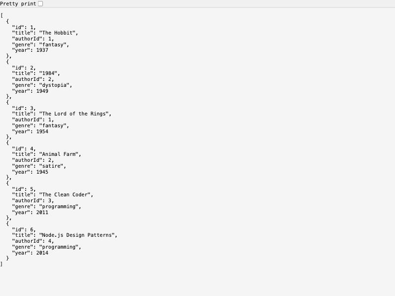
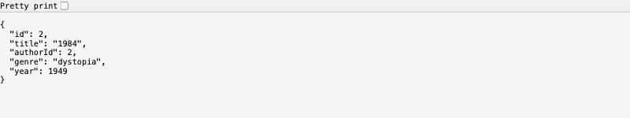
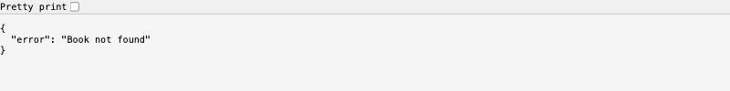
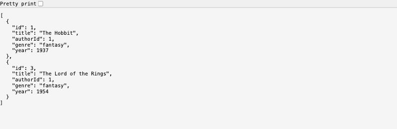
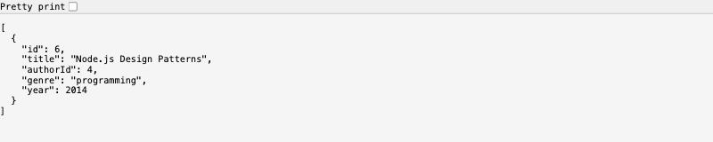
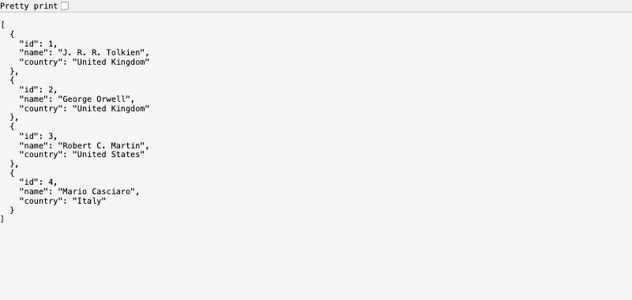
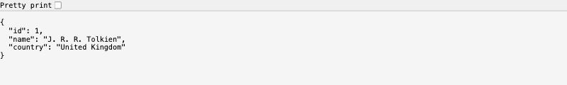
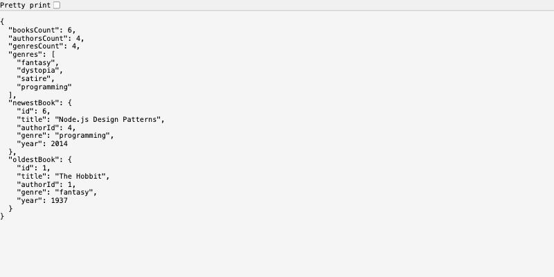

# Отчёт по лабораторной работе №2

**Дисциплина:** Dezvoltarea aplicațiilor Server-Side
**Тема:** Создание REST API на Express.js
**Студент:** Alina Zabolotnaia (Korsakova)
**Группа:** IAFR2302
**Преподаватель:** Вишневски Влада

## Цель работы

Познакомиться с framework Express.js, научиться создавать маршруты, работать с параметрами URL и query parameters, возвращать данные в формате JSON и организовывать проект в соответствии с архитектурой MVC.

## Структура проекта

```
lab2_alina_zabolotnaia/
├── app.js                          # точка входа: middleware, подключение маршрутов, 404
├── package.json
├── package-lock.json
├── routes/
│   ├── bookRoutes.js               # /api/books
│   ├── authorRoutes.js             # /api/authors
│   └── statisticsRoutes.js         # /api/statistics (задание 8.2)
├── controllers/
│   ├── bookController.js
│   ├── authorController.js
│   └── statisticsController.js     # задание 8.2
├── models/
│   ├── bookModel.js
│   └── authorModel.js
├── middleware/
│   └── logger.js
├── screenshots/                    # скриншоты работы маршрутов
└── README.md                       # отчёт
```

Структура из задания сохранена полностью. Для маршрута `/api/statistics` добавлены отдельные файлы `statisticsRoutes.js` и `statisticsController.js`, потому что статистика относится сразу и к книгам, и к авторам и не принадлежит ни одному из существующих роутеров.

## Ход работы

### 1. Создание проекта

```bash
npm init -y
npm install express
```

Установлен Express 5.3.0. В `package.json` указана точка входа `app.js` и скрипт `npm start`.

### 2. Архитектура MVC

Приложение разделено на слои, каждый отвечает за своё:

| Слой | Папка | Что делает |
|---|---|---|
| Model | `models/` | Хранит данные (массивы книг и авторов) и функции работы с ними: поиск, добавление, изменение, удаление |
| Controller | `controllers/` | Получает `req`, проверяет входные данные, вызывает модель и формирует ответ `res` с нужным статусом |
| Router | `routes/` | Связывает HTTP-метод и URL с функцией контроллера |
| Middleware | `middleware/` | Код, который выполняется для каждого запроса до маршрутов (логирование) |

View в REST API отсутствует: вместо HTML-страниц клиент получает JSON.

Путь запроса: `app.js` → `logger` → `express.json()` → нужный `Router` → функция `Controller` → `Model` → JSON-ответ.

### 3. Исходные данные

В `models/bookModel.js` хранятся 6 книг, в `models/authorModel.js` хранятся 4 автора. Автор с `id: 3` (Robert C. Martin) нужен для примера из задания, где добавляется книга «Clean Code» с `authorId: 3`. Книга «Node.js Design Patterns» добавлена, чтобы проверить поиск `?title=node`.

Данные хранятся в памяти, поэтому после перезапуска сервера добавленные, изменённые и удалённые книги возвращаются к исходному состоянию.

### 4. Маршруты

| Метод | URL | Назначение | Коды ответа |
|---|---|---|---|
| GET | `/api/books` | Все книги, фильтры `?genre=` и `?year=` | 200, 400 |
| GET | `/api/books/search?title=` | Поиск по части названия (8.1) | 200, 400 |
| GET | `/api/books/:id` | Книга по ID | 200, 404 |
| POST | `/api/books` | Добавление книги | 201, 400 |
| PATCH | `/api/books/:id` | Изменение книги | 200, 400, 404 |
| DELETE | `/api/books/:id` | Удаление книги | 200, 404 |
| GET | `/api/authors` | Все авторы | 200 |
| GET | `/api/authors/:id` | Автор по ID | 200, 404 |
| GET | `/api/authors/:id/books` | Книги автора | 200, 404 |
| GET | `/api/statistics` | Статистика (8.2) | 200 |
| любой | неизвестный URL | `{ "error": "Route not found" }` | 404 |

### 5. Параметры запроса

- **`req.params`**: параметры из пути. Для маршрута `/api/books/:id` и запроса `/api/books/2` получаем `req.params.id === '2'`. Значение всегда строка, поэтому переводится в число через `Number()`.
- **`req.query`**: параметры после `?`. Для `/api/books?genre=fantasy&year=1937` получаем `{ genre: 'fantasy', year: '1937' }`.
- **`req.body`**: тело запроса POST и PATCH. Заполняется только после подключения `app.use(express.json())`, которое разбирает JSON.

### 6. Добавление и изменение книги

`POST /api/books` проверяет, что переданы все обязательные поля (`title`, `authorId`, `genre`, `year`), что у них правильные типы, и что автор существует. При успехе возвращается созданная книга со статусом `201 Created`, при ошибке статус `400 Bad Request` и текст ошибки.

`PATCH /api/books/:id` меняет только переданные поля и проходит те же проверки типов и автора. Если книги нет, возвращается 404.

### 7. Фильтрация

Модель отбирает книги через `filter()`: условие по жанру проверяется, только если передан `genre`, условие по году, только если передан `year`. Без параметров возвращаются все книги. Жанр сравнивается без учёта регистра. Если `year` не число, возвращается 400.

### 8. Middleware логирования

`middleware/logger.js` подключён через `app.use(logger)` первым, поэтому срабатывает для всех запросов, включая неизвестные URL. После вывода строки вызывается `next()`, чтобы запрос пошёл дальше.

### 9. Неизвестные маршруты и ошибки

Последним подключён `app.use((req, res) => ...)`, который срабатывает, если ни один роутер не подошёл, и возвращает 404 `Route not found`. Дополнительно добавлен обработчик ошибок с четырьмя аргументами: если в теле запроса передан некорректный JSON, клиент получает `400 { "error": "Invalid JSON in request body" }` вместо HTML-страницы с ошибкой.

## Задания 8.1-8.3

**8.1. Поиск по части названия.** `GET /api/books/search?title=node`. Название книги и строка поиска приводятся к нижнему регистру через `toLowerCase()`, затем проверяется `includes()`. Маршрут `/search` объявлен в роутере раньше `/:id`, иначе Express принял бы слово `search` за `id`.

**8.2. Статистика.** `GET /api/statistics` возвращает количество книг, авторов и жанров (уникальные жанры собираются через `new Set()`), а также самую новую и самую старую книгу (поиск через `reduce()` по полю `year`).

**8.3. Проверка автора.** При `POST` и `PATCH` с полем `authorId` контроллер вызывает `authorModel.findById()`. Если автор не найден, книга не добавляется и не изменяется, возвращается `400 { "error": "Author not found" }`.

## Результаты работы

Запуск сервера:

```bash
$ npm start
Server is running at http://localhost:3000
```

### GET-запросы (браузер)

**`GET /api/books`**: все книги, 200



**`GET /api/books/2`**: книга по ID, 200



**`GET /api/books/99`**: книга не найдена, 404



**`GET /api/books?genre=fantasy`**: фильтр по жанру



**`GET /api/books?year=2014`**: фильтр по году


**`GET /api/books?genre=fantasy&year=1937`**: оба фильтра


**`GET /api/books/search?title=NODE`**: поиск без учёта регистра (8.1)



**`GET /api/authors`**



**`GET /api/authors/1`**



**`GET /api/authors/1/books`**: книги автора


**`GET /api/statistics`**: статистика (8.2)



**`GET /api/unknown`**: неизвестный маршрут, 404


### POST, PATCH, DELETE (curl)

Запросы отправлялись из терминала командой `curl -i`, которая показывает статус и заголовки ответа.

**Добавление книги, 201 Created**

```bash
curl -i -X POST http://localhost:3000/api/books \
  -H "Content-Type: application/json" \
  -d '{"title":"Clean Code","authorId":3,"genre":"programming","year":2008}'
```

```
HTTP/1.1 201 Created
Content-Type: application/json; charset=utf-8

{
  "id": 7,
  "title": "Clean Code",
  "authorId": 3,
  "genre": "programming",
  "year": 2008
}
```

**Нет обязательного поля, 400 Bad Request**

```bash
curl -i -X POST http://localhost:3000/api/books \
  -H "Content-Type: application/json" \
  -d '{"title":"Refactoring","authorId":3,"genre":"programming"}'
```

```
HTTP/1.1 400 Bad Request
Content-Type: application/json; charset=utf-8

{
  "error": "Missing required fields: year"
}
```

**Несуществующий автор, 400 Bad Request (8.3)**

```bash
curl -i -X POST http://localhost:3000/api/books \
  -H "Content-Type: application/json" \
  -d '{"title":"Unknown Book","authorId":42,"genre":"horror","year":2020}'
```

```
HTTP/1.1 400 Bad Request
Content-Type: application/json; charset=utf-8

{
  "error": "Author not found"
}
```

**Изменение книги, 200 OK**

```bash
curl -i -X PATCH http://localhost:3000/api/books/7 \
  -H "Content-Type: application/json" \
  -d '{"year":2009}'
```

```
HTTP/1.1 200 OK
Content-Type: application/json; charset=utf-8

{
  "id": 7,
  "title": "Clean Code",
  "authorId": 3,
  "genre": "programming",
  "year": 2009
}
```

**Изменение несуществующей книги, 404 Not Found**

```bash
curl -i -X PATCH http://localhost:3000/api/books/99 \
  -H "Content-Type: application/json" \
  -d '{"year":2009}'
```

```
HTTP/1.1 404 Not Found
Content-Type: application/json; charset=utf-8

{
  "error": "Book not found"
}
```

**Удаление книги, 200 OK**

```bash
curl -i -X DELETE http://localhost:3000/api/books/7
```

```
HTTP/1.1 200 OK
Content-Type: application/json; charset=utf-8

{
  "message": "Book deleted",
  "book": {
    "id": 7,
    "title": "Clean Code",
    "authorId": 3,
    "genre": "programming",
    "year": 2009
  }
}
```

**Повторное удаление, 404 Not Found**

```bash
curl -i -X DELETE http://localhost:3000/api/books/7
```

```
HTTP/1.1 404 Not Found
Content-Type: application/json; charset=utf-8

{
  "error": "Book not found"
}
```

### Лог запросов в терминале

```
Server is running at http://localhost:3000
GET | /api/books | 23.11.2026 16:30
GET | /api/books/2 | 23.11.2026 16:30
GET | /api/books/99 | 23.11.2026 16:30
GET | /api/books?genre=fantasy | 23.11.2026 16:30
GET | /api/books?genre=fantasy&year=1937 | 23.11.2026 16:30
GET | /api/books/search?title=NODE | 23.11.2026 16:30
POST | /api/books | 23.11.2026 16:30
PATCH | /api/books/7 | 23.11.2026 16:30
DELETE | /api/books/7 | 23.11.2026 16:30
GET | /api/authors | 23.11.2026 16:30
GET | /api/authors/1/books | 23.11.2026 16:30
GET | /api/statistics | 23.11.2026 16:30
GET | /api/unknown | 23.11.2026 16:30
```

## Код программы

### `app.js`

```javascript
// Лабораторная работа №2: REST API на Express.js (MVC)
// Студент: Alina Zabolotnaia (Korsakova), группа IAFR2302

const express = require('express');

const logger = require('./middleware/logger');
const bookRoutes = require('./routes/bookRoutes');
const authorRoutes = require('./routes/authorRoutes');
const statisticsRoutes = require('./routes/statisticsRoutes');

const app = express();
const PORT = 3000;

app.set('json spaces', 2);  // JSON-ответы с отступами, удобнее читать в браузере

// Middleware, общие для всех маршрутов
app.use(logger);            // логирование каждого запроса
app.use(express.json());    // разбор JSON из тела запроса в req.body

// Подключение маршрутов
app.use('/api/books', bookRoutes);
app.use('/api/authors', authorRoutes);
app.use('/api/statistics', statisticsRoutes);

// Неизвестный маршрут: срабатывает, если ни один маршрут выше не подошёл
app.use((req, res) => {
    res.status(404).json({ error: 'Route not found' });
});

// Обработчик ошибок (4 аргумента): например, некорректный JSON в теле запроса
app.use((err, req, res, next) => {
    if (err.type === 'entity.parse.failed') {
        return res.status(400).json({ error: 'Invalid JSON in request body' });
    }
    console.error(err);
    res.status(500).json({ error: 'Internal server error' });
});

app.listen(PORT, () => {
    console.log(`Server is running at http://localhost:${PORT}`);
});
```

### `middleware/logger.js`

```javascript
// Middleware логирования: HTTP Method | URL | Date and Time

function formatDateTime(date) {
    const pad = (n) => String(n).padStart(2, '0');
    return `${pad(date.getDate())}.${pad(date.getMonth() + 1)}.${date.getFullYear()} `
         + `${pad(date.getHours())}:${pad(date.getMinutes())}`;
}

function logger(req, res, next) {
    console.log(`${req.method} | ${req.originalUrl} | ${formatDateTime(new Date())}`);
    next(); // передаём запрос дальше, к следующему middleware или маршруту
}

module.exports = logger;
```

### `models/bookModel.js`

```javascript
// Модель книг: хранит данные и функции доступа к ним

const books = [
    { id: 1, title: 'The Hobbit', authorId: 1, genre: 'fantasy', year: 1937 },
    { id: 2, title: '1984', authorId: 2, genre: 'dystopia', year: 1949 },
    { id: 3, title: 'The Lord of the Rings', authorId: 1, genre: 'fantasy', year: 1954 },
    { id: 4, title: 'Animal Farm', authorId: 2, genre: 'satire', year: 1945 },
    { id: 5, title: 'The Clean Coder', authorId: 3, genre: 'programming', year: 2011 },
    { id: 6, title: 'Node.js Design Patterns', authorId: 4, genre: 'programming', year: 2014 }
];

// Следующий свободный id: максимальный существующий + 1
function nextId() {
    return books.length === 0 ? 1 : Math.max(...books.map((book) => book.id)) + 1;
}

// Все книги; если переданы genre и/или year, применяется фильтрация
function getAll({ genre, year } = {}) {
    return books.filter((book) =>
        (genre === undefined || book.genre.toLowerCase() === genre.toLowerCase()) &&
        (year === undefined || book.year === year)
    );
}

function findById(id) {
    return books.find((book) => book.id === id);
}

function findByAuthorId(authorId) {
    return books.filter((book) => book.authorId === authorId);
}

// Поиск по части названия без учёта регистра
function searchByTitle(text) {
    const query = text.toLowerCase();
    return books.filter((book) => book.title.toLowerCase().includes(query));
}

function create({ title, authorId, genre, year }) {
    const book = { id: nextId(), title, authorId, genre, year };
    books.push(book);
    return book;
}

function update(id, changes) {
    const book = findById(id);
    if (!book) {
        return null;
    }
    Object.assign(book, changes);
    return book;
}

function remove(id) {
    const index = books.findIndex((book) => book.id === id);
    if (index === -1) {
        return null;
    }
    return books.splice(index, 1)[0];
}

module.exports = { getAll, findById, findByAuthorId, searchByTitle, create, update, remove };
```

### `models/authorModel.js`

```javascript
// Модель авторов: хранит данные и функции доступа к ним

const authors = [
    { id: 1, name: 'J. R. R. Tolkien', country: 'United Kingdom' },
    { id: 2, name: 'George Orwell', country: 'United Kingdom' },
    { id: 3, name: 'Robert C. Martin', country: 'United States' },
    { id: 4, name: 'Mario Casciaro', country: 'Italy' }
];

function getAll() {
    return authors;
}

function findById(id) {
    return authors.find((author) => author.id === id);
}

function count() {
    return authors.length;
}

module.exports = { getAll, findById, count };
```

### `controllers/bookController.js`

```javascript
// Контроллер книг: принимает запрос, обращается к модели и формирует ответ

const bookModel = require('../models/bookModel');
const authorModel = require('../models/authorModel');

const REQUIRED_FIELDS = ['title', 'authorId', 'genre', 'year'];

// Проверка типов переданных полей; возвращает текст ошибки или null
function validateFields(data) {
    if ('title' in data && (typeof data.title !== 'string' || data.title.trim() === '')) {
        return 'title must be a non-empty string';
    }
    if ('genre' in data && (typeof data.genre !== 'string' || data.genre.trim() === '')) {
        return 'genre must be a non-empty string';
    }
    if ('authorId' in data && !Number.isInteger(data.authorId)) {
        return 'authorId must be an integer';
    }
    if ('year' in data && !Number.isInteger(data.year)) {
        return 'year must be an integer';
    }
    // Задание 8.3: нельзя ссылаться на несуществующего автора
    if ('authorId' in data && !authorModel.findById(data.authorId)) {
        return 'Author not found';
    }
    return null;
}

// GET /api/books, GET /api/books?genre=fantasy&year=1937
function getBooks(req, res) {
    const { genre, year } = req.query;
    const filters = {};

    if (genre !== undefined) {
        filters.genre = genre;
    }
    if (year !== undefined) {
        filters.year = Number(year);
        if (!Number.isInteger(filters.year)) {
            return res.status(400).json({ error: 'year must be an integer' });
        }
    }

    res.status(200).json(bookModel.getAll(filters));
}

// GET /api/books/search?title=node
function searchBooks(req, res) {
    const { title } = req.query;
    if (!title || title.trim() === '') {
        return res.status(400).json({ error: 'Query parameter title is required' });
    }
    res.status(200).json(bookModel.searchByTitle(title.trim()));
}

// GET /api/books/:id
function getBookById(req, res) {
    const book = bookModel.findById(Number(req.params.id));
    if (!book) {
        return res.status(404).json({ error: 'Book not found' });
    }
    res.status(200).json(book);
}

// POST /api/books
function createBook(req, res) {
    const data = req.body || {};

    const missing = REQUIRED_FIELDS.filter((field) => data[field] === undefined || data[field] === null);
    if (missing.length > 0) {
        return res.status(400).json({ error: `Missing required fields: ${missing.join(', ')}` });
    }

    const error = validateFields(data);
    if (error) {
        return res.status(400).json({ error });
    }

    const book = bookModel.create({
        title: data.title.trim(),
        authorId: data.authorId,
        genre: data.genre.trim(),
        year: data.year
    });
    res.status(201).json(book);
}

// PATCH /api/books/:id: меняются только переданные поля
function updateBook(req, res) {
    const id = Number(req.params.id);
    if (!bookModel.findById(id)) {
        return res.status(404).json({ error: 'Book not found' });
    }

    const data = req.body || {};
    const changes = {};
    for (const field of REQUIRED_FIELDS) {
        if (data[field] !== undefined) {
            changes[field] = data[field];
        }
    }

    if (Object.keys(changes).length === 0) {
        return res.status(400).json({ error: `Provide at least one field to update: ${REQUIRED_FIELDS.join(', ')}` });
    }

    const error = validateFields(changes);
    if (error) {
        return res.status(400).json({ error });
    }

    res.status(200).json(bookModel.update(id, changes));
}

// DELETE /api/books/:id
function deleteBook(req, res) {
    const book = bookModel.remove(Number(req.params.id));
    if (!book) {
        return res.status(404).json({ error: 'Book not found' });
    }
    res.status(200).json({ message: 'Book deleted', book });
}

module.exports = { getBooks, searchBooks, getBookById, createBook, updateBook, deleteBook };
```

### `controllers/authorController.js`

```javascript
// Контроллер авторов

const authorModel = require('../models/authorModel');
const bookModel = require('../models/bookModel');

// GET /api/authors
function getAuthors(req, res) {
    res.status(200).json(authorModel.getAll());
}

// GET /api/authors/:id
function getAuthorById(req, res) {
    const author = authorModel.findById(Number(req.params.id));
    if (!author) {
        return res.status(404).json({ error: 'Author not found' });
    }
    res.status(200).json(author);
}

// GET /api/authors/:id/books
function getAuthorBooks(req, res) {
    const author = authorModel.findById(Number(req.params.id));
    if (!author) {
        return res.status(404).json({ error: 'Author not found' });
    }
    res.status(200).json(bookModel.findByAuthorId(author.id));
}

module.exports = { getAuthors, getAuthorById, getAuthorBooks };
```

### `controllers/statisticsController.js`

```javascript
// Контроллер статистики (задание 8.2)

const bookModel = require('../models/bookModel');
const authorModel = require('../models/authorModel');

// GET /api/statistics
function getStatistics(req, res) {
    const books = bookModel.getAll();
    const genres = [...new Set(books.map((book) => book.genre))];

    // reduce проходит по массиву и оставляет книгу с наибольшим / наименьшим годом
    const newestBook = books.length ? books.reduce((a, b) => (b.year > a.year ? b : a)) : null;
    const oldestBook = books.length ? books.reduce((a, b) => (b.year < a.year ? b : a)) : null;

    res.status(200).json({
        booksCount: books.length,
        authorsCount: authorModel.count(),
        genresCount: genres.length,
        genres,
        newestBook,
        oldestBook
    });
}

module.exports = { getStatistics };
```

### `routes/bookRoutes.js`

```javascript
// Маршруты книг: связывают URL и HTTP-метод с функцией контроллера

const express = require('express');
const bookController = require('../controllers/bookController');

const router = express.Router();

// /search объявлен раньше /:id, иначе слово "search" было бы принято за id
router.get('/search', bookController.searchBooks);

router.get('/', bookController.getBooks);
router.get('/:id', bookController.getBookById);
router.post('/', bookController.createBook);
router.patch('/:id', bookController.updateBook);
router.delete('/:id', bookController.deleteBook);

module.exports = router;
```

### `routes/authorRoutes.js`

```javascript
// Маршруты авторов

const express = require('express');
const authorController = require('../controllers/authorController');

const router = express.Router();

router.get('/', authorController.getAuthors);
router.get('/:id', authorController.getAuthorById);
router.get('/:id/books', authorController.getAuthorBooks);

module.exports = router;
```

### `routes/statisticsRoutes.js`

```javascript
// Маршрут статистики (задание 8.2)

const express = require('express');
const statisticsController = require('../controllers/statisticsController');

const router = express.Router();

router.get('/', statisticsController.getStatistics);

module.exports = router;
```

## Выводы

В ходе работы я создала REST API на Express.js и разделила его по архитектуре MVC: данные и работа с ними находятся в моделях, обработка запросов в контроллерах, а связь URL с контроллерами в роутерах. По сравнению с чистым модулем `http` из лабораторной №1 Express избавляет от ручного разбора URL, метода и тела запроса: маршруты с параметрами (`/:id`), query-параметры, разбор JSON (`express.json()`) и отправка ответа (`res.status().json()`) берёт на себя framework. Я реализовала полный набор CRUD-операций для книг, фильтрацию и поиск, статистику, проверку входных данных и связи книги с автором, собственный middleware логирования и единый ответ 404 для неизвестных маршрутов. API возвращает корректные HTTP-коды 200, 201, 400 и 404.
