# Отчёт по лабораторной работе №3

**Дисциплина:** Dezvoltarea aplicațiilor Server-Side
**Тема:** Разработка веб-приложения с использованием Express.js, EJS и middleware
**Студент:** Alina Zabolotnaia (Korsakova)
**Группа:** IAFR2302
**Преподаватель:** Вишневски Влада

## Цель работы

Научиться разрабатывать структурированное веб-приложение на Express.js, использовать архитектуру MVC, создавать динамические страницы с помощью EJS, обрабатывать HTML-формы, применять middleware и выполнять операции добавления, просмотра, редактирования и удаления данных.

## Тема приложения

**Система управления учебными курсами.** Приложение позволяет просматривать список курсов и отдельный курс, добавлять, редактировать и удалять курсы, искать их по названию и преподавателю и фильтровать по семестру. Данные хранятся в массиве в памяти, поэтому после перезапуска сервера изменения теряются.

## Структура проекта

```
lab3_alina_zabolotnaia/
├── app.js                      # настройка Express, middleware, 404 и обработчик ошибок
├── package.json
├── package-lock.json
├── routes/
│   └── courseRoutes.js         # маршруты
├── controllers/
│   └── courseController.js     # обработка запросов
├── models/
│   └── courseModel.js          # массив курсов и операции с ним
├── middleware/
│   ├── logger.js               # логирование запросов
│   └── validateCourse.js       # валидация формы курса
├── views/
│   ├── courses/
│   │   ├── index.ejs           # список, поиск, фильтр
│   │   ├── details.ejs         # просмотр курса
│   │   ├── create.ejs          # форма добавления
│   │   └── edit.ejs            # форма редактирования
│   ├── partials/
│   │   ├── header.ejs          # название, навигация
│   │   ├── footer.ejs          # студент, группа, год
│   │   └── courseForm.ejs      # общие поля формы для create и edit
│   ├── 404.ejs
│   └── error.ejs
├── public/
│   └── css/
│       └── style.css
├── screenshots/                # скриншоты для отчёта
└── README.md                   # отчёт
```

Структура из задания сохранена полностью. Добавлен один файл: `views/partials/courseForm.ejs`. Формы добавления и редактирования содержат одинаковые пять полей с одинаковым выводом ошибок, поэтому поля вынесены в общий partial, а `create.ejs` и `edit.ejs` отличаются только заголовком и адресом отправки формы.

## Ход работы

### 1. Создание проекта

```bash
npm init -y
npm install express ejs
```

Установлены Express 5.3.0 и EJS 7.0.2. В `package.json` указаны точка входа `app.js` и скрипт `npm start`.

### 2. Архитектура MVC

| Слой | Файл | Ответственность |
|---|---|---|
| Model | `models/courseModel.js` | Массив курсов и функции `getAll`, `findById`, `create`, `update`, `remove`. Ничего не знает о HTTP |
| View | `views/**/*.ejs` | HTML-шаблоны, в которые подставляются данные |
| Controller | `controllers/courseController.js` | Получает данные из `req`, вызывает модель, выбирает шаблон (`res.render`) или делает перенаправление (`res.redirect`) |
| Router | `routes/courseRoutes.js` | Связывает метод и URL с функцией контроллера |
| Middleware | `middleware/*.js` | Логирование и валидация, выполняются до контроллера |

В `app.js` нет ни одного маршрута курсов: только настройка приложения, подключение middleware и роутера, обработка 404 и ошибок.

### 3. Исходные данные

В `models/courseModel.js` находится массив из 6 курсов со свойствами `id`, `title`, `teacher`, `credits`, `semester`, `description`. Массив экспортируется вместе с функциями доступа: `module.exports = { courses, getAll, findById, create, update, remove }`. Два курса ведёт Ivan Ivanov и один Ivan Petrov, чтобы проверить пример поиска `?search=ivan`. Курс «Node.js Fundamentals» нужен для примера `?search=node&semester=1`.

### 4. Настройка приложения (`app.js`)

- `app.set('view engine', 'ejs')` подключает EJS;
- `app.set('views', path.join(__dirname, 'views'))` указывает папку шаблонов. Вместо `'./views'` из задания используется абсолютный путь через `path.join(__dirname, ...)`: так приложение находит шаблоны, даже если запустить его из другой папки (`node lab3_alina_zabolotnaia/app.js`). Так же подключена папка `public`;
- `app.use(logger)` подключает логирование первым, до маршрутов;
- `app.use(express.urlencoded({ extended: true }))` разбирает данные HTML-форм в `req.body`;
- `app.use(express.static(...))` раздаёт CSS из `public`;
- `app.use('/', courseRoutes)` подключает маршруты;
- затем обработчик 404 и обработчик ошибок; сервер слушает порт 3000.

### 5. Маршруты

| Метод | URL | Функция контроллера | Результат |
|---|---|---|---|
| GET | `/` | `redirectToCourses` | 302 → `/courses` |
| GET | `/courses` | `listCourses` | Список, поиск `?search=`, фильтр `?semester=` |
| GET | `/courses/new` | `showCreateForm` | Форма добавления |
| POST | `/courses` | `validateCourse` → `createCourse` | 302 → `/courses` или форма с ошибками (400) |
| GET | `/courses/:id` | `showCourse` | Страница курса или 404 |
| GET | `/courses/:id/edit` | `showEditForm` | Форма с текущими данными или 404 |
| POST | `/courses/:id/edit` | `validateCourse` → `updateCourse` | 302 → `/courses/:id` или форма с ошибками (400) |
| POST | `/courses/:id/delete` | `deleteCourse` | 302 → `/courses` или 404 |

**Поиск курса по ID один раз для всех маршрутов.** В роутере используется `router.param('id', courseController.loadCourse)`. Express вызывает `loadCourse` перед любым маршрутом с параметром `:id`. Функция ищет курс в модели и кладёт его в `req.course`, а если курса нет, сразу показывает страницу 404. Поэтому проверка «курс не существует» написана один раз и работает для просмотра, формы редактирования, сохранения изменений и удаления.

**Порядок маршрутов.** `/courses/new` объявлен раньше `/courses/:id`, иначе слово `new` было бы принято за ID курса.

### 6. Список, поиск и фильтрация

Форма поиска на странице списка отправляется методом GET, поэтому параметры попадают в URL: `/courses?search=node&semester=1`. Контроллер читает их из `req.query` и передаёт в модель. В модели курс проходит фильтр, если выполняются **оба** условия:

- поиск пустой или строка содержится в названии **или** в имени преподавателя (обе строки приводятся к нижнему регистру через `toLowerCase()`);
- семестр не выбран или совпадает с семестром курса.

Семестр выбирается из выпадающего списка 1-8. Если в URL передан некорректный семестр (например, `?semester=abc` или `?semester=9`), фильтр не применяется и показываются все семестры. Введённая строка поиска и выбранный семестр сохраняются в форме после отправки. Если ни один курс не подошёл, выводится «Курсы не найдены».

### 7. Добавление, редактирование и удаление

- **Добавление.** Форма `/courses/new` отправляет POST на `/courses`. ID создаётся в модели автоматически: максимальный существующий ID + 1. После сохранения выполняется `res.redirect('/courses')`.
- **Редактирование.** Форма `/courses/:id/edit` заполнена текущими данными курса и отправляет POST на `/courses/:id/edit`. После сохранения пользователь попадает на страницу обновлённого курса.
- **Удаление.** Кнопка «Удалить» находится внутри формы с `method="POST"`. Перед отправкой появляется окно подтверждения: `onsubmit="return confirm('Удалить этот курс?')"`. Если пользователь нажмёт «Отмена», `confirm` вернёт `false` и форма не отправится. После удаления выполняется перенаправление на `/courses`.

После POST-запросов всегда делается перенаправление (паттерн Post/Redirect/Get), чтобы обновление страницы в браузере не отправило форму повторно.

### 8. Валидация (`middleware/validateCourse.js`)

Middleware подключён в роутере перед `createCourse` и `updateCourse`. Он обрезает пробелы у всех полей и проверяет:

| Поле | Правило | Сообщение |
|---|---|---|
| Название | не пустое | Название дисциплины обязательно |
| Преподаватель | не пустое | Укажите преподавателя |
| Кредиты | число больше нуля | Количество кредитов должно быть положительным числом |
| Семестр | целое число | Семестр должен быть целым числом |
| Семестр | от 1 до 8 | Семестр должен находиться в диапазоне от 1 до 8 |
| Описание | не пустое | Описание обязательно |

Если есть ошибки, middleware не вызывает `next()`, поэтому контроллер не выполняется и курс не сохраняется. Вместо этого возвращается та же форма со статусом 400: сверху общий список ошибок, под каждым неверным полем своё сообщение, поле подсвечено красным, а все введённые значения остаются в полях. Если ошибок нет, проверенные данные (кредиты и семестр уже числа) кладутся в `req.courseData` и вызывается `next()`.

Поля кредитов и семестра сделаны текстовыми (`type="text"` с `inputmode`), а у формы стоит `novalidate`. Так проверку выполняет именно сервер, а браузер не блокирует отправку своими подсказками. Проверка на сервере обязательна в любом случае: клиентскую проверку можно обойти, отправив запрос напрямую.

### 9. Логирование (`middleware/logger.js`)

Выводит `HTTP Method | URL | Date and Time` для каждого запроса. Подключён в `app.js` первым, поэтому срабатывает для всех запросов, включая неизвестные URL и запросы к CSS.

### 10. EJS и partials

- `<%= ... %>` выводит значение с экранированием HTML. Если в название курса ввести `<script>alert(1)</script>`, на странице появится текст, а скрипт не выполнится (защита от XSS).
- `<%- include(...) %>` вставляет другой шаблон без экранирования, так подключаются partials.
- `<% ... %>` выполняет JavaScript без вывода: циклы `forEach` и условия `if`.

`header.ejs` содержит начало HTML-документа, подключение CSS, название приложения и навигацию со ссылками «Список курсов» и «Добавить курс». `footer.ejs` содержит имя и фамилию, группу и текущий год (`new Date().getFullYear()`). Оба partial подключены ко всем страницам, включая страницы ошибок.

### 11. Страницы ошибок

- **404.ejs** показывается, если маршрут не существует (последний `app.use` в `app.js`) или курс с указанным ID не найден (`loadCourse`). Страница содержит код 404, сообщение, запрошенный URL (`req.originalUrl`) и ссылку на список курсов. Статус ответа 404.
- **error.ejs** показывается обработчиком ошибок `app.use((err, req, res, next) => ...)`. Пользователь видит только код и общее сообщение. Подробности ошибки со stack trace выводятся в терминал через `console.error`, на страницу они не попадают. Для внутренних ошибок используется статус 500, для ошибок запроса с кодом 4xx (например, некорректно закодированный URL `/courses/%E0%A4%A`) их собственный код.

### 12. Оформление (`public/css/style.css`)

Оформлены страница, тёмная шапка с навигацией, подвал, панель поиска, таблица (заголовки, разделители, подсветка строки при наведении), карточка курса, формы и поля (рамка в фокусе), сообщения об ошибках (красный блок и подсвеченные поля), страницы ошибок. Кнопки различаются по цвету: «Просмотр» с бирюзовой рамкой, «Редактировать» янтарная, «Удалить» красная, основные действия синие. Таблица обёрнута в блок с горизонтальной прокруткой, поэтому при любом количестве курсов и на узком экране страница остаётся читаемой. На ширине до 600px поля формы и данные карточки выстраиваются в одну колонку.

## Результаты работы

Запуск:

```bash
$ npm start
Server is running at http://localhost:3000
```

**Список курсов** (`/` перенаправляет сюда)


**Поиск по преподавателю `?search=ivan`**: найдены курсы Ivan Ivanov и Ivan Petrov

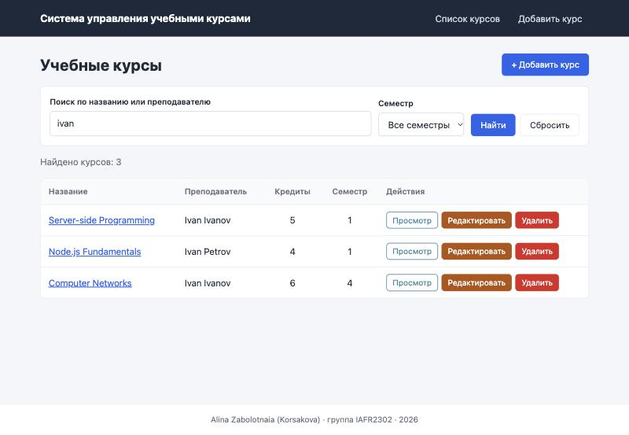

**Фильтр по семестру `?semester=2`**

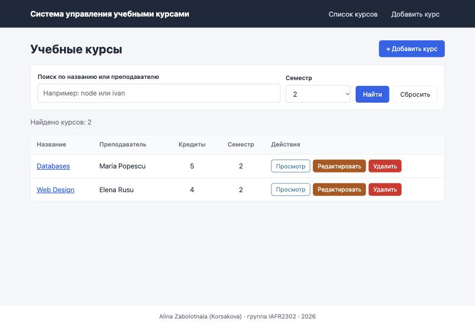

**Поиск и фильтр одновременно `?search=node&semester=1`**

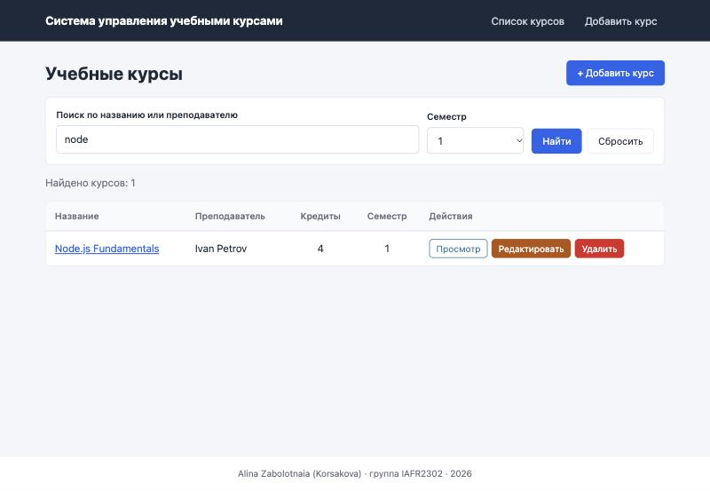

**Ничего не найдено**

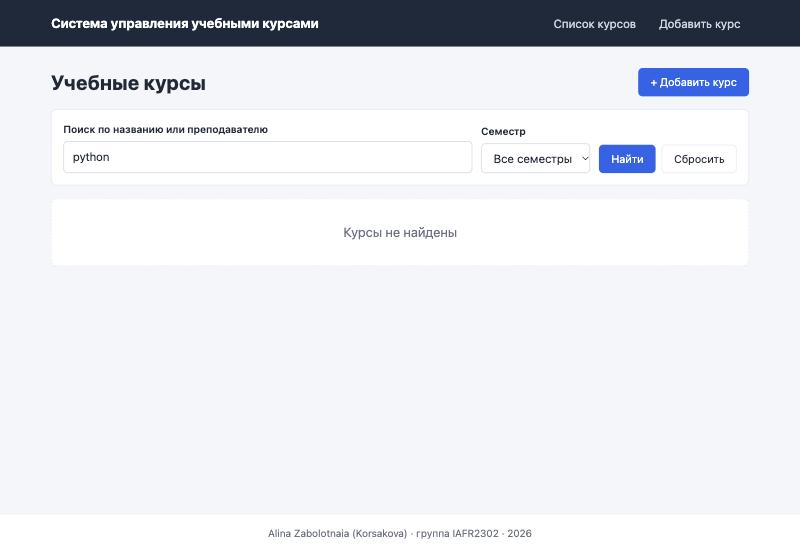

**Просмотр курса `/courses/1`**

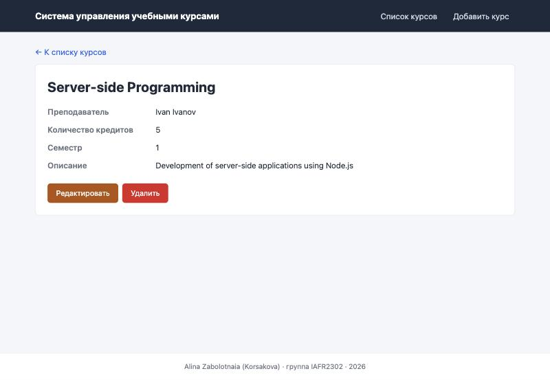

**Форма добавления `/courses/new`**

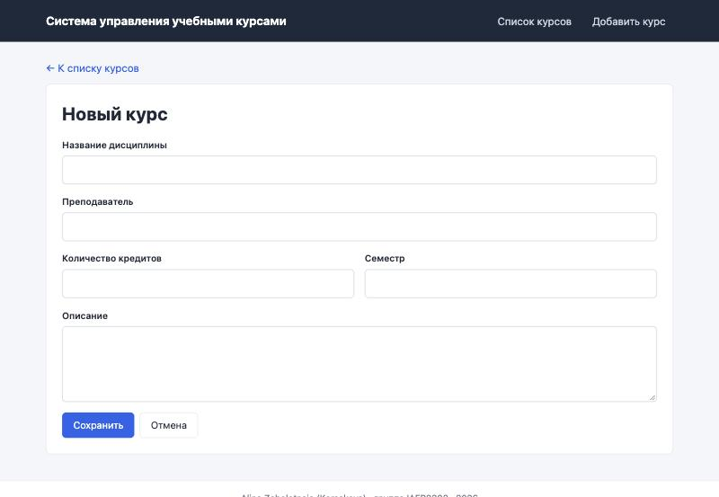

**Валидация при добавлении**: пустые название и описание, кредиты -3, семестр 10. Курс не сохранён, введённые значения остались в полях.

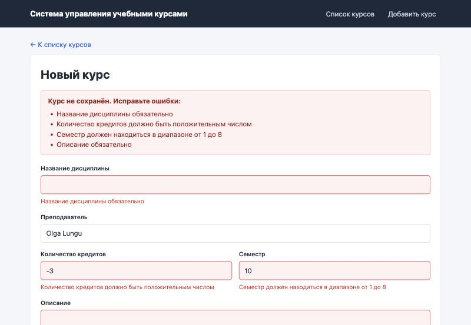

**После исправления и сохранения**: перенаправление на `/courses`, новый курс «Cloud Computing» в списке с автоматически созданным ID 7

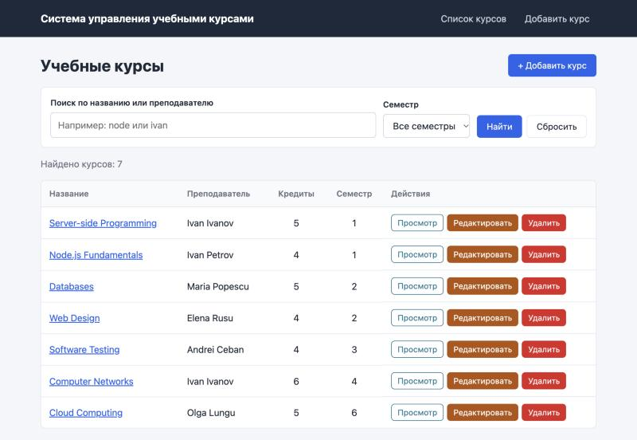

**Форма редактирования `/courses/7/edit`** с текущими данными

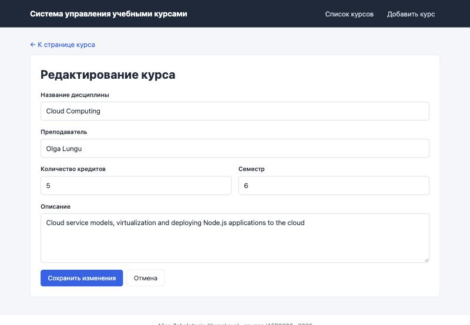

**Валидация при редактировании**: кредиты `abc`, семестр `2.5`

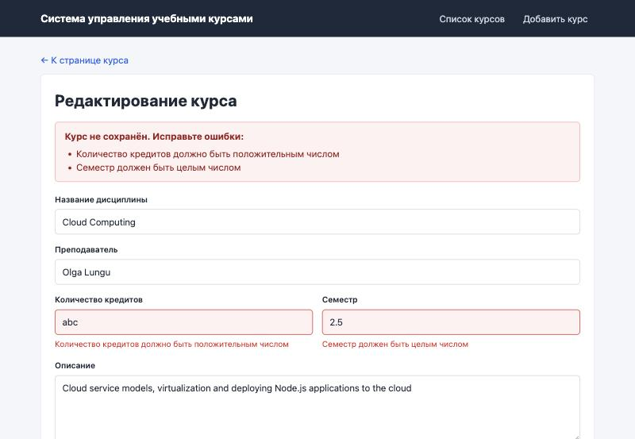

**После сохранения изменений**: перенаправление на страницу курса, кредиты 6, семестр 7

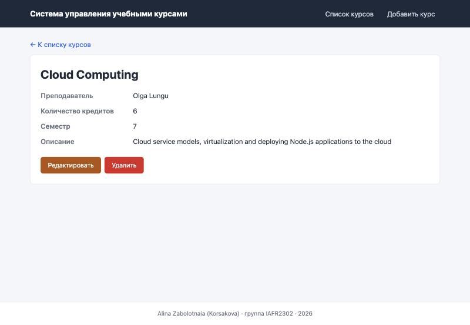

**После удаления курса 7**: перенаправление на `/courses`, в списке снова 6 курсов

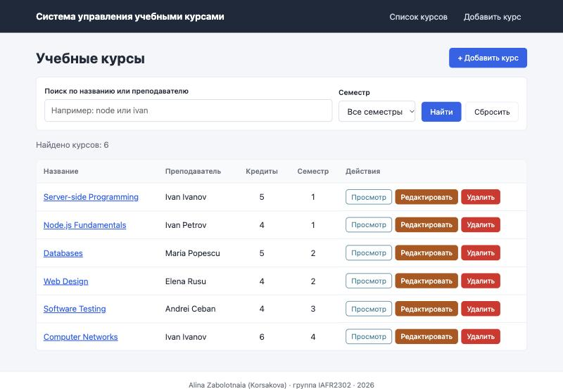

**Курс не найден `/courses/7`**: статус 404

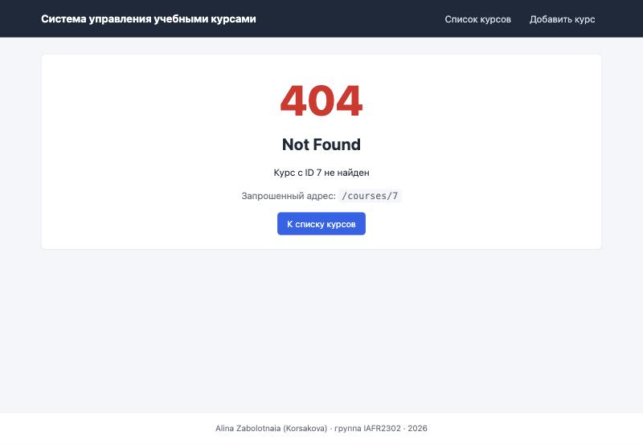

**Несуществующий маршрут `/students`**: статус 404

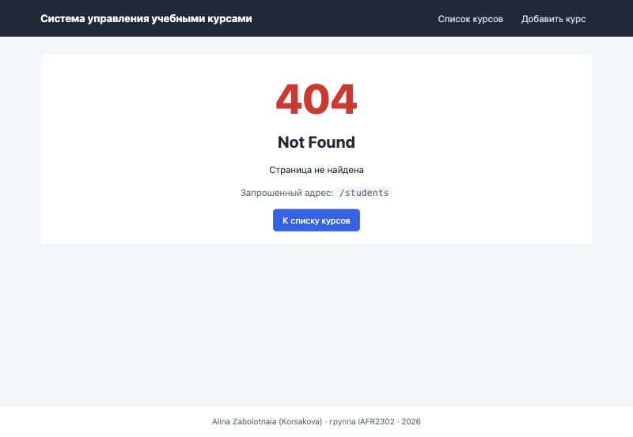

**Страница общей ошибки `error.ejs`** на примере некорректно закодированного URL: без stack trace

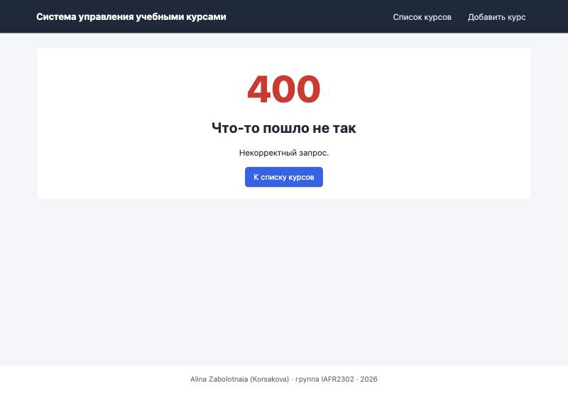

### Лог запросов в терминале

```
Server is running at http://localhost:3000
GET | / | 23.11.2026 16:38
GET | /courses | 23.11.2026 16:38
GET | /css/style.css | 23.11.2026 16:38
...
GET | /courses?search=ivan | 23.11.2026 16:40
GET | /courses?semester=2 | 23.11.2026 16:40
GET | /courses?search=node&semester=1 | 23.11.2026 16:40
GET | /courses?search=python | 23.11.2026 16:40
GET | /courses/1 | 23.11.2026 16:40
GET | /courses/new | 23.11.2026 16:40
POST | /courses | 23.11.2026 16:40
POST | /courses | 23.11.2026 16:41
GET | /courses | 23.11.2026 16:41
GET | /courses/7/edit | 23.11.2026 16:41
POST | /courses/7/edit | 23.11.2026 16:41
POST | /courses/7/edit | 23.11.2026 16:41
GET | /courses/7 | 23.11.2026 16:41
POST | /courses/7/delete | 23.11.2026 16:41
GET | /courses | 23.11.2026 16:41
GET | /courses/7 | 23.11.2026 16:41
GET | /students | 23.11.2026 16:41
GET | /courses/%E0%A4%A | 23.11.2026 16:41
```

Запросы к `/css/style.css` и `/favicon.ico`, которые браузер делает для каждой страницы, в выдержке опущены. Первый `POST /courses` вернул форму с ошибками, второй сохранил курс. Аналогично первый `POST /courses/7/edit` не прошёл валидацию, второй сохранил изменения.

## Код программы

### `app.js`

```javascript
// Лабораторная работа №3: система управления учебными курсами (Express.js, EJS, middleware)
// Студент: Alina Zabolotnaia (Korsakova), группа IAFR2302

const path = require('path');
const express = require('express');

const logger = require('./middleware/logger');
const courseRoutes = require('./routes/courseRoutes');
const { renderNotFound } = require('./controllers/courseController');

const app = express();
const PORT = 3000;

// Шаблонизатор EJS. path.join(__dirname, ...) даёт абсолютный путь,
// поэтому приложение работает при запуске из любой папки
app.set('view engine', 'ejs');
app.set('views', path.join(__dirname, 'views'));

// Middleware: подключаются до маршрутов и применяются ко всем запросам
app.use(logger);                                            // логирование
app.use(express.urlencoded({ extended: true }));            // данные HTML-форм → req.body
app.use(express.static(path.join(__dirname, 'public')));    // CSS и другие статические файлы

// Маршруты
app.use('/', courseRoutes);

// Неизвестный маршрут → страница 404
app.use((req, res) => {
    renderNotFound(req, res);
});

// Обработчик ошибок (4 аргумента). Stack trace пишем только в терминал, пользователю не показываем
app.use((err, req, res, next) => {
    console.error(err);
    const status = err.status >= 400 && err.status < 500 ? err.status : 500;
    res.status(status).render('error', {
        title: 'Ошибка',
        status,
        message: status === 500
            ? 'На сервере произошла внутренняя ошибка. Попробуйте позже.'
            : 'Некорректный запрос.'
    });
});

app.listen(PORT, () => {
    console.log(`Server is running at http://localhost:${PORT}`);
});
```

### `routes/courseRoutes.js`

```javascript
// Маршруты приложения: связывают метод и URL с функциями контроллера

const express = require('express');
const courseController = require('../controllers/courseController');
const validateCourse = require('../middleware/validateCourse');

const router = express.Router();

// Для каждого маршрута с :id сначала ищем курс (или показываем 404)
router.param('id', courseController.loadCourse);

router.get('/', courseController.redirectToCourses);

router.get('/courses', courseController.listCourses);
// /courses/new объявлен раньше /courses/:id, иначе "new" было бы принято за id
router.get('/courses/new', courseController.showCreateForm);
router.post('/courses', validateCourse, courseController.createCourse);

router.get('/courses/:id', courseController.showCourse);
router.get('/courses/:id/edit', courseController.showEditForm);
router.post('/courses/:id/edit', validateCourse, courseController.updateCourse);
router.post('/courses/:id/delete', courseController.deleteCourse);

module.exports = router;
```

### `controllers/courseController.js`

```javascript
// Контроллер курсов: получает запрос, обращается к модели и выбирает, какую страницу показать

const courseModel = require('../models/courseModel');

const SEMESTERS = [1, 2, 3, 4, 5, 6, 7, 8];

// Общая страница 404 (используется и здесь, и в app.js)
function renderNotFound(req, res, message = 'Страница не найдена') {
    res.status(404).render('404', { title: '404 Not Found', message, url: req.originalUrl });
}

// router.param('id', ...): вызывается для всех маршрутов с :id.
// Находит курс и кладёт его в req.course, иначе сразу отвечает 404.
function loadCourse(req, res, next, id) {
    const course = courseModel.findById(Number(id));
    if (!course) {
        return renderNotFound(req, res, `Курс с ID ${id} не найден`);
    }
    req.course = course;
    next();
}

// GET /
function redirectToCourses(req, res) {
    res.redirect('/courses');
}

// GET /courses?search=node&semester=1
function listCourses(req, res) {
    const search = typeof req.query.search === 'string' ? req.query.search.trim() : '';

    // Фильтр применяется, только если семестр целый и от 1 до 8, иначе показываем все семестры
    const semesterNumber = Number(req.query.semester);
    const semester = SEMESTERS.includes(semesterNumber) ? semesterNumber : null;

    const courses = courseModel.getAll({ search, semester });

    res.render('courses/index', {
        title: 'Список курсов',
        courses,
        search,
        semester,
        semesters: SEMESTERS
    });
}

// GET /courses/new
function showCreateForm(req, res) {
    res.render('courses/create', {
        title: 'Новый курс',
        course: { title: '', teacher: '', credits: '', semester: '', description: '' },
        errors: {}
    });
}

// POST /courses (данные уже проверены middleware validateCourse)
function createCourse(req, res) {
    courseModel.create(req.courseData);
    res.redirect('/courses');
}

// GET /courses/:id
function showCourse(req, res) {
    res.render('courses/details', { title: req.course.title, course: req.course });
}

// GET /courses/:id/edit
function showEditForm(req, res) {
    res.render('courses/edit', { title: 'Редактирование курса', course: req.course, errors: {} });
}

// POST /courses/:id/edit
function updateCourse(req, res) {
    courseModel.update(req.course.id, req.courseData);
    res.redirect(`/courses/${req.course.id}`);
}

// POST /courses/:id/delete
function deleteCourse(req, res) {
    courseModel.remove(req.course.id);
    res.redirect('/courses');
}

module.exports = {
    renderNotFound,
    loadCourse,
    redirectToCourses,
    listCourses,
    showCreateForm,
    createCourse,
    showCourse,
    showEditForm,
    updateCourse,
    deleteCourse
};
```

### `models/courseModel.js`

```javascript
// Модель курсов: хранит данные и операции с ними.
// Данные лежат в массиве в памяти, поэтому после перезапуска сервера изменения теряются.

const courses = [
    {
        id: 1,
        title: 'Server-side Programming',
        teacher: 'Ivan Ivanov',
        credits: 5,
        semester: 1,
        description: 'Development of server-side applications using Node.js'
    },
    {
        id: 2,
        title: 'Node.js Fundamentals',
        teacher: 'Ivan Petrov',
        credits: 4,
        semester: 1,
        description: 'Modules, npm, asynchronous programming and the event loop in Node.js'
    },
    {
        id: 3,
        title: 'Databases',
        teacher: 'Maria Popescu',
        credits: 5,
        semester: 2,
        description: 'Relational data modelling, SQL queries, indexes and transactions'
    },
    {
        id: 4,
        title: 'Web Design',
        teacher: 'Elena Rusu',
        credits: 4,
        semester: 2,
        description: 'HTML, CSS, responsive layouts and basic UX principles'
    },
    {
        id: 5,
        title: 'Software Testing',
        teacher: 'Andrei Ceban',
        credits: 4,
        semester: 3,
        description: 'Test design techniques, unit and integration testing, bug reporting'
    },
    {
        id: 6,
        title: 'Computer Networks',
        teacher: 'Ivan Ivanov',
        credits: 6,
        semester: 4,
        description: 'OSI and TCP/IP models, HTTP, DNS and network troubleshooting'
    }
];

// Следующий свободный id: максимальный существующий + 1
function nextId() {
    return courses.length === 0 ? 1 : Math.max(...courses.map((course) => course.id)) + 1;
}

// Все курсы с необязательным поиском (по названию и преподавателю) и фильтром по семестру
function getAll({ search = '', semester = null } = {}) {
    const query = search.trim().toLowerCase();

    return courses.filter((course) => {
        const matchesSearch = query === ''
            || course.title.toLowerCase().includes(query)
            || course.teacher.toLowerCase().includes(query);
        const matchesSemester = semester === null || course.semester === semester;
        return matchesSearch && matchesSemester;
    });
}

function findById(id) {
    return courses.find((course) => course.id === id);
}

function create(data) {
    const course = { id: nextId(), ...data };
    courses.push(course);
    return course;
}

function update(id, data) {
    const course = findById(id);
    if (!course) {
        return null;
    }
    Object.assign(course, data);
    return course;
}

function remove(id) {
    const index = courses.findIndex((course) => course.id === id);
    if (index === -1) {
        return null;
    }
    return courses.splice(index, 1)[0];
}

module.exports = { courses, getAll, findById, create, update, remove };
```

### `middleware/logger.js`

```javascript
// Middleware логирования: HTTP Method | URL | Date and Time

function formatDateTime(date) {
    const pad = (n) => String(n).padStart(2, '0');
    return `${pad(date.getDate())}.${pad(date.getMonth() + 1)}.${date.getFullYear()} `
         + `${pad(date.getHours())}:${pad(date.getMinutes())}`;
}

function logger(req, res, next) {
    console.log(`${req.method} | ${req.originalUrl} | ${formatDateTime(new Date())}`);
    next();
}

module.exports = logger;
```

### `middleware/validateCourse.js`

```javascript
// Middleware валидации формы курса (добавление и редактирование).
// Если данные верны, кладёт очищенный курс в req.courseData и передаёт управление контроллеру.
// Если нет, сразу показывает ту же форму с сообщениями об ошибках и введёнными данными.

function validateCourse(req, res, next) {
    const body = req.body || {};

    // Значения из формы всегда строки; убираем пробелы по краям
    const form = {
        title: String(body.title ?? '').trim(),
        teacher: String(body.teacher ?? '').trim(),
        credits: String(body.credits ?? '').trim(),
        semester: String(body.semester ?? '').trim(),
        description: String(body.description ?? '').trim()
    };

    const errors = {};

    if (form.title === '') {
        errors.title = 'Название дисциплины обязательно';
    }

    if (form.teacher === '') {
        errors.teacher = 'Укажите преподавателя';
    }

    const credits = Number(form.credits);
    if (form.credits === '' || !Number.isFinite(credits) || credits <= 0) {
        errors.credits = 'Количество кредитов должно быть положительным числом';
    }

    const semester = Number(form.semester);
    if (form.semester === '' || !Number.isInteger(semester)) {
        errors.semester = 'Семестр должен быть целым числом';
    } else if (semester < 1 || semester > 8) {
        errors.semester = 'Семестр должен находиться в диапазоне от 1 до 8';
    }

    if (form.description === '') {
        errors.description = 'Описание обязательно';
    }

    if (Object.keys(errors).length > 0) {
        // req.course есть только при редактировании (его заранее находит router.param)
        const isEdit = Boolean(req.course);
        return res.status(400).render(isEdit ? 'courses/edit' : 'courses/create', {
            title: isEdit ? 'Редактирование курса' : 'Новый курс',
            course: isEdit ? { id: req.course.id, ...form } : form,
            errors
        });
    }

    req.courseData = {
        title: form.title,
        teacher: form.teacher,
        credits,
        semester,
        description: form.description
    };
    next();
}

module.exports = validateCourse;
```

### `views/partials/header.ejs`

```ejs
<!DOCTYPE html>
<html lang="ru">
<head>
    <meta charset="UTF-8">
    <meta name="viewport" content="width=device-width, initial-scale=1.0">
    <title><%= title %> | Система управления курсами</title>
    <link rel="stylesheet" href="/css/style.css">
</head>
<body>
    <header class="site-header">
        <div class="container header-inner">
            <a href="/courses" class="logo">Система управления учебными курсами</a>
            <nav class="nav">
                <a href="/courses">Список курсов</a>
                <a href="/courses/new">Добавить курс</a>
            </nav>
        </div>
    </header>
    <main class="container">
```

### `views/partials/footer.ejs`

```ejs
    </main>
    <footer class="site-footer">
        <div class="container">
            Alina Zabolotnaia (Korsakova) · группа IAFR2302 · <%= new Date().getFullYear() %>
        </div>
    </footer>
</body>
</html>
```

### `views/partials/courseForm.ejs`

```ejs
<%# Общие поля формы курса для create.ejs и edit.ejs %>
<% if (Object.keys(errors).length > 0) { %>
    <div class="alert alert-error">
        <strong>Курс не сохранён. Исправьте ошибки:</strong>
        <ul>
            <% Object.values(errors).forEach((message) => { %>
                <li><%= message %></li>
            <% }) %>
        </ul>
    </div>
<% } %>

<div class="form-group">
    <label for="title">Название дисциплины</label>
    <input type="text" id="title" name="title" value="<%= course.title %>"
           class="<%= errors.title ? 'invalid' : '' %>">
    <% if (errors.title) { %><p class="field-error"><%= errors.title %></p><% } %>
</div>

<div class="form-group">
    <label for="teacher">Преподаватель</label>
    <input type="text" id="teacher" name="teacher" value="<%= course.teacher %>"
           class="<%= errors.teacher ? 'invalid' : '' %>">
    <% if (errors.teacher) { %><p class="field-error"><%= errors.teacher %></p><% } %>
</div>

<div class="form-row">
    <div class="form-group">
        <label for="credits">Количество кредитов</label>
        <input type="text" id="credits" name="credits" value="<%= course.credits %>" inputmode="decimal"
               class="<%= errors.credits ? 'invalid' : '' %>">
        <% if (errors.credits) { %><p class="field-error"><%= errors.credits %></p><% } %>
    </div>

    <div class="form-group">
        <label for="semester">Семестр</label>
        <input type="text" id="semester" name="semester" value="<%= course.semester %>" inputmode="numeric"
               class="<%= errors.semester ? 'invalid' : '' %>">
        <% if (errors.semester) { %><p class="field-error"><%= errors.semester %></p><% } %>
    </div>
</div>

<div class="form-group">
    <label for="description">Описание</label>
    <textarea id="description" name="description" rows="4"
              class="<%= errors.description ? 'invalid' : '' %>"><%= course.description %></textarea>
    <% if (errors.description) { %><p class="field-error"><%= errors.description %></p><% } %>
</div>
```

### `views/courses/index.ejs`

```ejs
<%- include('../partials/header', { title }) %>

<div class="page-title">
    <h1>Учебные курсы</h1>
    <a href="/courses/new" class="btn btn-primary">+ Добавить курс</a>
</div>

<form action="/courses" method="GET" class="filters">
    <div class="form-group">
        <label for="search">Поиск по названию или преподавателю</label>
        <input type="text" id="search" name="search" value="<%= search %>" placeholder="Например: node или ivan">
    </div>
    <div class="form-group">
        <label for="semester">Семестр</label>
        <select id="semester" name="semester">
            <option value="">Все семестры</option>
            <% semesters.forEach((number) => { %>
                <option value="<%= number %>" <%= semester === number ? 'selected' : '' %>><%= number %></option>
            <% }) %>
        </select>
    </div>
    <div class="filters-actions">
        <button type="submit" class="btn btn-primary">Найти</button>
        <a href="/courses" class="btn btn-secondary">Сбросить</a>
    </div>
</form>

<% if (courses.length === 0) { %>
    <p class="empty">Курсы не найдены</p>
<% } else { %>
    <p class="muted">Найдено курсов: <%= courses.length %></p>
    <div class="table-wrapper">
        <table class="table">
            <thead>
                <tr>
                    <th>Название</th>
                    <th>Преподаватель</th>
                    <th class="num">Кредиты</th>
                    <th class="num">Семестр</th>
                    <th>Действия</th>
                </tr>
            </thead>
            <tbody>
                <% courses.forEach((course) => { %>
                    <tr>
                        <td><a href="/courses/<%= course.id %>"><%= course.title %></a></td>
                        <td><%= course.teacher %></td>
                        <td class="num"><%= course.credits %></td>
                        <td class="num"><%= course.semester %></td>
                        <td class="actions">
                            <a href="/courses/<%= course.id %>" class="btn btn-sm btn-view">Просмотр</a>
                            <a href="/courses/<%= course.id %>/edit" class="btn btn-sm btn-edit">Редактировать</a>
                            <form action="/courses/<%= course.id %>/delete" method="POST"
                                  onsubmit="return confirm('Удалить этот курс?')">
                                <button type="submit" class="btn btn-sm btn-delete">Удалить</button>
                            </form>
                        </td>
                    </tr>
                <% }) %>
            </tbody>
        </table>
    </div>
<% } %>

<%- include('../partials/footer') %>
```

### `views/courses/details.ejs`

```ejs
<%- include('../partials/header', { title }) %>

<a href="/courses" class="back-link">← К списку курсов</a>

<article class="card course-details">
    <h1><%= course.title %></h1>

    <dl class="details-list">
        <dt>Преподаватель</dt>
        <dd><%= course.teacher %></dd>

        <dt>Количество кредитов</dt>
        <dd><%= course.credits %></dd>

        <dt>Семестр</dt>
        <dd><%= course.semester %></dd>

        <dt>Описание</dt>
        <dd><%= course.description %></dd>
    </dl>

    <div class="card-actions">
        <a href="/courses/<%= course.id %>/edit" class="btn btn-edit">Редактировать</a>
        <form action="/courses/<%= course.id %>/delete" method="POST"
              onsubmit="return confirm('Удалить этот курс?')">
            <button type="submit" class="btn btn-delete">Удалить</button>
        </form>
    </div>
</article>

<%- include('../partials/footer') %>
```

### `views/courses/create.ejs`

```ejs
<%- include('../partials/header', { title }) %>

<a href="/courses" class="back-link">← К списку курсов</a>

<div class="card">
    <h1>Новый курс</h1>
    <form action="/courses" method="POST" class="course-form" novalidate>
        <%- include('../partials/courseForm', { course, errors }) %>
        <div class="form-actions">
            <button type="submit" class="btn btn-primary">Сохранить</button>
            <a href="/courses" class="btn btn-secondary">Отмена</a>
        </div>
    </form>
</div>

<%- include('../partials/footer') %>
```

### `views/courses/edit.ejs`

```ejs
<%- include('../partials/header', { title }) %>

<a href="/courses/<%= course.id %>" class="back-link">← К странице курса</a>

<div class="card">
    <h1>Редактирование курса</h1>
    <form action="/courses/<%= course.id %>/edit" method="POST" class="course-form" novalidate>
        <%- include('../partials/courseForm', { course, errors }) %>
        <div class="form-actions">
            <button type="submit" class="btn btn-primary">Сохранить изменения</button>
            <a href="/courses/<%= course.id %>" class="btn btn-secondary">Отмена</a>
        </div>
    </form>
</div>

<%- include('../partials/footer') %>
```

### `views/404.ejs`

```ejs
<%- include('partials/header', { title }) %>

<div class="card error-page">
    <p class="error-code">404</p>
    <h1>Not Found</h1>
    <p><%= message %></p>
    <p class="muted">Запрошенный адрес: <code><%= url %></code></p>
    <a href="/courses" class="btn btn-primary">К списку курсов</a>
</div>

<%- include('partials/footer') %>
```

### `views/error.ejs`

```ejs
<%- include('partials/header', { title }) %>

<div class="card error-page">
    <p class="error-code"><%= status %></p>
    <h1>Что-то пошло не так</h1>
    <p><%= message %></p>
    <a href="/courses" class="btn btn-primary">К списку курсов</a>
</div>

<%- include('partials/footer') %>
```

### `public/css/style.css`

<details>
<summary>Показать CSS</summary>

```css
/* Лабораторная работа №3: оформление приложения */

:root {
    --color-bg: #f4f6fa;
    --color-surface: #ffffff;
    --color-text: #1f2937;
    --color-muted: #6b7280;
    --color-border: #e2e8f0;
    --color-primary: #2563eb;
    --color-primary-dark: #1d4ed8;
    --color-view: #0e7490;
    --color-edit: #b45309;
    --color-delete: #dc2626;
    --color-error-bg: #fef2f2;
    --color-error-border: #fca5a5;
    --radius: 8px;
}

* {
    box-sizing: border-box;
}

/* Страница */
body {
    margin: 0;
    min-height: 100vh;
    display: flex;
    flex-direction: column;
    font-family: -apple-system, BlinkMacSystemFont, "Segoe UI", Roboto, Arial, sans-serif;
    font-size: 16px;
    line-height: 1.5;
    color: var(--color-text);
    background: var(--color-bg);
}

.container {
    width: 100%;
    max-width: 1000px;
    margin: 0 auto;
    padding: 0 20px;
}

/* main.container: селектор специфичнее .container, поэтому вертикальные отступы не перезаписываются */
main.container {
    flex: 1;
    padding-top: 28px;
    padding-bottom: 40px;
}

h1 {
    margin: 0 0 16px;
    font-size: 28px;
}

a {
    color: var(--color-primary);
}

.muted {
    color: var(--color-muted);
}

code {
    padding: 2px 6px;
    background: var(--color-bg);
    border-radius: 4px;
}

/* Шапка и навигация */
.site-header {
    background: #1e293b;
    color: #fff;
}

.header-inner {
    display: flex;
    flex-wrap: wrap;
    align-items: center;
    justify-content: space-between;
    gap: 12px;
    padding-top: 14px;
    padding-bottom: 14px;
}

.logo {
    color: #fff;
    font-size: 18px;
    font-weight: 700;
    text-decoration: none;
}

.nav {
    display: flex;
    gap: 8px;
}

.nav a {
    padding: 6px 12px;
    color: #cbd5e1;
    text-decoration: none;
    border-radius: 6px;
}

.nav a:hover {
    color: #fff;
    background: rgba(255, 255, 255, 0.1);
}

/* Подвал */
.site-footer {
    padding: 16px 0;
    color: var(--color-muted);
    font-size: 14px;
    text-align: center;
    border-top: 1px solid var(--color-border);
    background: var(--color-surface);
}

/* Кнопки */
.btn {
    display: inline-block;
    padding: 8px 16px;
    font: inherit;
    font-size: 15px;
    line-height: 1.4;
    text-decoration: none;
    white-space: nowrap;
    border: 1px solid transparent;
    border-radius: 6px;
    cursor: pointer;
    transition: background 0.15s, color 0.15s;
}

.btn-sm {
    padding: 4px 10px;
    font-size: 14px;
}

.btn-primary {
    color: #fff;
    background: var(--color-primary);
}

.btn-primary:hover {
    background: var(--color-primary-dark);
}

.btn-secondary {
    color: var(--color-text);
    background: var(--color-surface);
    border-color: var(--color-border);
}

.btn-secondary:hover {
    background: var(--color-bg);
}

/* Просмотр: контурная бирюзовая */
.btn-view {
    color: var(--color-view);
    background: transparent;
    border-color: var(--color-view);
}

.btn-view:hover {
    color: #fff;
    background: var(--color-view);
}

/* Редактирование: янтарная */
.btn-edit {
    color: #fff;
    background: var(--color-edit);
}

.btn-edit:hover {
    background: #92400e;
}

/* Удаление: красная */
.btn-delete {
    color: #fff;
    background: var(--color-delete);
}

.btn-delete:hover {
    background: #b91c1c;
}

/* Заголовок страницы */
.page-title {
    display: flex;
    flex-wrap: wrap;
    align-items: center;
    justify-content: space-between;
    gap: 12px;
    margin-bottom: 16px;
}

.page-title h1 {
    margin: 0;
}

/* Поиск и фильтр */
.filters {
    display: flex;
    flex-wrap: wrap;
    align-items: flex-end;
    gap: 12px;
    padding: 16px;
    margin-bottom: 16px;
    background: var(--color-surface);
    border: 1px solid var(--color-border);
    border-radius: var(--radius);
}

.filters .form-group {
    margin: 0;
}

.filters .form-group:first-child {
    flex: 1 1 260px;
}

.filters-actions {
    display: flex;
    gap: 8px;
}

/* Таблица */
.table-wrapper {
    overflow-x: auto;
    background: var(--color-surface);
    border: 1px solid var(--color-border);
    border-radius: var(--radius);
}

.table {
    width: 100%;
    border-collapse: collapse;
}

.table th,
.table td {
    padding: 12px 14px;
    text-align: left;
    border-bottom: 1px solid var(--color-border);
}

.table th {
    font-size: 14px;
    font-weight: 600;
    color: var(--color-muted);
    background: #f8fafc;
}

.table tbody tr:last-child td {
    border-bottom: none;
}

.table tbody tr:hover {
    background: #f8fafc;
}

.table .num {
    text-align: center;
}

.actions {
    display: flex;
    flex-wrap: wrap;
    gap: 6px;
}

.actions form,
.card-actions form {
    margin: 0;
}

.empty {
    padding: 32px;
    font-size: 18px;
    text-align: center;
    color: var(--color-muted);
    background: var(--color-surface);
    border: 1px dashed var(--color-border);
    border-radius: var(--radius);
}

/* Карточки (просмотр курса, формы, ошибки) */
.card {
    padding: 24px;
    background: var(--color-surface);
    border: 1px solid var(--color-border);
    border-radius: var(--radius);
}

.back-link {
    display: inline-block;
    margin-bottom: 12px;
    text-decoration: none;
}

.details-list {
    display: grid;
    grid-template-columns: 200px 1fr;
    gap: 12px 16px;
    margin: 0 0 24px;
}

.details-list dt {
    font-weight: 600;
    color: var(--color-muted);
}

.details-list dd {
    margin: 0;
}

.card-actions,
.form-actions {
    display: flex;
    flex-wrap: wrap;
    gap: 8px;
}

/* Формы и текстовые поля */
.form-group {
    display: flex;
    flex-direction: column;
    gap: 6px;
    margin-bottom: 16px;
}

.form-row {
    display: grid;
    grid-template-columns: 1fr 1fr;
    gap: 16px;
}

label {
    font-size: 14px;
    font-weight: 600;
}

input[type="text"],
select,
textarea {
    width: 100%;
    padding: 9px 12px;
    font: inherit;
    color: var(--color-text);
    background: #fff;
    border: 1px solid #cbd5e1;
    border-radius: 6px;
}

textarea {
    resize: vertical;
}

input:focus,
select:focus,
textarea:focus {
    outline: none;
    border-color: var(--color-primary);
    box-shadow: 0 0 0 3px rgba(37, 99, 235, 0.15);
}

/* Сообщения об ошибках */
.alert {
    padding: 12px 16px;
    margin-bottom: 20px;
    border-radius: 6px;
}

.alert-error {
    color: #991b1b;
    background: var(--color-error-bg);
    border: 1px solid var(--color-error-border);
}

.alert ul {
    margin: 6px 0 0;
    padding-left: 20px;
}

input.invalid,
textarea.invalid {
    border-color: var(--color-delete);
    background: var(--color-error-bg);
}

.field-error {
    margin: 0;
    font-size: 14px;
    color: var(--color-delete);
}

/* Страницы ошибок */
.error-page {
    text-align: center;
}

.error-code {
    margin: 0;
    font-size: 72px;
    font-weight: 800;
    color: var(--color-delete);
}

/* Узкие экраны */
@media (max-width: 600px) {
    .form-row,
    .details-list {
        grid-template-columns: 1fr;
    }

    .details-list dd {
        margin-bottom: 8px;
    }
}
```

</details>

## Выводы

В ходе работы я разработала веб-приложение для управления учебными курсами на Express.js с серверной генерацией HTML через EJS. Приложение разделено по MVC: данные и операции с ними находятся в модели, обработка запросов в контроллере, связь URL с контроллером в роутере, а внешний вид в EJS-шаблонах, где общие части (шапка, подвал, поля формы) вынесены в partials. Реализованы все операции CRUD через HTML-формы, поиск по названию и преподавателю без учёта регистра, фильтр по семестру и их совместная работа через query-параметры. Middleware используются для логирования всех запросов и для валидации форм: некорректные данные не сохраняются, пользователь видит понятные сообщения, а введённые значения остаются в форме. Проверка существования курса вынесена в `router.param`, поэтому 404 для несуществующего ID работает одинаково на всех страницах. Страницы 404 и общей ошибки не раскрывают пользователю технических деталей, а вывод через `<%= %>` защищает от XSS. В следующей работе массив в памяти будет заменён базой данных, и благодаря MVC для этого понадобится менять в основном только модель.
