# Отчёт по лабораторной работе №4

**Дисциплина:** Dezvoltarea aplicațiilor Server-Side
**Тема:** Разработка CRUD-приложения с базой данных и Sequelize
**Студент:** Alina Zabolotnaia (Korsakova)
**Группа:** IAFR2302
**Преподаватель:** Вишневски Влада

> Лабораторные работы №4 и №5 выполнены как один проект «Система управления учебными курсами». Совмещённый отчёт по обеим работам: [Индивидуальная работа](../individual_work/README.md). Здесь описана часть работы №4 (PostgreSQL и Sequelize). Продолжение с регистрацией, входом, ролями, логированием и WebSocket-уведомлениями находится в папке [lab5_alina_zabolotnaia](../lab5_alina_zabolotnaia/README.md).

## Цель работы

Научиться подключать приложение Node.js к базе данных PostgreSQL, создавать модели с помощью Sequelize, устанавливать связи между моделями и выполнять операции создания, просмотра, редактирования и удаления данных.

## Что изменилось по сравнению с лабораторной №3

Приложение «Система управления учебными курсами» из лабораторной №3 перенесено на PostgreSQL:

- курсы и преподаватели хранятся в таблицах `Courses` и `Teachers`, массивов с данными в коде больше нет;
- имя преподавателя больше не хранится в курсе: курс ссылается на преподавателя через внешний ключ `teacherId`;
- добавлен полный CRUD для преподавателей, страница статистики и фильтр курсов по преподавателю;
- поиск и фильтры выполняет PostgreSQL (условие `WHERE`), а не JavaScript после загрузки всех записей;
- все обращения к базе асинхронные (`async/await` + `try...catch`).

## Технологии

Node.js 22, Express 5.3, PostgreSQL 16, Sequelize 6.37, pg 8.23, pg-hstore 2.3, EJS 7, dotenv 18.

```bash
npm install express ejs sequelize pg pg-hstore dotenv
```

## Структура проекта

```
lab4_alina_zabolotnaia/
├── app.js                          # настройка Express, подключение к БД, запуск сервера
├── package.json
├── package-lock.json
├── .env                            # параметры подключения (не в git)
├── .env.example                    # шаблон .env без пароля (в git)
├── .gitignore                      # node_modules/ и .env
├── config/
│   └── database.js                 # экземпляр Sequelize
├── models/
│   ├── index.js                    # сборка моделей, связи, запрос с подсчётом курсов
│   ├── Teacher.js
│   └── Course.js
├── routes/
│   ├── courseRoutes.js             # /, /courses..., /statistics
│   └── teacherRoutes.js            # /teachers...
├── controllers/
│   ├── courseController.js         # курсы и статистика
│   └── teacherController.js
├── middleware/
│   ├── logger.js
│   ├── validateData.js             # валидация форм курса и преподавателя
│   └── errorHandler.js             # 404 и обработчик ошибок
├── scripts/
│   └── seed.js                     # начальное заполнение БД (npm run seed)
├── views/
│   ├── courses/      index, details, create, edit
│   ├── teachers/     index, details, create, edit
│   ├── partials/     header, footer, courseForm, teacherForm, formErrors
│   ├── statistics.ejs
│   ├── 404.ejs
│   └── error.ejs
├── public/css/style.css
├── screenshots/                    # скриншоты для отчёта
└── README.md                       # отчёт
```

Все файлы и папки из задания на месте. Дополнительно добавлены:

| Файл | Зачем |
|---|---|
| `middleware/errorHandler.js` | Обработчики 404 и ошибок вынесены из `app.js`, чтобы в нём не было логики, и используются контроллерами |
| `scripts/seed.js` | Заполняет пустую базу исходными данными. Данные вставляются в таблицы один раз, приложение их из массивов не читает |
| `.env.example` | Показывает, какие переменные нужны, без настоящего пароля. Сам `.env` в git не попадает |
| `partials/courseForm.ejs`, `teacherForm.ejs`, `formErrors.ejs` | Общие поля форм для страниц создания и редактирования, чтобы не дублировать разметку |

Маршрут `/statistics` находится в `courseRoutes.js`, а его обработчик в `courseController.js`: в задании нет отдельных файлов для статистики, а большая часть её показателей относится к курсам.

## Ход работы

### 1. База данных и `.env`

База `node_courses` создана в локальном PostgreSQL 16:

```bash
createdb -h localhost -U postgres node_courses
```

Параметры подключения хранятся в `.env`, который указан в `.gitignore`:

```
DB_HOST=localhost
DB_PORT=5432
DB_NAME=node_courses
DB_USER=postgres
DB_PASSWORD=
PORT=3000
```

На моём компьютере локальный PostgreSQL принимает пользователя `postgres` без пароля, поэтому `DB_PASSWORD` пустой. Если у сервера есть пароль, он указывается только в `.env`. В JavaScript-файлах пароля нет: `config/database.js` читает значения из `process.env`.

### 2. Подключение (`config/database.js`)

`dotenv` загружает `.env` в `process.env` (путь задан относительно файла, поэтому приложение работает при запуске из любой папки), затем создаётся экземпляр `Sequelize` с диалектом `postgres` и `logging: false`.

При запуске `app.js` вызывает `sequelize.authenticate()`. При успехе выводится `Database connection established`, затем `sequelize.sync()` создаёт отсутствующие таблицы. При ошибке выводится понятное сообщение с причиной, а сервер всё равно запускается и на любой запрос к данным показывает страницу 503 «Нет подключения к базе данных». Необработанного исключения и аварийного завершения нет.

```
Unable to connect to the database "node_courses" at localhost:5999: ECONNREFUSED
Check that PostgreSQL is running and the settings in .env are correct.
Server is running at http://localhost:3001
GET | /courses | 23.11.2026 17:00
Database connection error: ECONNREFUSED
```

Используется `sequelize.sync()` без `force: true`: таблицы создаются только если их нет, существующие данные не удаляются.

### 3. Модели

**Teacher** (`models/Teacher.js`, таблица `Teachers`):

| Поле | Тип | Ограничения |
|---|---|---|
| id | INTEGER | primary key, auto increment |
| name | STRING | not null, `notEmpty` |
| email | STRING | not null, **unique**, `isEmail` |
| department | STRING | not null, `notEmpty` |
| academicDegree | STRING | not null, `notEmpty` |

**Course** (`models/Course.js`, таблица `Courses`):

| Поле | Тип | Ограничения |
|---|---|---|
| id | INTEGER | primary key, auto increment |
| title | STRING | not null, `notEmpty` |
| credits | INTEGER | not null, `isInt`, `min: 1` |
| semester | INTEGER | not null, `isInt`, `min: 1`, `max: 8` |
| description | TEXT | not null, `notEmpty` |
| teacherId | INTEGER | not null, foreign key → `Teachers.id` |

Поля `createdAt` и `updatedAt` Sequelize добавляет автоматически. У каждого валидатора модели задано сообщение на русском, поэтому даже если запрос обойдёт middleware, ошибка модели будет понятна пользователю.

Структура таблиц в PostgreSQL после первого запуска (`\d "Courses"`):

```
 Column      | Type                     | Nullable
-------------+--------------------------+---------
 id          | integer                  | not null  (nextval)
 title       | character varying(255)   | not null
 credits     | integer                  | not null
 semester    | integer                  | not null
 description | text                     | not null
 teacherId   | integer                  | not null
 createdAt   | timestamp with time zone | not null
 updatedAt   | timestamp with time zone | not null
Foreign-key constraints:
 "Courses_teacherId_fkey" FOREIGN KEY ("teacherId") REFERENCES "Teachers"(id)
                          ON UPDATE CASCADE ON DELETE RESTRICT
```

У таблицы `Teachers` есть ограничение `"Teachers_email_key" UNIQUE (email)`.

### 4. Связь One-to-Many (`models/index.js`)

```javascript
Teacher.hasMany(Course, { foreignKey: 'teacherId', onDelete: 'RESTRICT' });
Course.belongsTo(Teacher, { foreignKey: 'teacherId' });
```

- `hasMany` даёт преподавателю методы `teacher.getCourses()` и `teacher.countCourses()`;
- `belongsTo` позволяет загружать курс вместе с преподавателем: `Course.findAll({ include: Teacher })` выполняет `LEFT OUTER JOIN "Teachers"`, а данные доступны как `course.Teacher.name`;
- `onDelete: 'RESTRICT'` создаёт в базе ограничение, которое не даст удалить преподавателя с курсами даже в обход приложения.

В `models/index.js` также определён метод `Teacher.findAllWithCourseCount()`: он считает количество курсов каждого преподавателя в самой базе через `COUNT("Courses".id)` и `GROUP BY "Teacher".id`. Его используют список преподавателей и статистика.

### 5. Начальные данные (`scripts/seed.js`)

```bash
$ npm run seed
Seeded 6 teachers and 7 courses
$ npm run seed
The database already contains data, seeding skipped
```

Скрипт вставляет данные, только если таблица преподавателей пуста, и делает это в одной транзакции. Курсы из лабораторной №3 привязаны к преподавателям через `teacherId`. Преподаватель Olga Lungu добавлен без курсов, чтобы показать успешное удаление.

### 6. Маршруты

| Метод | URL | Обработчик | Результат |
|---|---|---|---|
| GET | `/` | `redirectToCourses` | 302 → `/courses` |
| GET | `/courses` | `listCourses` | Список, `?search=`, `?teacherId=`, `?semester=` |
| GET | `/courses/new` | `showCreateForm` | Форма, преподаватели для `<select>` из БД |
| POST | `/courses` | `validateCourse` → `createCourse` | 302 → `/courses` или 400 с ошибками |
| GET | `/courses/:id` | `showCourse` | Курс и данные преподавателя или 404 |
| GET | `/courses/:id/edit` | `showEditForm` | Форма с текущими данными |
| POST | `/courses/:id/edit` | `validateCourse` → `updateCourse` | 302 → `/courses/:id` или 400 |
| POST | `/courses/:id/delete` | `deleteCourse` | 302 → `/courses` |
| GET | `/teachers` | `listTeachers` | Список с количеством курсов |
| GET | `/teachers/new` | `showCreateForm` | Форма |
| POST | `/teachers` | `validateTeacher` → `createTeacher` | 302 → `/teachers` или 400 |
| GET | `/teachers/:id` | `showTeacher` | Преподаватель и его курсы или 404 |
| GET | `/teachers/:id/edit` | `showEditForm` | Форма с текущими данными |
| POST | `/teachers/:id/edit` | `validateTeacher` → `updateTeacher` | 302 → `/teachers/:id` или 400 |
| POST | `/teachers/:id/delete` | `deleteTeacher` | 302 → `/teachers` или 409 «есть курсы» |
| GET | `/statistics` | `showStatistics` | Статистика |

Для параметра `:id` в обоих роутерах используется `router.param('id', ...)`. Функции `loadCourse` и `loadTeacher` один раз проверяют ID и загружают запись для всех маршрутов с `:id`:

- ID не является положительным целым числом (`/teachers/abc`, `/courses/0`) → 400 «Некорректный ID»;
- запись не найдена → 404;
- иначе запись кладётся в `req.course` / `req.teacher`, курс сразу загружается вместе с преподавателем (`include: Teacher`).

### 7. Преподаватели

- **Список** показывает имя, email, кафедру, учёную степень, количество курсов (посчитано в БД) и кнопки просмотра, редактирования и удаления. Если записей нет, выводится «Преподаватели не найдены».
- **Просмотр** показывает данные преподавателя, количество курсов и таблицу его курсов. Курсы получены через связь: `teacher.getCourses()` выполняет `SELECT ... FROM "Courses" WHERE "teacherId" = $1`, ручной фильтрации в JavaScript нет.
- **Добавление и редактирование** проходят через `validateTeacher`. Email приводится к нижнему регистру и проверяется на уникальность запросом `Teacher.findOne({ where: { email } })`; при редактировании свой собственный email оставить можно, а email другого преподавателя нельзя.
- **Удаление**: контроллер вызывает `teacher.countCourses()`. Если курсов больше нуля, преподаватель не удаляется, и на его странице выводится «Невозможно удалить преподавателя, у которого есть курсы» (статус 409 Conflict). Если курсов нет, запись удаляется и выполняется перенаправление на `/teachers`. Дополнительно ограничение `ON DELETE RESTRICT` в базе не даст удалить такую запись, а если это всё же произойдёт (например, курс добавили в момент удаления), контроллер перехватит `ForeignKeyConstraintError` и покажет то же сообщение.

### 8. Курсы

- **Список** загружается запросом `Course.findAll({ where, include: Teacher, order: [['title', 'ASC']] })`. Имя преподавателя берётся из связанной модели (`course.Teacher.name`), в таблице `Courses` хранится только `teacherId`.
- **Форма** содержит `<select>` со всеми преподавателями из таблицы `Teachers`. Пользователь выбирает имя, а в запрос уходит `teacherId` из `value` опции. Вручную вводить ID не нужно.
- **Просмотр** показывает название, кредиты, семестр, описание, а также имя, email и кафедру преподавателя.
- **Редактирование** позволяет изменить все поля и выбрать другого преподавателя; изменения записываются через `course.update()`.
- **Удаление** спрашивает «Вы действительно хотите удалить этот курс?» (`onsubmit="return confirm(...)"`) и выполняет `course.destroy()`.

### 9. Поиск и фильтрация через Sequelize

```javascript
const where = {};
if (search !== '')       where.title = { [Op.iLike]: `%${escapeLike(search)}%` };
if (teacherId !== null)  where.teacherId = teacherId;
if (semester !== null)   where.semester = semester;

Course.findAll({ where, include: Teacher, order: [['title', 'ASC']] });
```

Все переданные условия объединяются через `AND` в одном SQL-запросе. `iLike` в PostgreSQL ищет без учёта регистра. Значения передаются в запрос как параметры, поэтому SQL-инъекция невозможна, а символы `%` и `_` в строке поиска экранируются и ищутся как обычные символы. Некорректные значения фильтров (`?teacherId=abc`, `?semester=99`) игнорируются. Выбранные фильтры сохраняются в форме после поиска.

### 10. Валидация (`middleware/validateData.js`)

Проверка выполняется на трёх уровнях:

1. **Middleware** проверяет форму до обращения к контроллеру и показывает понятные сообщения у полей. Введённые значения остаются в форме.
2. **Модель Sequelize** (`validate`, `allowNull`) не даст сохранить некорректные данные, даже если middleware пропустит ошибку. Контроллер перехватит `ValidationError` и покажет форму с сообщениями.
3. **PostgreSQL** (`NOT NULL`, `UNIQUE`, `FOREIGN KEY`) защищает данные на уровне базы.

| Форма | Проверка | Сообщение |
|---|---|---|
| Преподаватель | имя заполнено | Имя преподавателя обязательно |
| | email заполнен | Email обязателен |
| | формат email | Email имеет некорректный формат |
| | email уникален | Этот email уже используется другим преподавателем |
| | кафедра указана | Кафедра обязательна |
| | учёная степень указана | Учёная степень обязательна |
| Курс | название заполнено | Название дисциплины обязательно |
| | кредиты: целое число > 0 | Количество кредитов должно быть положительным целым числом |
| | семестр от 1 до 8 | Семестр должен находиться в диапазоне от 1 до 8 |
| | описание заполнено | Описание обязательно |
| | преподаватель выбран | Выберите преподавателя |
| | преподаватель существует (`Teacher.findByPk`) | Выбранный преподаватель не существует |

Список `<select>` не мешает отправить поддельный `teacherId` (например, через curl или DevTools), поэтому существование преподавателя проверяется по базе.

### 11. Обработка ошибок

| Ситуация | Что видит пользователь |
|---|---|
| PostgreSQL недоступен при запуске | Сообщение в терминале, сервер продолжает работу |
| PostgreSQL недоступен при запросе (`ConnectionError`) | Страница 503 «Нет подключения к базе данных» |
| Некорректный ID (`/courses/abc`) | Страница 400 «Некорректный ID курса» |
| Курс или преподаватель не найден | Страница 404 с запрошенным URL |
| Неизвестный маршрут | Страница 404 |
| Повторяющийся email | Форма 400 с сообщением у поля email |
| Нет обязательных данных | Форма 400 с сообщениями у полей |
| Несуществующий teacherId | Форма 400 «Выбранный преподаватель не существует» |
| Удаление преподавателя с курсами | Страница преподавателя, 409 «Невозможно удалить преподавателя, у которого есть курсы» |
| Ошибка модели (`ValidationError`, `UniqueConstraintError`) | Форма 400 с сообщениями модели |
| Нарушение внешнего ключа (`ForeignKeyConstraintError`) | Форма 400 или сообщение 409 |
| Другие ошибки Sequelize | Страница 500 «Ошибка при работе с базой данных» |

Каждая асинхронная функция контроллеров и middleware написана с `async/await` и обёрнута в `try...catch`; неожиданные ошибки передаются через `next(error)` в общий обработчик `errorHandler`. Пользователь никогда не видит stack trace: полная ошибка выводится только в терминал, а для ошибок подключения выводится одна строка с причиной.

### 12. Статистика

Все показатели считает PostgreSQL:

- количество преподавателей и курсов: `Teacher.count()`, `Course.count()`;
- курсы по семестрам: `SELECT semester, COUNT(id) FROM "Courses" GROUP BY semester` (на странице показаны все семестры 1-8, в том числе пустые);
- курсы у каждого преподавателя: `Teacher.findAllWithCourseCount()` (`LEFT JOIN` + `GROUP BY`, преподаватели без курсов тоже попадают в список с нулём);
- преподаватель с наибольшим количеством курсов: первый в списке, отсортированном по `coursesCount DESC`. Если таких несколько, показываются все.

### 13. Навигация

`views/partials/header.ejs` содержит ссылки «Курсы», «Преподаватели», «Добавить курс», «Добавить преподавателя», «Статистика» и подключён ко всем страницам.

## Результаты работы

Запуск:

```bash
$ npm run seed
Seeded 6 teachers and 7 courses
$ npm start
Database connection established
Database tables are synchronized
Server is running at http://localhost:3000
```

### Курсы

**Список курсов**: имена преподавателей получены через `include: Teacher`

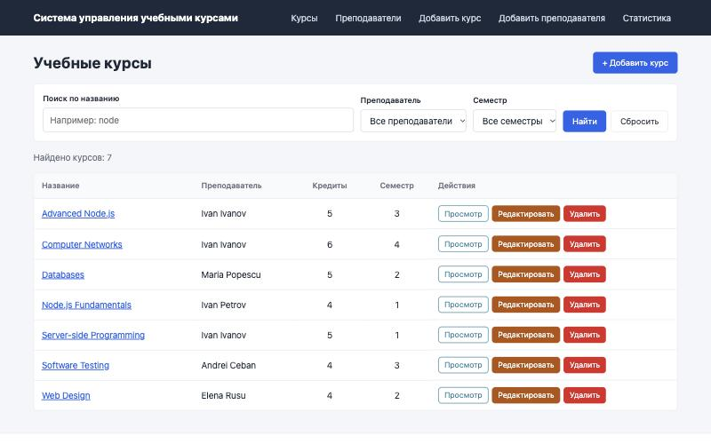

**Поиск по названию без учёта регистра `?search=NODE`**

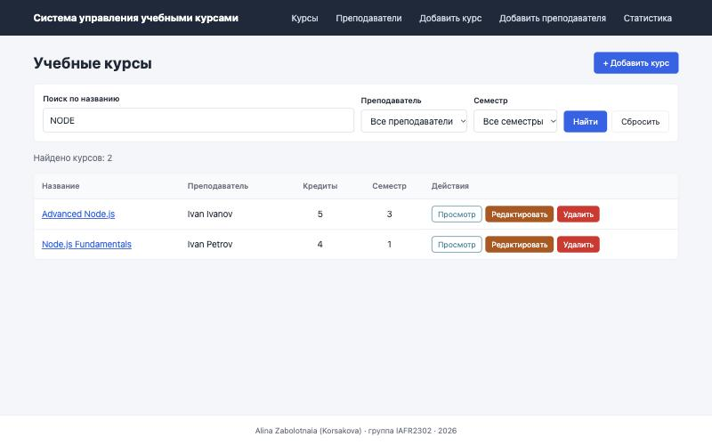

**Фильтр по преподавателю `?teacherId=1`**

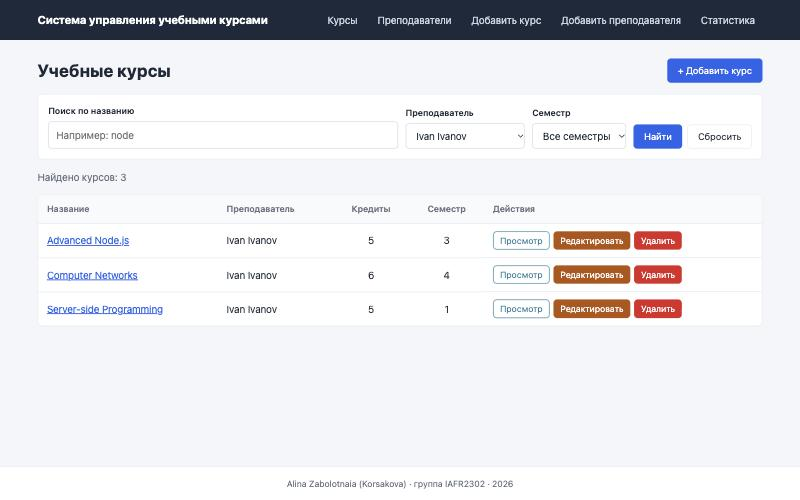

**Фильтр по семестру `?semester=2`**

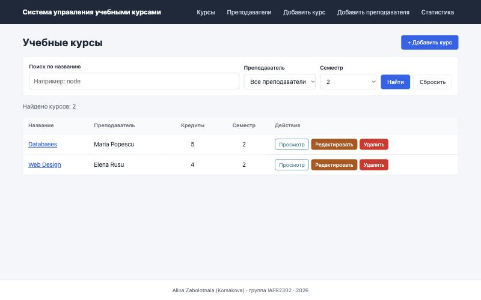

**Комбинированная фильтрация `?search=node&teacherId=2&semester=1`**

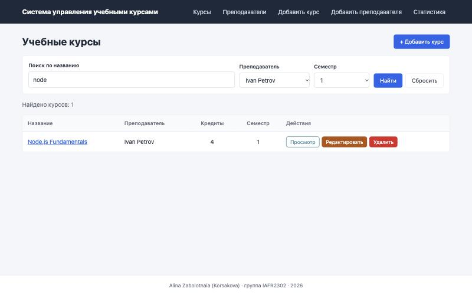

**Ничего не найдено `?search=node&teacherId=4`**

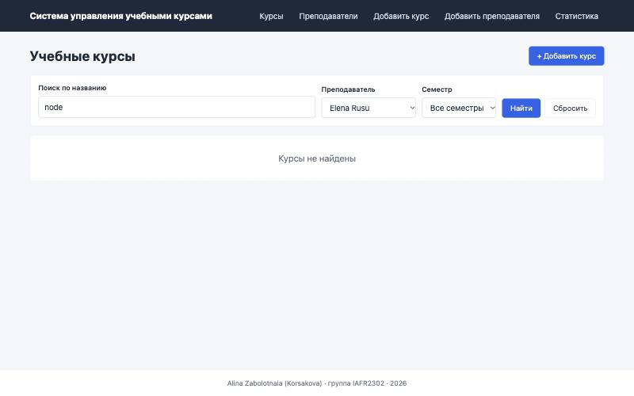

**Просмотр курса**: данные преподавателя из связанной таблицы

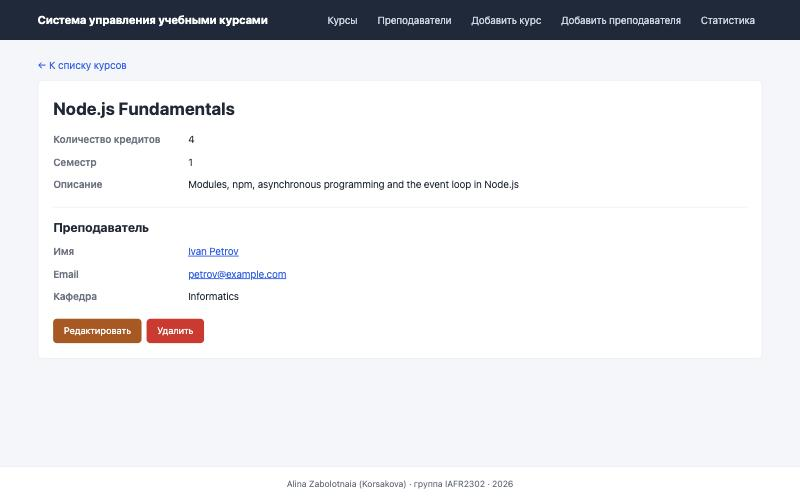

### Преподаватели

**Список преподавателей с количеством курсов**

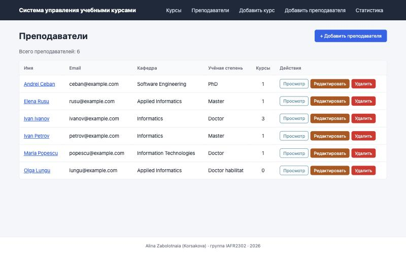

**Страница преподавателя и его курсы** (через `teacher.getCourses()`)

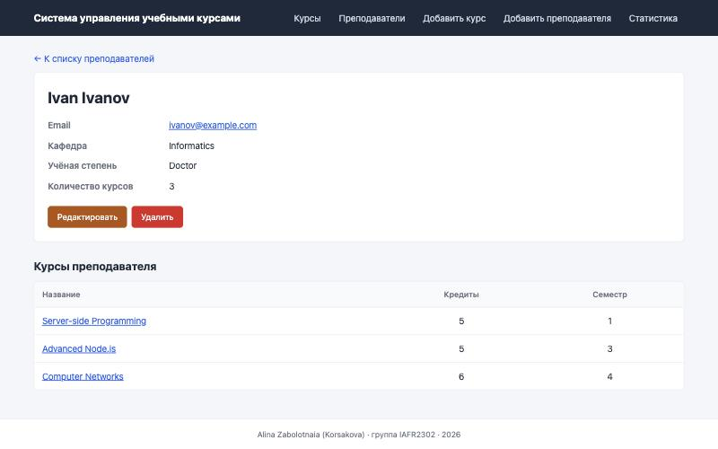

**Попытка удалить преподавателя с курсами**: удаление запрещено, статус 409

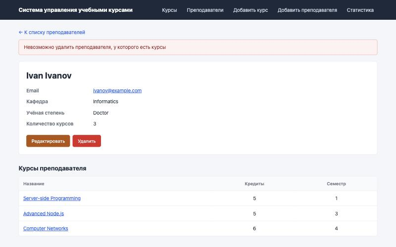

**Валидация формы преподавателя**: некорректный email, пустые кафедра и степень

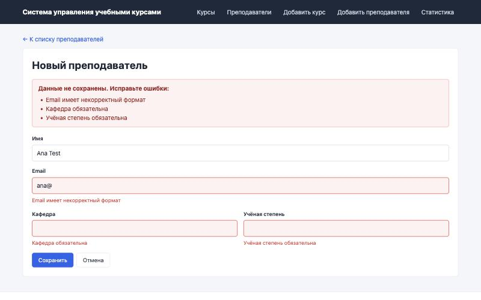

**Повторяющийся email** (`IVANOV@example.com` совпадает с `ivanov@example.com` без учёта регистра)

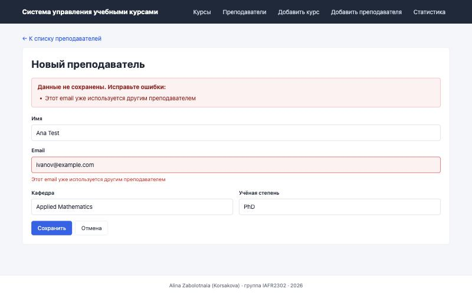

**После добавления преподавателя Ana Test**: перенаправление на `/teachers`, курсов 0

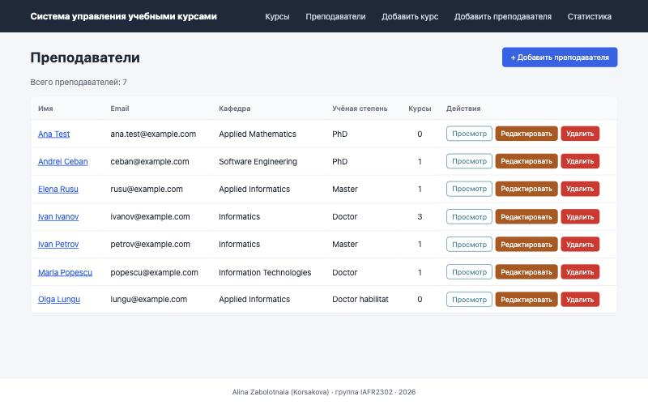

**Редактирование: email другого преподавателя использовать нельзя**

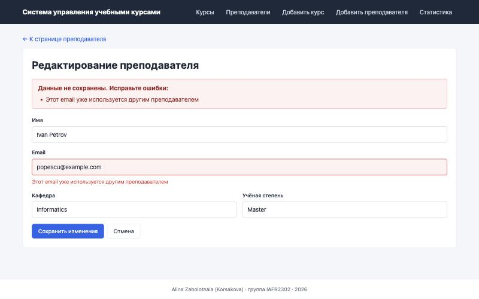

### Добавление, редактирование и удаление курса

**Форма добавления курса** с выбором преподавателя из `<select>`

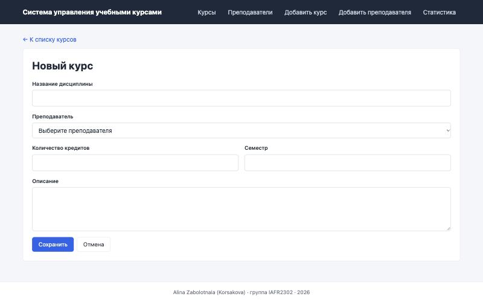

**Валидация курса**: кредиты 0, семестр 9, пустое описание и подставленный в запрос несуществующий `teacherId=999`

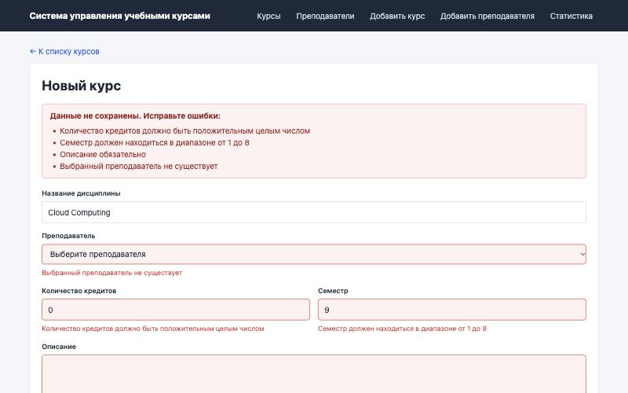

**После добавления курса «Cloud Computing» для Ana Test**

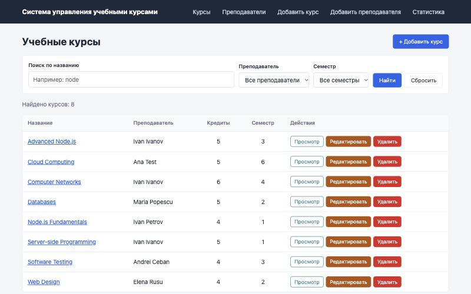

**Редактирование: выбран другой преподаватель (Ivan Petrov) и семестр 7**

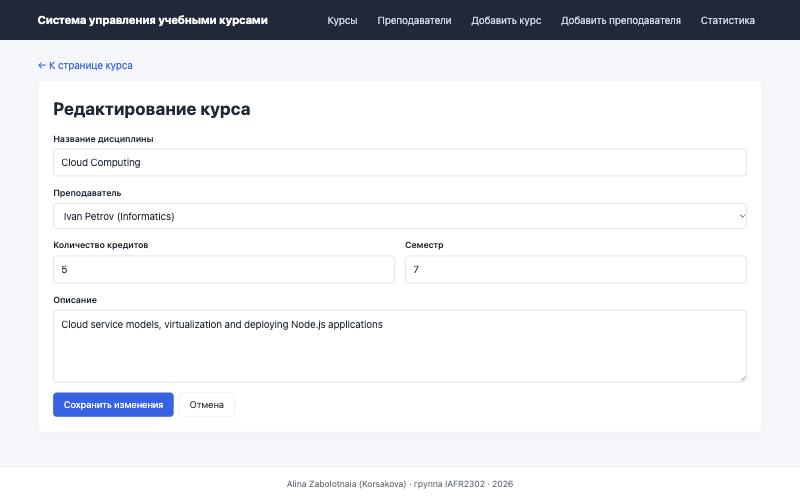

**После сохранения**: курс теперь у Ivan Petrov

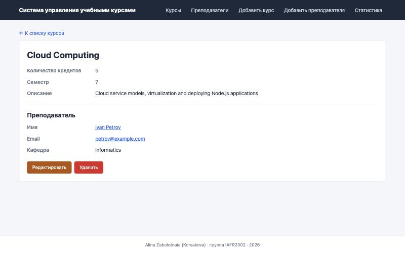

**Страница Ivan Petrov**: курс появился в его списке, курсов стало 2

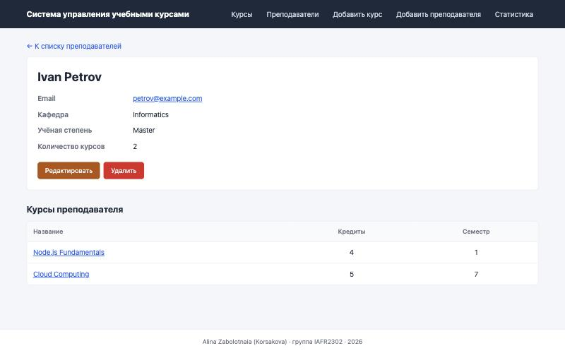

**После удаления курса «Cloud Computing»**: снова 7 курсов


**После удаления Ana Test** (у неё больше нет курсов, поэтому удаление разрешено)


### Статистика и ошибки

**Страница статистики**

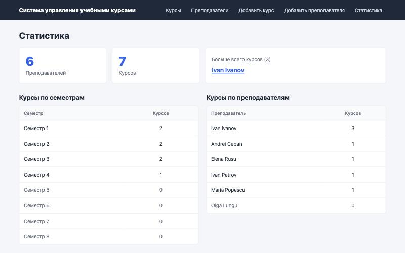

**Курс не найден `/courses/999`**: 404

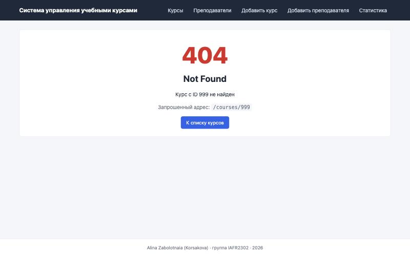

**Некорректный ID `/teachers/abc`**: 400

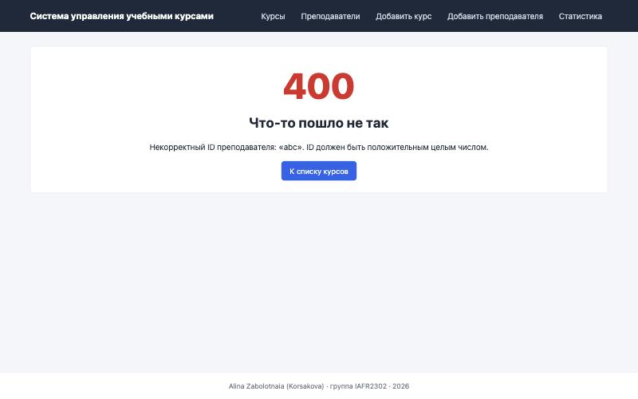

**База данных недоступна** (запуск с `DB_PORT=5999`): 503, без stack trace

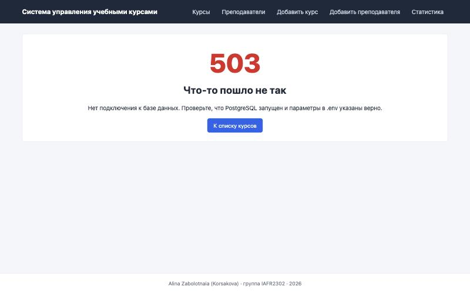

### Лог запросов

Выдержка из терминала во время проверки (запросы к CSS и favicon опущены):

```
Database connection established
Database tables are synchronized
Server is running at http://localhost:3000
GET | /courses | 23.11.2026 16:59
GET | /courses?search=node&teacherId=2&semester=1 | 23.11.2026 16:59
GET | /courses?teacherId=1 | 23.11.2026 16:59
GET | /courses?search=NODE | 23.11.2026 16:59
GET | /courses?semester=2 | 23.11.2026 16:59
GET | /courses/2 | 23.11.2026 16:59
GET | /teachers | 23.11.2026 16:59
GET | /courses?search=node&teacherId=4 | 23.11.2026 16:59
GET | /teachers/1 | 23.11.2026 16:59
POST | /teachers/1/delete | 23.11.2026 16:59
GET | /statistics | 23.11.2026 16:59
GET | /teachers/new | 23.11.2026 16:59
POST | /teachers | 23.11.2026 16:59
POST | /teachers | 23.11.2026 17:00
GET | /teachers | 23.11.2026 17:00
GET | /courses/new | 23.11.2026 17:00
POST | /courses | 23.11.2026 17:00
GET | /courses | 23.11.2026 17:00
GET | /courses/8/edit | 23.11.2026 17:00
POST | /courses/8/edit | 23.11.2026 17:00
GET | /courses/8 | 23.11.2026 17:00
GET | /teachers/2 | 23.11.2026 17:00
GET | /teachers/2/edit | 23.11.2026 17:00
POST | /teachers/2/edit | 23.11.2026 17:00
POST | /courses/8/delete | 23.11.2026 17:00
POST | /teachers/7/delete | 23.11.2026 17:00
GET | /courses/999 | 23.11.2026 17:00
GET | /teachers/abc | 23.11.2026 17:00
```

## Код программы

### `app.js`

```javascript
// Лабораторная работа №4: система управления учебными курсами (PostgreSQL + Sequelize)
// Студент: Alina Zabolotnaia (Korsakova), группа IAFR2302

const path = require('path');
const express = require('express');

const { sequelize } = require('./models');          // также загружает .env через config/database.js
const logger = require('./middleware/logger');
const { describeError, notFound, errorHandler } = require('./middleware/errorHandler');
const courseRoutes = require('./routes/courseRoutes');
const teacherRoutes = require('./routes/teacherRoutes');

const app = express();
const PORT = Number(process.env.PORT) || 3000;

app.set('view engine', 'ejs');
app.set('views', path.join(__dirname, 'views'));

app.use(logger);
app.use(express.urlencoded({ extended: true }));
app.use(express.static(path.join(__dirname, 'public')));

app.use('/', courseRoutes);
app.use('/', teacherRoutes);

app.use(notFound);
app.use(errorHandler);

// Проверка соединения с базой и создание таблиц, затем запуск сервера.
// Если база недоступна, выводим понятное сообщение; сервер всё равно запускается
// и показывает страницу ошибки 503 вместо аварийного завершения.
async function start() {
    try {
        await sequelize.authenticate();
        console.log('Database connection established');

        await sequelize.sync();   // создаёт отсутствующие таблицы, существующие данные не трогает
        console.log('Database tables are synchronized');
    } catch (error) {
        console.error(`Unable to connect to the database "${process.env.DB_NAME}" `
            + `at ${process.env.DB_HOST}:${process.env.DB_PORT}: ${describeError(error)}`);
        console.error('Check that PostgreSQL is running and the settings in .env are correct.');
    }

    app.listen(PORT, () => {
        console.log(`Server is running at http://localhost:${PORT}`);
    });
}

start();
```

### `config/database.js`

```javascript
// Подключение Sequelize к PostgreSQL. Параметры берутся из файла .env

const path = require('path');
// quiet: true отключает служебное сообщение dotenv в терминале
require('dotenv').config({ path: path.join(__dirname, '..', '.env'), quiet: true });

const { Sequelize } = require('sequelize');

const sequelize = new Sequelize(
    process.env.DB_NAME,
    process.env.DB_USER,
    process.env.DB_PASSWORD,
    {
        host: process.env.DB_HOST,
        port: process.env.DB_PORT,
        dialect: 'postgres',
        logging: false
    }
);

module.exports = sequelize;
```

### `models/index.js`

```javascript
// Точка сборки моделей: создаёт модели и настраивает связи между ними

const sequelize = require('../config/database');
const Teacher = require('./Teacher')(sequelize);
const Course = require('./Course')(sequelize);

// Teacher 1 → Many Courses
// onDelete: 'RESTRICT': база данных сама не даст удалить преподавателя, у которого есть курсы
Teacher.hasMany(Course, {
    foreignKey: 'teacherId',
    onDelete: 'RESTRICT'
});

Course.belongsTo(Teacher, {
    foreignKey: 'teacherId'
});

// Все преподаватели с количеством курсов, посчитанным в самой базе данных:
// SELECT "Teacher".*, COUNT("Courses".id) ... LEFT JOIN "Courses" ... GROUP BY "Teacher".id
Teacher.findAllWithCourseCount = function ({ order = [['name', 'ASC']] } = {}) {
    return Teacher.findAll({
        attributes: {
            include: [[sequelize.cast(sequelize.fn('COUNT', sequelize.col('Courses.id')), 'INTEGER'), 'coursesCount']]
        },
        include: [{ model: Course, attributes: [] }],
        group: ['Teacher.id'],
        order
    });
};

module.exports = { sequelize, Teacher, Course };
```

### `models/Teacher.js`

```javascript
// Модель Teacher → таблица "Teachers"

const { DataTypes } = require('sequelize');

module.exports = (sequelize) => sequelize.define('Teacher', {
    id: {
        type: DataTypes.INTEGER,
        primaryKey: true,
        autoIncrement: true
    },
    name: {
        type: DataTypes.STRING,
        allowNull: false,
        validate: {
            notEmpty: { msg: 'Имя преподавателя обязательно' }
        }
    },
    email: {
        type: DataTypes.STRING,
        allowNull: false,
        unique: { msg: 'Этот email уже используется другим преподавателем' },
        validate: {
            notEmpty: { msg: 'Email обязателен' },
            isEmail: { msg: 'Email имеет некорректный формат' }
        }
    },
    department: {
        type: DataTypes.STRING,
        allowNull: false,
        validate: {
            notEmpty: { msg: 'Кафедра обязательна' }
        }
    },
    academicDegree: {
        type: DataTypes.STRING,
        allowNull: false,
        validate: {
            notEmpty: { msg: 'Учёная степень обязательна' }
        }
    }
});
```

### `models/Course.js`

```javascript
// Модель Course → таблица "Courses"

const { DataTypes } = require('sequelize');

module.exports = (sequelize) => sequelize.define('Course', {
    id: {
        type: DataTypes.INTEGER,
        primaryKey: true,
        autoIncrement: true
    },
    title: {
        type: DataTypes.STRING,
        allowNull: false,
        validate: {
            notEmpty: { msg: 'Название дисциплины обязательно' }
        }
    },
    credits: {
        type: DataTypes.INTEGER,
        allowNull: false,
        validate: {
            isInt: { msg: 'Количество кредитов должно быть целым числом' },
            min: { args: [1], msg: 'Количество кредитов должно быть положительным числом' }
        }
    },
    semester: {
        type: DataTypes.INTEGER,
        allowNull: false,
        validate: {
            isInt: { msg: 'Семестр должен быть целым числом' },
            min: { args: [1], msg: 'Семестр должен находиться в диапазоне от 1 до 8' },
            max: { args: [8], msg: 'Семестр должен находиться в диапазоне от 1 до 8' }
        }
    },
    description: {
        type: DataTypes.TEXT,
        allowNull: false,
        validate: {
            notEmpty: { msg: 'Описание обязательно' }
        }
    },
    // Внешний ключ на Teachers.id. Сама связь настраивается в models/index.js
    teacherId: {
        type: DataTypes.INTEGER,
        allowNull: false
    }
});
```

### `routes/courseRoutes.js`

```javascript
// Маршруты курсов и статистики

const express = require('express');
const courseController = require('../controllers/courseController');
const { validateCourse } = require('../middleware/validateData');

const router = express.Router();

// Для каждого маршрута с :id сначала загружаем курс (или отвечаем 400/404)
router.param('id', courseController.loadCourse);

router.get('/', courseController.redirectToCourses);
router.get('/statistics', courseController.showStatistics);

router.get('/courses', courseController.listCourses);
// /courses/new объявлен раньше /courses/:id, иначе "new" было бы принято за id
router.get('/courses/new', courseController.showCreateForm);
router.post('/courses', validateCourse, courseController.createCourse);

router.get('/courses/:id', courseController.showCourse);
router.get('/courses/:id/edit', courseController.showEditForm);
router.post('/courses/:id/edit', validateCourse, courseController.updateCourse);
router.post('/courses/:id/delete', courseController.deleteCourse);

module.exports = router;
```

### `routes/teacherRoutes.js`

```javascript
// Маршруты преподавателей

const express = require('express');
const teacherController = require('../controllers/teacherController');
const { validateTeacher } = require('../middleware/validateData');

const router = express.Router();

router.param('id', teacherController.loadTeacher);

router.get('/teachers', teacherController.listTeachers);
router.get('/teachers/new', teacherController.showCreateForm);
router.post('/teachers', validateTeacher, teacherController.createTeacher);

router.get('/teachers/:id', teacherController.showTeacher);
router.get('/teachers/:id/edit', teacherController.showEditForm);
router.post('/teachers/:id/edit', validateTeacher, teacherController.updateTeacher);
router.post('/teachers/:id/delete', teacherController.deleteTeacher);

module.exports = router;
```

### `controllers/courseController.js`

```javascript
// Контроллер курсов и страницы статистики

const { Op, ValidationError, ForeignKeyConstraintError } = require('sequelize');
const { sequelize, Teacher, Course } = require('../models');
const { parseId, toFieldErrors } = require('../middleware/validateData');
const { renderNotFound, renderError } = require('../middleware/errorHandler');

const SEMESTERS = [1, 2, 3, 4, 5, 6, 7, 8];

const getTeachersForSelect = () => Teacher.findAll({ order: [['name', 'ASC']] });

// Экранирование % и _ , чтобы они искались как обычные символы, а не как шаблоны LIKE
const escapeLike = (value) => value.replace(/[\\%_]/g, '\\$&');

// router.param('id'): для всех маршрутов /courses/:id находит курс вместе с преподавателем
async function loadCourse(req, res, next, value) {
    try {
        const id = parseId(String(value));
        if (id === null) {
            return renderError(res, 400, `Некорректный ID курса: «${value}». ID должен быть положительным целым числом.`);
        }
        const course = await Course.findByPk(id, { include: Teacher });
        if (!course) {
            return renderNotFound(req, res, `Курс с ID ${id} не найден`);
        }
        req.course = course;
        next();
    } catch (error) {
        next(error);
    }
}

// GET /
function redirectToCourses(req, res) {
    res.redirect('/courses');
}

// GET /courses?search=node&teacherId=2&semester=1
// Все условия собираются в один WHERE, фильтрацию выполняет PostgreSQL
async function listCourses(req, res, next) {
    try {
        const search = typeof req.query.search === 'string' ? req.query.search.trim() : '';
        const teacherId = parseId(String(req.query.teacherId ?? ''));
        const semesterNumber = parseId(String(req.query.semester ?? ''));
        const semester = SEMESTERS.includes(semesterNumber) ? semesterNumber : null;

        const where = {};
        if (search !== '') {
            where.title = { [Op.iLike]: `%${escapeLike(search)}%` };  // ILIKE: без учёта регистра
        }
        if (teacherId !== null) {
            where.teacherId = teacherId;
        }
        if (semester !== null) {
            where.semester = semester;
        }

        const [courses, teachers] = await Promise.all([
            Course.findAll({ where, include: Teacher, order: [['title', 'ASC']] }),
            getTeachersForSelect()
        ]);

        res.render('courses/index', {
            title: 'Курсы',
            courses,
            teachers,
            semesters: SEMESTERS,
            filters: { search, teacherId, semester }
        });
    } catch (error) {
        next(error);
    }
}

// GET /courses/new
async function showCreateForm(req, res, next) {
    try {
        res.render('courses/create', {
            title: 'Новый курс',
            course: { title: '', credits: '', semester: '', description: '', teacherId: '' },
            teachers: await getTeachersForSelect(),
            errors: {}
        });
    } catch (error) {
        next(error);
    }
}

// Запасная обработка ошибок модели и внешнего ключа при сохранении курса
async function renderCourseFormWithDbErrors(res, view, title, course, error) {
    const errors = error instanceof ForeignKeyConstraintError
        ? { teacherId: 'Выбранный преподаватель не существует' }
        : toFieldErrors(error);
    res.status(400).render(view, { title, course, teachers: await getTeachersForSelect(), errors });
}

// POST /courses
async function createCourse(req, res, next) {
    try {
        await Course.create(req.courseData);
        res.redirect('/courses');
    } catch (error) {
        if (error instanceof ValidationError || error instanceof ForeignKeyConstraintError) {
            try {
                return await renderCourseFormWithDbErrors(res, 'courses/create', 'Новый курс', req.courseData, error);
            } catch (renderFailure) {
                return next(renderFailure);
            }
        }
        next(error);
    }
}

// GET /courses/:id
function showCourse(req, res) {
    res.render('courses/details', { title: req.course.title, course: req.course });
}

// GET /courses/:id/edit
async function showEditForm(req, res, next) {
    try {
        res.render('courses/edit', {
            title: 'Редактирование курса',
            course: req.course,
            teachers: await getTeachersForSelect(),
            errors: {}
        });
    } catch (error) {
        next(error);
    }
}

// POST /courses/:id/edit
async function updateCourse(req, res, next) {
    try {
        await req.course.update(req.courseData);
        res.redirect(`/courses/${req.course.id}`);
    } catch (error) {
        if (error instanceof ValidationError || error instanceof ForeignKeyConstraintError) {
            try {
                return await renderCourseFormWithDbErrors(res, 'courses/edit', 'Редактирование курса',
                    { id: req.course.id, ...req.courseData }, error);
            } catch (renderFailure) {
                return next(renderFailure);
            }
        }
        next(error);
    }
}

// POST /courses/:id/delete
async function deleteCourse(req, res, next) {
    try {
        await req.course.destroy();
        res.redirect('/courses');
    } catch (error) {
        next(error);
    }
}

// GET /statistics: все числа считает PostgreSQL (COUNT ... GROUP BY)
async function showStatistics(req, res, next) {
    try {
        const [teachersCount, coursesCount, semesterRows, teachers] = await Promise.all([
            Teacher.count(),
            Course.count(),
            Course.findAll({
                attributes: ['semester', [sequelize.cast(sequelize.fn('COUNT', sequelize.col('id')), 'INTEGER'), 'count']],
                group: ['semester'],
                raw: true
            }),
            Teacher.findAllWithCourseCount({
                order: [[sequelize.literal('"coursesCount"'), 'DESC'], ['name', 'ASC']]
            })
        ]);

        // Показываем все семестры 1-8, в том числе те, где курсов нет
        const countBySemester = Object.fromEntries(semesterRows.map((row) => [row.semester, row.count]));
        const semesters = SEMESTERS.map((number) => ({ number, count: countBySemester[number] || 0 }));

        // Преподаватели с наибольшим количеством курсов (если таких несколько, показываем всех)
        const maxCourses = teachers.length ? teachers[0].get('coursesCount') : 0;
        const topTeachers = maxCourses > 0 ? teachers.filter((t) => t.get('coursesCount') === maxCourses) : [];

        res.render('statistics', {
            title: 'Статистика',
            teachersCount,
            coursesCount,
            semesters,
            teachers,
            topTeachers,
            maxCourses
        });
    } catch (error) {
        next(error);
    }
}

module.exports = {
    loadCourse,
    redirectToCourses,
    listCourses,
    showCreateForm,
    createCourse,
    showCourse,
    showEditForm,
    updateCourse,
    deleteCourse,
    showStatistics
};
```

### `controllers/teacherController.js`

```javascript
// Контроллер преподавателей

const { ValidationError, ForeignKeyConstraintError } = require('sequelize');
const { Teacher } = require('../models');
const { parseId, toFieldErrors } = require('../middleware/validateData');
const { renderNotFound, renderError } = require('../middleware/errorHandler');

const HAS_COURSES_MESSAGE = 'Невозможно удалить преподавателя, у которого есть курсы';

// router.param('id'): для всех маршрутов /teachers/:id находит преподавателя или отвечает 400/404
async function loadTeacher(req, res, next, value) {
    try {
        const id = parseId(String(value));
        if (id === null) {
            return renderError(res, 400, `Некорректный ID преподавателя: «${value}». ID должен быть положительным целым числом.`);
        }
        const teacher = await Teacher.findByPk(id);
        if (!teacher) {
            return renderNotFound(req, res, `Преподаватель с ID ${id} не найден`);
        }
        req.teacher = teacher;
        next();
    } catch (error) {
        next(error);
    }
}

// Страница преподавателя с курсами, полученными через связь (teacher.getCourses)
async function renderTeacherDetails(res, teacher, { status = 200, error = null } = {}) {
    const courses = await teacher.getCourses({ order: [['semester', 'ASC'], ['title', 'ASC']] });
    res.status(status).render('teachers/details', { title: teacher.name, teacher, courses, error });
}

// GET /teachers
async function listTeachers(req, res, next) {
    try {
        const teachers = await Teacher.findAllWithCourseCount();
        res.render('teachers/index', { title: 'Преподаватели', teachers });
    } catch (error) {
        next(error);
    }
}

// GET /teachers/new
function showCreateForm(req, res) {
    res.render('teachers/create', {
        title: 'Новый преподаватель',
        teacher: { name: '', email: '', department: '', academicDegree: '' },
        errors: {}
    });
}

// POST /teachers
async function createTeacher(req, res, next) {
    try {
        await Teacher.create(req.teacherData);
        res.redirect('/teachers');
    } catch (error) {
        if (error instanceof ValidationError) {
            return res.status(400).render('teachers/create', {
                title: 'Новый преподаватель', teacher: req.teacherData, errors: toFieldErrors(error)
            });
        }
        next(error);
    }
}

// GET /teachers/:id
async function showTeacher(req, res, next) {
    try {
        await renderTeacherDetails(res, req.teacher);
    } catch (error) {
        next(error);
    }
}

// GET /teachers/:id/edit
function showEditForm(req, res) {
    res.render('teachers/edit', { title: 'Редактирование преподавателя', teacher: req.teacher, errors: {} });
}

// POST /teachers/:id/edit
async function updateTeacher(req, res, next) {
    try {
        await req.teacher.update(req.teacherData);
        res.redirect(`/teachers/${req.teacher.id}`);
    } catch (error) {
        if (error instanceof ValidationError) {
            return res.status(400).render('teachers/edit', {
                title: 'Редактирование преподавателя',
                teacher: { id: req.teacher.id, ...req.teacherData },
                errors: toFieldErrors(error)
            });
        }
        next(error);
    }
}

// POST /teachers/:id/delete: удалять можно только преподавателя без курсов
async function deleteTeacher(req, res, next) {
    try {
        const coursesCount = await req.teacher.countCourses();
        if (coursesCount > 0) {
            return renderTeacherDetails(res, req.teacher, { status: 409, error: HAS_COURSES_MESSAGE });
        }
        await req.teacher.destroy();
        res.redirect('/teachers');
    } catch (error) {
        // Запасная защита: ограничение ON DELETE RESTRICT в базе данных
        if (error instanceof ForeignKeyConstraintError) {
            try {
                return await renderTeacherDetails(res, req.teacher, { status: 409, error: HAS_COURSES_MESSAGE });
            } catch (detailsError) {
                return next(detailsError);
            }
        }
        next(error);
    }
}

module.exports = {
    loadTeacher,
    listTeachers,
    showCreateForm,
    createTeacher,
    showTeacher,
    showEditForm,
    updateTeacher,
    deleteTeacher
};
```

### `middleware/logger.js`

```javascript
// Middleware логирования: HTTP Method | URL | Date and Time

function formatDateTime(date) {
    const pad = (n) => String(n).padStart(2, '0');
    return `${pad(date.getDate())}.${pad(date.getMonth() + 1)}.${date.getFullYear()} `
         + `${pad(date.getHours())}:${pad(date.getMinutes())}`;
}

function logger(req, res, next) {
    console.log(`${req.method} | ${req.originalUrl} | ${formatDateTime(new Date())}`);
    next();
}

module.exports = logger;
```

### `middleware/validateData.js`

```javascript
// Middleware валидации форм преподавателя и курса.
// Если данные верны, кладёт очищенные значения в req.teacherData / req.courseData и вызывает next().
// Если нет, показывает ту же форму со статусом 400, сообщениями об ошибках и введёнными данными.

const { Teacher } = require('../models');

const EMAIL_PATTERN = /^[^\s@]+@[^\s@]+\.[^\s@]+$/;
const MAX_INT = 2147483647; // максимум для типа INTEGER в PostgreSQL

const text = (value) => String(value ?? '').trim();

// Строка из формы → целое положительное число или null
function toPositiveInteger(value) {
    if (!/^\d+$/.test(value)) {
        return null;
    }
    const number = Number(value);
    return number > 0 && number <= MAX_INT ? number : null;
}

async function validateTeacher(req, res, next) {
    try {
        const body = req.body || {};
        const form = {
            name: text(body.name),
            email: text(body.email).toLowerCase(),
            department: text(body.department),
            academicDegree: text(body.academicDegree)
        };
        const errors = {};

        if (form.name === '') {
            errors.name = 'Имя преподавателя обязательно';
        }

        if (form.email === '') {
            errors.email = 'Email обязателен';
        } else if (!EMAIL_PATTERN.test(form.email)) {
            errors.email = 'Email имеет некорректный формат';
        } else {
            // Email должен быть уникальным; при редактировании свой email можно оставить
            const owner = await Teacher.findOne({ where: { email: form.email } });
            if (owner && (!req.teacher || owner.id !== req.teacher.id)) {
                errors.email = 'Этот email уже используется другим преподавателем';
            }
        }

        if (form.department === '') {
            errors.department = 'Кафедра обязательна';
        }

        if (form.academicDegree === '') {
            errors.academicDegree = 'Учёная степень обязательна';
        }

        if (Object.keys(errors).length > 0) {
            const isEdit = Boolean(req.teacher);
            return res.status(400).render(isEdit ? 'teachers/edit' : 'teachers/create', {
                title: isEdit ? 'Редактирование преподавателя' : 'Новый преподаватель',
                teacher: isEdit ? { id: req.teacher.id, ...form } : form,
                errors
            });
        }

        req.teacherData = form;
        next();
    } catch (error) {
        next(error);
    }
}

async function validateCourse(req, res, next) {
    try {
        const body = req.body || {};
        const form = {
            title: text(body.title),
            credits: text(body.credits),
            semester: text(body.semester),
            description: text(body.description),
            teacherId: text(body.teacherId)
        };
        const errors = {};

        if (form.title === '') {
            errors.title = 'Название дисциплины обязательно';
        }

        const credits = toPositiveInteger(form.credits);
        if (credits === null) {
            errors.credits = 'Количество кредитов должно быть положительным целым числом';
        }

        const semester = toPositiveInteger(form.semester);
        if (semester === null || semester > 8) {
            errors.semester = 'Семестр должен находиться в диапазоне от 1 до 8';
        }

        if (form.description === '') {
            errors.description = 'Описание обязательно';
        }

        // Преподаватель выбирается из списка, но запрос можно подделать, поэтому проверяем по базе
        const teacherId = toPositiveInteger(form.teacherId);
        if (form.teacherId === '') {
            errors.teacherId = 'Выберите преподавателя';
        } else if (teacherId === null || !(await Teacher.findByPk(teacherId))) {
            errors.teacherId = 'Выбранный преподаватель не существует';
        }

        if (Object.keys(errors).length > 0) {
            const isEdit = Boolean(req.course);
            const teachers = await Teacher.findAll({ order: [['name', 'ASC']] });
            return res.status(400).render(isEdit ? 'courses/edit' : 'courses/create', {
                title: isEdit ? 'Редактирование курса' : 'Новый курс',
                course: isEdit ? { id: req.course.id, ...form } : form,
                teachers,
                errors
            });
        }

        req.courseData = { title: form.title, credits, semester, description: form.description, teacherId };
        next();
    } catch (error) {
        next(error);
    }
}

// Ошибка валидации Sequelize (в том числе нарушение уникальности) → { поле: сообщение } для формы.
// Используется в контроллерах как запасная проверка на уровне модели и базы данных
function toFieldErrors(validationError) {
    const errors = {};
    for (const item of validationError.errors || []) {
        errors[item.path] = errors[item.path] || item.message;
    }
    return errors;
}

module.exports = { validateTeacher, validateCourse, parseId: toPositiveInteger, toFieldErrors };
```

### `middleware/errorHandler.js`

```javascript
// Обработка 404 и ошибок приложения. Пользователь видит понятное сообщение, stack trace пишется только в терминал

const { BaseError, ConnectionError } = require('sequelize');

// Короткое описание ошибки подключения: у ECONNREFUSED поле message пустое, поэтому берём код ошибки
function describeError(error) {
    return error.message || error.parent?.code || error.original?.code || error.name;
}

function renderNotFound(req, res, message = 'Страница не найдена') {
    res.status(404).render('404', { title: '404 Not Found', message, url: req.originalUrl });
}

function renderError(res, status, message) {
    res.status(status).render('error', { title: 'Ошибка', status, message });
}

// Последний обычный middleware: ни один маршрут не подошёл
function notFound(req, res) {
    renderNotFound(req, res);
}

// Обработчик ошибок (4 аргумента)
function errorHandler(err, req, res, next) {
    if (res.headersSent) {
        return next(err);
    }

    if (err instanceof ConnectionError) {
        // Для ошибки подключения достаточно одной строки, stack trace здесь ничего не добавляет
        console.error(`Database connection error: ${describeError(err)}`);
        return renderError(res, 503,
            'Нет подключения к базе данных. Проверьте, что PostgreSQL запущен и параметры в .env указаны верно.');
    }

    console.error(err);

    if (err.status >= 400 && err.status < 500) {
        return renderError(res, err.status, 'Некорректный запрос.');
    }
    if (err instanceof BaseError) {
        return renderError(res, 500, 'Ошибка при работе с базой данных. Попробуйте позже.');
    }
    renderError(res, 500, 'На сервере произошла внутренняя ошибка. Попробуйте позже.');
}

module.exports = { describeError, renderNotFound, renderError, notFound, errorHandler };
```

### `scripts/seed.js`

```javascript
// Начальное заполнение базы данных: npm run seed
// Создаёт таблицы (если их нет) и добавляет преподавателей и курсы, только если таблица преподавателей пуста.
// Существующие данные скрипт не удаляет и не перезаписывает.

const { sequelize, Teacher, Course } = require('../models');

const teachers = [
    { name: 'Ivan Ivanov', email: 'ivanov@example.com', department: 'Informatics', academicDegree: 'Doctor' },
    { name: 'Ivan Petrov', email: 'petrov@example.com', department: 'Informatics', academicDegree: 'Master' },
    { name: 'Maria Popescu', email: 'popescu@example.com', department: 'Information Technologies', academicDegree: 'Doctor' },
    { name: 'Elena Rusu', email: 'rusu@example.com', department: 'Applied Informatics', academicDegree: 'Master' },
    { name: 'Andrei Ceban', email: 'ceban@example.com', department: 'Software Engineering', academicDegree: 'PhD' },
    { name: 'Olga Lungu', email: 'lungu@example.com', department: 'Applied Informatics', academicDegree: 'Doctor habilitat' }
];

// teacherEmail связывает курс с преподавателем; при вставке заменяется на teacherId
const courses = [
    { title: 'Server-side Programming', credits: 5, semester: 1, teacherEmail: 'ivanov@example.com',
      description: 'Development of server-side applications using Node.js' },
    { title: 'Node.js Fundamentals', credits: 4, semester: 1, teacherEmail: 'petrov@example.com',
      description: 'Modules, npm, asynchronous programming and the event loop in Node.js' },
    { title: 'Databases', credits: 5, semester: 2, teacherEmail: 'popescu@example.com',
      description: 'Relational data modelling, SQL queries, indexes and transactions' },
    { title: 'Web Design', credits: 4, semester: 2, teacherEmail: 'rusu@example.com',
      description: 'HTML, CSS, responsive layouts and basic UX principles' },
    { title: 'Software Testing', credits: 4, semester: 3, teacherEmail: 'ceban@example.com',
      description: 'Test design techniques, unit and integration testing, bug reporting' },
    { title: 'Advanced Node.js', credits: 5, semester: 3, teacherEmail: 'ivanov@example.com',
      description: 'Streams, worker threads, performance and security of Node.js services' },
    { title: 'Computer Networks', credits: 6, semester: 4, teacherEmail: 'ivanov@example.com',
      description: 'OSI and TCP/IP models, HTTP, DNS and network troubleshooting' }
];

async function seed() {
    try {
        await sequelize.authenticate();
        await sequelize.sync();

        if (await Teacher.count() > 0) {
            console.log('The database already contains data, seeding skipped');
            return;
        }

        // Транзакция: либо добавятся все записи, либо ни одной
        await sequelize.transaction(async (transaction) => {
            const created = await Teacher.bulkCreate(teachers, { transaction });
            const idByEmail = Object.fromEntries(created.map((teacher) => [teacher.email, teacher.id]));

            await Course.bulkCreate(
                courses.map(({ teacherEmail, ...course }) => ({ ...course, teacherId: idByEmail[teacherEmail] })),
                { transaction, validate: true }
            );
        });

        console.log(`Seeded ${teachers.length} teachers and ${courses.length} courses`);
    } catch (error) {
        console.error('Seeding failed:', error.message);
        process.exitCode = 1;
    } finally {
        await sequelize.close();
    }
}

seed();
```

### `.env.example`

```bash
# Скопируйте этот файл в .env и укажите свои параметры подключения
DB_HOST=localhost
DB_PORT=5432
DB_NAME=node_courses
DB_USER=postgres
DB_PASSWORD=your_password
PORT=3000
```

### `.gitignore`

```text
node_modules/
.env
```

### `views/partials/header.ejs`

```ejs
<!DOCTYPE html>
<html lang="ru">
<head>
    <meta charset="UTF-8">
    <meta name="viewport" content="width=device-width, initial-scale=1.0">
    <title><%= title %> | Система управления курсами</title>
    <link rel="stylesheet" href="/css/style.css">
</head>
<body>
    <header class="site-header">
        <div class="container header-inner">
            <a href="/courses" class="logo">Система управления учебными курсами</a>
            <nav class="nav">
                <a href="/courses">Курсы</a>
                <a href="/teachers">Преподаватели</a>
                <a href="/courses/new">Добавить курс</a>
                <a href="/teachers/new">Добавить преподавателя</a>
                <a href="/statistics">Статистика</a>
            </nav>
        </div>
    </header>
    <main class="container">
```

### `views/partials/footer.ejs`

```ejs
    </main>
    <footer class="site-footer">
        <div class="container">
            Alina Zabolotnaia (Korsakova) · группа IAFR2302 · <%= new Date().getFullYear() %>
        </div>
    </footer>
</body>
</html>
```

### `views/partials/formErrors.ejs`

```ejs
<%# Общий блок со списком ошибок формы %>
<% if (Object.keys(errors).length > 0) { %>
    <div class="alert alert-error">
        <strong>Данные не сохранены. Исправьте ошибки:</strong>
        <ul>
            <% Object.values(errors).forEach((message) => { %>
                <li><%= message %></li>
            <% }) %>
        </ul>
    </div>
<% } %>
```

### `views/partials/courseForm.ejs`

```ejs
<%# Общие поля формы курса для courses/create.ejs и courses/edit.ejs %>
<%- include('formErrors', { errors }) %>

<div class="form-group">
    <label for="title">Название дисциплины</label>
    <input type="text" id="title" name="title" value="<%= course.title %>"
           class="<%= errors.title ? 'invalid' : '' %>">
    <% if (errors.title) { %><p class="field-error"><%= errors.title %></p><% } %>
</div>

<div class="form-group">
    <label for="teacherId">Преподаватель</label>
    <% if (teachers.length === 0) { %>
        <p class="field-error">Преподавателей пока нет. Сначала <a href="/teachers/new">добавьте преподавателя</a>.</p>
    <% } %>
    <select id="teacherId" name="teacherId" class="<%= errors.teacherId ? 'invalid' : '' %>">
        <option value="">Выберите преподавателя</option>
        <% teachers.forEach((teacher) => { %>
            <option value="<%= teacher.id %>" <%= String(course.teacherId) === String(teacher.id) ? 'selected' : '' %>>
                <%= teacher.name %> (<%= teacher.department %>)
            </option>
        <% }) %>
    </select>
    <% if (errors.teacherId) { %><p class="field-error"><%= errors.teacherId %></p><% } %>
</div>

<div class="form-row">
    <div class="form-group">
        <label for="credits">Количество кредитов</label>
        <input type="text" id="credits" name="credits" value="<%= course.credits %>" inputmode="numeric"
               class="<%= errors.credits ? 'invalid' : '' %>">
        <% if (errors.credits) { %><p class="field-error"><%= errors.credits %></p><% } %>
    </div>

    <div class="form-group">
        <label for="semester">Семестр</label>
        <input type="text" id="semester" name="semester" value="<%= course.semester %>" inputmode="numeric"
               class="<%= errors.semester ? 'invalid' : '' %>">
        <% if (errors.semester) { %><p class="field-error"><%= errors.semester %></p><% } %>
    </div>
</div>

<div class="form-group">
    <label for="description">Описание</label>
    <textarea id="description" name="description" rows="4"
              class="<%= errors.description ? 'invalid' : '' %>"><%= course.description %></textarea>
    <% if (errors.description) { %><p class="field-error"><%= errors.description %></p><% } %>
</div>
```

### `views/partials/teacherForm.ejs`

```ejs
<%# Общие поля формы преподавателя для teachers/create.ejs и teachers/edit.ejs %>
<%- include('formErrors', { errors }) %>

<div class="form-group">
    <label for="name">Имя</label>
    <input type="text" id="name" name="name" value="<%= teacher.name %>"
           class="<%= errors.name ? 'invalid' : '' %>">
    <% if (errors.name) { %><p class="field-error"><%= errors.name %></p><% } %>
</div>

<div class="form-group">
    <label for="email">Email</label>
    <input type="text" id="email" name="email" value="<%= teacher.email %>" inputmode="email"
           class="<%= errors.email ? 'invalid' : '' %>">
    <% if (errors.email) { %><p class="field-error"><%= errors.email %></p><% } %>
</div>

<div class="form-row">
    <div class="form-group">
        <label for="department">Кафедра</label>
        <input type="text" id="department" name="department" value="<%= teacher.department %>"
               class="<%= errors.department ? 'invalid' : '' %>">
        <% if (errors.department) { %><p class="field-error"><%= errors.department %></p><% } %>
    </div>

    <div class="form-group">
        <label for="academicDegree">Учёная степень</label>
        <input type="text" id="academicDegree" name="academicDegree" value="<%= teacher.academicDegree %>"
               list="degrees" class="<%= errors.academicDegree ? 'invalid' : '' %>">
        <datalist id="degrees">
            <option value="Master"></option>
            <option value="PhD"></option>
            <option value="Doctor"></option>
            <option value="Doctor habilitat"></option>
        </datalist>
        <% if (errors.academicDegree) { %><p class="field-error"><%= errors.academicDegree %></p><% } %>
    </div>
</div>
```

### `views/courses/index.ejs`

```ejs
<%- include('../partials/header', { title }) %>

<div class="page-title">
    <h1>Учебные курсы</h1>
    <a href="/courses/new" class="btn btn-primary">+ Добавить курс</a>
</div>

<form action="/courses" method="GET" class="filters">
    <div class="form-group filter-search">
        <label for="search">Поиск по названию</label>
        <input type="text" id="search" name="search" value="<%= filters.search %>" placeholder="Например: node">
    </div>
    <div class="form-group">
        <label for="teacherId">Преподаватель</label>
        <select id="teacherId" name="teacherId">
            <option value="">Все преподаватели</option>
            <% teachers.forEach((teacher) => { %>
                <option value="<%= teacher.id %>" <%= filters.teacherId === teacher.id ? 'selected' : '' %>><%= teacher.name %></option>
            <% }) %>
        </select>
    </div>
    <div class="form-group">
        <label for="semester">Семестр</label>
        <select id="semester" name="semester">
            <option value="">Все семестры</option>
            <% semesters.forEach((number) => { %>
                <option value="<%= number %>" <%= filters.semester === number ? 'selected' : '' %>><%= number %></option>
            <% }) %>
        </select>
    </div>
    <div class="filters-actions">
        <button type="submit" class="btn btn-primary">Найти</button>
        <a href="/courses" class="btn btn-secondary">Сбросить</a>
    </div>
</form>

<% if (courses.length === 0) { %>
    <p class="empty">Курсы не найдены</p>
<% } else { %>
    <p class="muted">Найдено курсов: <%= courses.length %></p>
    <div class="table-wrapper">
        <table class="table">
            <thead>
                <tr>
                    <th>Название</th>
                    <th>Преподаватель</th>
                    <th class="num">Кредиты</th>
                    <th class="num">Семестр</th>
                    <th>Действия</th>
                </tr>
            </thead>
            <tbody>
                <% courses.forEach((course) => { %>
                    <tr>
                        <td><a href="/courses/<%= course.id %>"><%= course.title %></a></td>
                        <td><a href="/teachers/<%= course.Teacher.id %>" class="plain-link"><%= course.Teacher.name %></a></td>
                        <td class="num"><%= course.credits %></td>
                        <td class="num"><%= course.semester %></td>
                        <td class="actions">
                            <a href="/courses/<%= course.id %>" class="btn btn-sm btn-view">Просмотр</a>
                            <a href="/courses/<%= course.id %>/edit" class="btn btn-sm btn-edit">Редактировать</a>
                            <form action="/courses/<%= course.id %>/delete" method="POST"
                                  onsubmit="return confirm('Вы действительно хотите удалить этот курс?')">
                                <button type="submit" class="btn btn-sm btn-delete">Удалить</button>
                            </form>
                        </td>
                    </tr>
                <% }) %>
            </tbody>
        </table>
    </div>
<% } %>

<%- include('../partials/footer') %>
```

### `views/courses/details.ejs`

```ejs
<%- include('../partials/header', { title }) %>

<a href="/courses" class="back-link">← К списку курсов</a>

<article class="card">
    <h1><%= course.title %></h1>

    <dl class="details-list">
        <dt>Количество кредитов</dt>
        <dd><%= course.credits %></dd>

        <dt>Семестр</dt>
        <dd><%= course.semester %></dd>

        <dt>Описание</dt>
        <dd><%= course.description %></dd>
    </dl>

    <h2>Преподаватель</h2>
    <dl class="details-list">
        <dt>Имя</dt>
        <dd><a href="/teachers/<%= course.Teacher.id %>"><%= course.Teacher.name %></a></dd>

        <dt>Email</dt>
        <dd><a href="mailto:<%= course.Teacher.email %>"><%= course.Teacher.email %></a></dd>

        <dt>Кафедра</dt>
        <dd><%= course.Teacher.department %></dd>
    </dl>

    <div class="card-actions">
        <a href="/courses/<%= course.id %>/edit" class="btn btn-edit">Редактировать</a>
        <form action="/courses/<%= course.id %>/delete" method="POST"
              onsubmit="return confirm('Вы действительно хотите удалить этот курс?')">
            <button type="submit" class="btn btn-delete">Удалить</button>
        </form>
    </div>
</article>

<%- include('../partials/footer') %>
```

### `views/courses/create.ejs`

```ejs
<%- include('../partials/header', { title }) %>

<a href="/courses" class="back-link">← К списку курсов</a>

<div class="card">
    <h1>Новый курс</h1>
    <form action="/courses" method="POST" class="course-form" novalidate>
        <%- include('../partials/courseForm', { course, teachers, errors }) %>
        <div class="form-actions">
            <button type="submit" class="btn btn-primary">Сохранить</button>
            <a href="/courses" class="btn btn-secondary">Отмена</a>
        </div>
    </form>
</div>

<%- include('../partials/footer') %>
```

### `views/courses/edit.ejs`

```ejs
<%- include('../partials/header', { title }) %>

<a href="/courses/<%= course.id %>" class="back-link">← К странице курса</a>

<div class="card">
    <h1>Редактирование курса</h1>
    <form action="/courses/<%= course.id %>/edit" method="POST" class="course-form" novalidate>
        <%- include('../partials/courseForm', { course, teachers, errors }) %>
        <div class="form-actions">
            <button type="submit" class="btn btn-primary">Сохранить изменения</button>
            <a href="/courses/<%= course.id %>" class="btn btn-secondary">Отмена</a>
        </div>
    </form>
</div>

<%- include('../partials/footer') %>
```

### `views/teachers/index.ejs`

```ejs
<%- include('../partials/header', { title }) %>

<div class="page-title">
    <h1>Преподаватели</h1>
    <a href="/teachers/new" class="btn btn-primary">+ Добавить преподавателя</a>
</div>

<% if (teachers.length === 0) { %>
    <p class="empty">Преподаватели не найдены</p>
<% } else { %>
    <p class="muted">Всего преподавателей: <%= teachers.length %></p>
    <div class="table-wrapper">
        <table class="table">
            <thead>
                <tr>
                    <th>Имя</th>
                    <th>Email</th>
                    <th>Кафедра</th>
                    <th>Учёная степень</th>
                    <th class="num">Курсы</th>
                    <th>Действия</th>
                </tr>
            </thead>
            <tbody>
                <% teachers.forEach((teacher) => { %>
                    <tr>
                        <td><a href="/teachers/<%= teacher.id %>"><%= teacher.name %></a></td>
                        <td><%= teacher.email %></td>
                        <td><%= teacher.department %></td>
                        <td><%= teacher.academicDegree %></td>
                        <td class="num"><%= teacher.get('coursesCount') %></td>
                        <td class="actions">
                            <a href="/teachers/<%= teacher.id %>" class="btn btn-sm btn-view">Просмотр</a>
                            <a href="/teachers/<%= teacher.id %>/edit" class="btn btn-sm btn-edit">Редактировать</a>
                            <form action="/teachers/<%= teacher.id %>/delete" method="POST"
                                  onsubmit="return confirm('Вы действительно хотите удалить этого преподавателя?')">
                                <button type="submit" class="btn btn-sm btn-delete">Удалить</button>
                            </form>
                        </td>
                    </tr>
                <% }) %>
            </tbody>
        </table>
    </div>
<% } %>

<%- include('../partials/footer') %>
```

### `views/teachers/details.ejs`

```ejs
<%- include('../partials/header', { title }) %>

<a href="/teachers" class="back-link">← К списку преподавателей</a>

<% if (error) { %>
    <div class="alert alert-error"><%= error %></div>
<% } %>

<article class="card">
    <h1><%= teacher.name %></h1>

    <dl class="details-list">
        <dt>Email</dt>
        <dd><a href="mailto:<%= teacher.email %>"><%= teacher.email %></a></dd>

        <dt>Кафедра</dt>
        <dd><%= teacher.department %></dd>

        <dt>Учёная степень</dt>
        <dd><%= teacher.academicDegree %></dd>

        <dt>Количество курсов</dt>
        <dd><%= courses.length %></dd>
    </dl>

    <div class="card-actions">
        <a href="/teachers/<%= teacher.id %>/edit" class="btn btn-edit">Редактировать</a>
        <form action="/teachers/<%= teacher.id %>/delete" method="POST"
              onsubmit="return confirm('Вы действительно хотите удалить этого преподавателя?')">
            <button type="submit" class="btn btn-delete">Удалить</button>
        </form>
    </div>
</article>

<section class="section">
    <h2>Курсы преподавателя</h2>
    <% if (courses.length === 0) { %>
        <p class="empty">У преподавателя пока нет курсов</p>
    <% } else { %>
        <div class="table-wrapper">
            <table class="table">
                <thead>
                    <tr>
                        <th>Название</th>
                        <th class="num">Кредиты</th>
                        <th class="num">Семестр</th>
                    </tr>
                </thead>
                <tbody>
                    <% courses.forEach((course) => { %>
                        <tr>
                            <td><a href="/courses/<%= course.id %>"><%= course.title %></a></td>
                            <td class="num"><%= course.credits %></td>
                            <td class="num"><%= course.semester %></td>
                        </tr>
                    <% }) %>
                </tbody>
            </table>
        </div>
    <% } %>
</section>

<%- include('../partials/footer') %>
```

### `views/teachers/create.ejs`

```ejs
<%- include('../partials/header', { title }) %>

<a href="/teachers" class="back-link">← К списку преподавателей</a>

<div class="card">
    <h1>Новый преподаватель</h1>
    <form action="/teachers" method="POST" novalidate>
        <%- include('../partials/teacherForm', { teacher, errors }) %>
        <div class="form-actions">
            <button type="submit" class="btn btn-primary">Сохранить</button>
            <a href="/teachers" class="btn btn-secondary">Отмена</a>
        </div>
    </form>
</div>

<%- include('../partials/footer') %>
```

### `views/teachers/edit.ejs`

```ejs
<%- include('../partials/header', { title }) %>

<a href="/teachers/<%= teacher.id %>" class="back-link">← К странице преподавателя</a>

<div class="card">
    <h1>Редактирование преподавателя</h1>
    <form action="/teachers/<%= teacher.id %>/edit" method="POST" novalidate>
        <%- include('../partials/teacherForm', { teacher, errors }) %>
        <div class="form-actions">
            <button type="submit" class="btn btn-primary">Сохранить изменения</button>
            <a href="/teachers/<%= teacher.id %>" class="btn btn-secondary">Отмена</a>
        </div>
    </form>
</div>

<%- include('../partials/footer') %>
```

### `views/statistics.ejs`

```ejs
<%- include('partials/header', { title }) %>

<h1>Статистика</h1>

<div class="stats-grid">
    <div class="stat-card">
        <p class="stat-value"><%= teachersCount %></p>
        <p class="stat-label">Преподавателей</p>
    </div>
    <div class="stat-card">
        <p class="stat-value"><%= coursesCount %></p>
        <p class="stat-label">Курсов</p>
    </div>
    <div class="stat-card stat-card-wide">
        <p class="stat-label">Больше всего курсов (<%= maxCourses %>)</p>
        <% if (topTeachers.length === 0) { %>
            <p class="stat-text muted">Курсов пока нет</p>
        <% } else { %>
            <p class="stat-text">
                <% topTeachers.forEach((teacher, index) => { %><%= index > 0 ? ', ' : '' %><a href="/teachers/<%= teacher.id %>"><%= teacher.name %></a><% }) %>
            </p>
        <% } %>
    </div>
</div>

<div class="stats-columns">
    <section>
        <h2>Курсы по семестрам</h2>
        <div class="table-wrapper">
            <table class="table">
                <thead>
                    <tr><th>Семестр</th><th class="num">Курсов</th></tr>
                </thead>
                <tbody>
                    <% semesters.forEach((semester) => { %>
                        <tr class="<%= semester.count === 0 ? 'row-muted' : '' %>">
                            <td><a href="/courses?semester=<%= semester.number %>" class="plain-link">Семестр <%= semester.number %></a></td>
                            <td class="num"><%= semester.count %></td>
                        </tr>
                    <% }) %>
                </tbody>
            </table>
        </div>
    </section>

    <section>
        <h2>Курсы по преподавателям</h2>
        <% if (teachers.length === 0) { %>
            <p class="empty">Преподаватели не найдены</p>
        <% } else { %>
            <div class="table-wrapper">
                <table class="table">
                    <thead>
                        <tr><th>Преподаватель</th><th class="num">Курсов</th></tr>
                    </thead>
                    <tbody>
                        <% teachers.forEach((teacher) => { %>
                            <tr class="<%= teacher.get('coursesCount') === 0 ? 'row-muted' : '' %>">
                                <td><a href="/teachers/<%= teacher.id %>" class="plain-link"><%= teacher.name %></a></td>
                                <td class="num"><%= teacher.get('coursesCount') %></td>
                            </tr>
                        <% }) %>
                    </tbody>
                </table>
            </div>
        <% } %>
    </section>
</div>

<%- include('partials/footer') %>
```

### `views/404.ejs`

```ejs
<%- include('partials/header', { title }) %>

<div class="card error-page">
    <p class="error-code">404</p>
    <h1>Not Found</h1>
    <p><%= message %></p>
    <p class="muted">Запрошенный адрес: <code><%= url %></code></p>
    <a href="/courses" class="btn btn-primary">К списку курсов</a>
</div>

<%- include('partials/footer') %>
```

### `views/error.ejs`

```ejs
<%- include('partials/header', { title }) %>

<div class="card error-page">
    <p class="error-code"><%= status %></p>
    <h1>Что-то пошло не так</h1>
    <p><%= message %></p>
    <a href="/courses" class="btn btn-primary">К списку курсов</a>
</div>

<%- include('partials/footer') %>
```

### `public/css/style.css`

<details>
<summary>Показать CSS</summary>

```css
/* Лабораторная работа №4: оформление приложения */

:root {
    --color-bg: #f4f6fa;
    --color-surface: #ffffff;
    --color-text: #1f2937;
    --color-muted: #6b7280;
    --color-border: #e2e8f0;
    --color-primary: #2563eb;
    --color-primary-dark: #1d4ed8;
    --color-view: #0e7490;
    --color-edit: #b45309;
    --color-delete: #dc2626;
    --color-error-bg: #fef2f2;
    --color-error-border: #fca5a5;
    --radius: 8px;
}

* {
    box-sizing: border-box;
}

/* Страница */
body {
    margin: 0;
    min-height: 100vh;
    display: flex;
    flex-direction: column;
    font-family: -apple-system, BlinkMacSystemFont, "Segoe UI", Roboto, Arial, sans-serif;
    font-size: 16px;
    line-height: 1.5;
    color: var(--color-text);
    background: var(--color-bg);
}

.container {
    width: 100%;
    max-width: 1000px;
    margin: 0 auto;
    padding: 0 20px;
}

/* main.container: селектор специфичнее .container, поэтому вертикальные отступы не перезаписываются */
main.container {
    flex: 1;
    padding-top: 28px;
    padding-bottom: 40px;
}

h1 {
    margin: 0 0 16px;
    font-size: 28px;
}

a {
    color: var(--color-primary);
}

.muted {
    color: var(--color-muted);
}

code {
    padding: 2px 6px;
    background: var(--color-bg);
    border-radius: 4px;
}

/* Шапка и навигация */
.site-header {
    background: #1e293b;
    color: #fff;
}

.header-inner {
    display: flex;
    flex-wrap: wrap;
    align-items: center;
    justify-content: space-between;
    gap: 12px;
    padding-top: 14px;
    padding-bottom: 14px;
}

.logo {
    color: #fff;
    font-size: 18px;
    font-weight: 700;
    text-decoration: none;
}

.nav {
    display: flex;
    gap: 8px;
}

.nav a {
    padding: 6px 12px;
    color: #cbd5e1;
    text-decoration: none;
    border-radius: 6px;
}

.nav a:hover {
    color: #fff;
    background: rgba(255, 255, 255, 0.1);
}

/* Подвал */
.site-footer {
    padding: 16px 0;
    color: var(--color-muted);
    font-size: 14px;
    text-align: center;
    border-top: 1px solid var(--color-border);
    background: var(--color-surface);
}

/* Кнопки */
.btn {
    display: inline-block;
    padding: 8px 16px;
    font: inherit;
    font-size: 15px;
    line-height: 1.4;
    text-decoration: none;
    white-space: nowrap;
    border: 1px solid transparent;
    border-radius: 6px;
    cursor: pointer;
    transition: background 0.15s, color 0.15s;
}

.btn-sm {
    padding: 4px 10px;
    font-size: 14px;
}

.btn-primary {
    color: #fff;
    background: var(--color-primary);
}

.btn-primary:hover {
    background: var(--color-primary-dark);
}

.btn-secondary {
    color: var(--color-text);
    background: var(--color-surface);
    border-color: var(--color-border);
}

.btn-secondary:hover {
    background: var(--color-bg);
}

/* Просмотр: контурная бирюзовая */
.btn-view {
    color: var(--color-view);
    background: transparent;
    border-color: var(--color-view);
}

.btn-view:hover {
    color: #fff;
    background: var(--color-view);
}

/* Редактирование: янтарная */
.btn-edit {
    color: #fff;
    background: var(--color-edit);
}

.btn-edit:hover {
    background: #92400e;
}

/* Удаление: красная */
.btn-delete {
    color: #fff;
    background: var(--color-delete);
}

.btn-delete:hover {
    background: #b91c1c;
}

/* Заголовок страницы */
.page-title {
    display: flex;
    flex-wrap: wrap;
    align-items: center;
    justify-content: space-between;
    gap: 12px;
    margin-bottom: 16px;
}

.page-title h1 {
    margin: 0;
}

/* Поиск и фильтр */
.filters {
    display: flex;
    flex-wrap: wrap;
    align-items: flex-end;
    gap: 12px;
    padding: 16px;
    margin-bottom: 16px;
    background: var(--color-surface);
    border: 1px solid var(--color-border);
    border-radius: var(--radius);
}

.filters .form-group {
    margin: 0;
}

.filters .form-group:first-child {
    flex: 1 1 260px;
}

.filters-actions {
    display: flex;
    gap: 8px;
}

/* Таблица */
.table-wrapper {
    overflow-x: auto;
    background: var(--color-surface);
    border: 1px solid var(--color-border);
    border-radius: var(--radius);
}

.table {
    width: 100%;
    border-collapse: collapse;
}

.table th,
.table td {
    padding: 12px 14px;
    text-align: left;
    border-bottom: 1px solid var(--color-border);
}

.table th {
    font-size: 14px;
    font-weight: 600;
    color: var(--color-muted);
    background: #f8fafc;
}

.table tbody tr:last-child td {
    border-bottom: none;
}

.table tbody tr:hover {
    background: #f8fafc;
}

.table .num {
    text-align: center;
}

.actions {
    display: flex;
    flex-wrap: wrap;
    gap: 6px;
}

.actions form,
.card-actions form {
    margin: 0;
}

.empty {
    padding: 32px;
    font-size: 18px;
    text-align: center;
    color: var(--color-muted);
    background: var(--color-surface);
    border: 1px dashed var(--color-border);
    border-radius: var(--radius);
}

/* Карточки (просмотр курса, формы, ошибки) */
.card {
    padding: 24px;
    background: var(--color-surface);
    border: 1px solid var(--color-border);
    border-radius: var(--radius);
}

.back-link {
    display: inline-block;
    margin-bottom: 12px;
    text-decoration: none;
}

.details-list {
    display: grid;
    grid-template-columns: 200px 1fr;
    gap: 12px 16px;
    margin: 0 0 24px;
}

.details-list dt {
    font-weight: 600;
    color: var(--color-muted);
}

.details-list dd {
    margin: 0;
}

.card-actions,
.form-actions {
    display: flex;
    flex-wrap: wrap;
    gap: 8px;
}

/* Формы и текстовые поля */
.form-group {
    display: flex;
    flex-direction: column;
    gap: 6px;
    margin-bottom: 16px;
}

.form-row {
    display: grid;
    grid-template-columns: 1fr 1fr;
    gap: 16px;
}

label {
    font-size: 14px;
    font-weight: 600;
}

input[type="text"],
select,
textarea {
    width: 100%;
    padding: 9px 12px;
    font: inherit;
    color: var(--color-text);
    background: #fff;
    border: 1px solid #cbd5e1;
    border-radius: 6px;
}

textarea {
    resize: vertical;
}

input:focus,
select:focus,
textarea:focus {
    outline: none;
    border-color: var(--color-primary);
    box-shadow: 0 0 0 3px rgba(37, 99, 235, 0.15);
}

/* Сообщения об ошибках */
.alert {
    padding: 12px 16px;
    margin-bottom: 20px;
    border-radius: 6px;
}

.alert-error {
    color: #991b1b;
    background: var(--color-error-bg);
    border: 1px solid var(--color-error-border);
}

.alert ul {
    margin: 6px 0 0;
    padding-left: 20px;
}

input.invalid,
textarea.invalid {
    border-color: var(--color-delete);
    background: var(--color-error-bg);
}

.field-error {
    margin: 0;
    font-size: 14px;
    color: var(--color-delete);
}

/* Страницы ошибок */
.error-page {
    text-align: center;
}

.error-code {
    margin: 0;
    font-size: 72px;
    font-weight: 800;
    color: var(--color-delete);
}

/* Узкие экраны */
@media (max-width: 600px) {
    .form-row,
    .details-list {
        grid-template-columns: 1fr;
    }

    .details-list dd {
        margin-bottom: 8px;
    }
}

/* ===== Лабораторная работа №4 ===== */

h2 {
    margin: 0 0 12px;
    font-size: 20px;
}

.card h2 {
    padding-top: 16px;
    border-top: 1px solid var(--color-border);
}

.section {
    margin-top: 28px;
}

.nav {
    flex-wrap: wrap;
}

/* Ссылка без подчёркивания (имя преподавателя в таблице) */
.plain-link {
    color: inherit;
    text-decoration: none;
}

.plain-link:hover {
    color: var(--color-primary);
    text-decoration: underline;
}

select.invalid {
    border-color: var(--color-delete);
    background: var(--color-error-bg);
}

/* Статистика */
.stats-grid {
    display: grid;
    grid-template-columns: repeat(auto-fit, minmax(180px, 1fr));
    gap: 16px;
    margin-bottom: 28px;
}

.stat-card {
    padding: 20px;
    background: var(--color-surface);
    border: 1px solid var(--color-border);
    border-radius: var(--radius);
}

.stat-card-wide {
    grid-column: span 2;
}

.stat-value {
    margin: 0;
    font-size: 40px;
    font-weight: 800;
    line-height: 1.1;
    color: var(--color-primary);
}

.stat-label {
    margin: 4px 0 0;
    color: var(--color-muted);
}

.stat-text {
    margin: 8px 0 0;
    font-size: 20px;
    font-weight: 600;
}

.stats-columns {
    display: grid;
    grid-template-columns: 1fr 1fr;
    gap: 24px;
}

.row-muted td {
    color: var(--color-muted);
}

@media (max-width: 700px) {
    .stats-columns {
        grid-template-columns: 1fr;
    }

    .stat-card-wide {
        grid-column: auto;
    }
}

/* Таблица преподавателей шире, чем таблица курсов: даём больше места и не переносим кнопки */
.container {
    max-width: 1200px;
}

.actions {
    flex-wrap: nowrap;
}
```

</details>

## Выводы

В ходе работы я перевела приложение управления курсами с массивов в памяти на PostgreSQL с ORM Sequelize. Параметры подключения вынесены в `.env`, который не попадает в репозиторий. Созданы модели `Teacher` и `Course` с валидацией и связь «один ко многим» через внешний ключ `teacherId`. Благодаря связи курс загружается вместе с преподавателем через `include`, а курсы преподавателя через `teacher.getCourses()`, без ручной фильтрации. Поиск, фильтры и статистика выполняются SQL-запросами (`WHERE`, `ILIKE`, `COUNT`, `GROUP BY`), поэтому из базы приходят только нужные строки. Данные защищены на трёх уровнях: middleware с понятными сообщениями, валидаторы модели и ограничения PostgreSQL (`NOT NULL`, `UNIQUE`, `FOREIGN KEY ... ON DELETE RESTRICT`). Все операции с базой асинхронные и обёрнуты в `try...catch`, поэтому приложение не падает ни при ошибках данных, ни при недоступности базы, а пользователь видит понятные страницы 400, 404, 409 и 503. Архитектура MVC из лабораторной №3 позволила заменить хранилище, почти не меняя шаблоны и маршруты.
