# Отчёт по лабораторной работе №5

**Дисциплина:** Dezvoltarea aplicațiilor Server-Side
**Тема:** Аутентификация, авторизация и защита Express-приложения
**Студент:** Alina Zabolotnaia (Korsakova)
**Группа:** IAFR2302
**Преподаватель:** Вишневски Влада

> Лабораторные работы №4 и №5 выполнены как один проект «Система управления учебными курсами». Эта папка содержит итоговую версию: всё из [лабораторной №4](../lab4_alina_zabolotnaia/README.md) (PostgreSQL, Sequelize, CRUD курсов и преподавателей, поиск, фильтры, статистика) плюс аутентификация, роли и защита из лабораторной №5. Ниже описано только то, что добавлено в работе №5.

## Цель работы

Научиться реализовывать регистрацию и аутентификацию пользователей, безопасно хранить пароли, использовать сессии, разграничивать права доступа, проверять входные данные, централизованно обрабатывать ошибки, вести журнал запросов и отправлять уведомления в реальном времени.

## Технологии

К стеку лабораторной №4 (Node.js 22, Express 5.3, PostgreSQL 16, Sequelize 6.37, EJS 7, dotenv 18) добавлены:

```bash
npm install bcrypt express-session express-validator morgan socket.io
```

| Пакет | Версия | Назначение |
|---|---|---|
| bcrypt | 6.0.0 | hash-ирование и проверка паролей |
| express-session | 1.19.0 | сессии пользователей (cookie с ID сессии) |
| express-validator | 7.3.2 | проверка и очистка данных форм |
| morgan | 1.12.1 | логирование HTTP-запросов |
| socket.io | 4.8.4 | уведомления в реальном времени через WebSocket |

## Структура проекта

```
lab5_alina_zabolotnaia/
├── app.js                      # Express, сессии, morgan, HTTP-сервер + Socket.IO
├── package.json
├── .env / .env.example         # + SESSION_SECRET, BCRYPT_ROUNDS
├── .gitignore                  # node_modules/, .env, logs/*.log
├── config/database.js
├── routes/
│   ├── authRoutes.js           # новый: /register, /login, /logout, /profile
│   ├── courseRoutes.js         # + isAuthenticated / isAdmin
│   └── teacherRoutes.js        # + isAdmin
├── controllers/
│   ├── authController.js       # новый
│   ├── courseController.js     # + журнал администратора, событие courseCreated
│   └── teacherController.js    # + журнал администратора
├── models/
│   ├── index.js
│   ├── User.js                 # новый
│   ├── Course.js
│   └── Teacher.js
├── middleware/
│   ├── auth.js                 # новый: setCurrentUser, isAuthenticated, isAdmin, isGuest
│   ├── validation.js           # новый: правила express-validator (заменил validateData.js)
│   ├── logger.js               # morgan (терминал + файл) и журнал администратора
│   ├── notFound.js             # новый: 404
│   └── errorHandler.js         # централизованная обработка ошибок, класс HttpError
├── scripts/seed.js
├── views/
│   ├── auth/register.ejs, login.ejs   # новые
│   ├── profile.ejs                    # новый
│   ├── 403.ejs                        # новый
│   ├── courses/, teachers/            # кнопки изменения только для admin
│   ├── partials/header.ejs, footer.ejs, courseForm.ejs, teacherForm.ejs, formErrors.ejs
│   ├── statistics.ejs, 404.ejs, error.ejs
├── public/
│   ├── css/style.css
│   └── js/notifications.js     # новый: клиент Socket.IO
├── logs/
│   └── requests.log            # создаётся автоматически, в git не попадает
├── screenshots/
└── README.md
```

Все файлы из задания на месте. `logs/requests.log` создаётся при первом запуске и указан в `.gitignore`, потому что лог меняется при каждом запросе; в репозитории хранится пустая папка `logs/` (файл `.gitkeep`), а пример содержимого лога приведён ниже. Файл `validateData.js` из лабораторной №4 заменён на `validation.js` с express-validator.

## Ход работы

### 1. Модель User

| Поле | Тип | Ограничения |
|---|---|---|
| id | INTEGER | primary key, auto increment |
| name | STRING | not null, длина 2-100 |
| email | STRING | not null, **unique**, `isEmail` |
| password | STRING | not null, хранится только bcrypt-hash |
| role | ENUM('user', 'admin') | not null, **по умолчанию `user`** |
| lastLogin | DATE | дата последнего входа |
| createdAt, updatedAt | DATE | добавляет Sequelize |

Модель настроена так, что hash пароля не выходит за пределы входа:

- `defaultScope` исключает поле `password` из всех запросов (`User.findByPk`, `findOne` и т.д.);
- только при входе используется `User.scope('withPassword')`, чтобы сравнить пароль.

Таблица `Users` создаётся `sequelize.sync()` при запуске.

### 2. Переменные окружения

В `.env` добавлены:

```
SESSION_SECRET=<случайная строка из 96 hex-символов>
BCRYPT_ROUNDS=10
```

Секрет сгенерирован командой `node -e "console.log(require('crypto').randomBytes(48).toString('hex'))"`. `.env` указан в `.gitignore`, в репозитории есть только `.env.example` с заглушками. Если `SESSION_SECRET` не задан, приложение не запускается и выводит понятное сообщение.

### 3. Сессии (`express-session`)

```javascript
app.use(session({
    secret: process.env.SESSION_SECRET,
    resave: false,                 // не сохранять сессию повторно без изменений
    saveUninitialized: false,      // не создавать сессию для гостя
    cookie: {
        maxAge: 1000 * 60 * 60,    // 1 час
        httpOnly: true,            // cookie недоступна JavaScript на странице
        sameSite: 'lax'            // не отправляется с POST-запросами с чужих сайтов
    }
}));
```

**Как работает сессия.** Данные пользователя хранятся на сервере, а браузер получает только cookie `connect.sid` со случайным ID сессии, подписанным `SESSION_SECRET`. При каждом запросе express-session находит по этому ID данные и кладёт их в `req.session`. Подделать cookie нельзя без секрета. Гость, который ничего не сохранил в сессии, cookie вообще не получает (`saveUninitialized: false`); проверено: ответ на `GET /courses` для гостя не содержит `Set-Cookie`.

После входа в сессии сохраняется только:

```javascript
req.session.user = { id: user.id, name: user.name, email: user.email, role: user.role };
```

Пароля и его hash в сессии нет. Перед записью вызывается `req.session.regenerate()`: пользователь получает новый ID сессии, что защищает от атаки фиксации сессии (session fixation). Содержимое сессии выводится на странице профиля.

Сессии хранятся в памяти процесса (MemoryStore по умолчанию), поэтому после перезапуска сервера нужно войти заново. Для учебного проекта этого достаточно; в реальном приложении сессии хранят в базе или Redis.

### 4. Регистрация (`POST /register`)

1. `registerRules` (express-validator) проверяет: все поля заполнены, имя минимум 2 символа, корректный email, пароль минимум 6 символов (и не длиннее 72, это предел bcrypt), пароль и подтверждение совпадают. Email обрезается и приводится к нижнему регистру.
2. При ошибках форма показывается снова со статусом **400**, сообщениями у полей и общим списком. Имя и email остаются в форме, **поля паролей всегда пустые**.
3. Контроллер проверяет, что email ещё не зарегистрирован; если занят, форма возвращается со статусом **409 Conflict**.
4. Пароль хэшируется: `await bcrypt.hash(password, Number(process.env.BCRYPT_ROUNDS) || 10)`.
5. Пользователь создаётся с явным списком полей `{ fields: ['name', 'email', 'password'] }`, поэтому роль всегда `user` по умолчанию. Проверено: запрос с дополнительным полем `role=admin` создал пользователя с ролью `user`.
6. Перенаправление на `/login?registered=1` с сообщением об успешной регистрации.

### 5. Хранение паролей (bcrypt)

bcrypt превращает пароль в hash с солью: одинаковые пароли дают разные hash, а восстановить пароль из hash нельзя. Проверить пароль можно только функцией `bcrypt.compare()`. Параметр `10` (cost factor) означает 2<sup>10</sup> раундов, что делает перебор паролей медленным.

Содержимое таблицы `Users` (hash обрезан для отчёта, полная длина 60 символов):

```
$ psql -h localhost -U postgres -d node_courses \
       -c 'SELECT id, name, email, role, password, "lastLogin", "createdAt" FROM "Users"'

 id | name       | email             | role  | password            | lastLogin              | createdAt
----+------------+-------------------+-------+---------------------+------------------------+------------------------
  1 | Test User  | user@example.com  | user  | $2b$10$BPC2yZ…      | 2026-11-23 17:46:55+02 | 2026-11-23 17:45:38+02
  2 | Admin User | admin@example.com | admin | $2b$10$nM7l61…      | 2026-11-23 17:47:25+02 | 2026-11-23 17:45:38+02
```

`$2b$` означает алгоритм bcrypt, `10$` это cost factor, дальше идут соль и сам hash. Проверка запросом `SELECT count(*) FROM "Users" WHERE password IN ('<пароль1>', '<пароль2>')` с настоящими паролями тестовых пользователей вернула `0`: открытых паролей в базе нет.

### 6. Вход и выход

**`POST /login`:**

1. `loginRules` проверяет, что email корректный и пароль не пустой (иначе 400).
2. Пользователь ищется по email (`User.scope('withPassword').findOne`).
3. Пароль проверяется `bcrypt.compare()`. Если пользователь не найден, сравнение всё равно выполняется с заранее созданным фиктивным hash, чтобы время ответа не выдавало, зарегистрирован ли email.
4. При ошибке показывается одно общее сообщение **«Неверный email или пароль»** со статусом **401**, без уточнения, что именно неверно.
5. При успехе обновляется `lastLogin`, создаётся новая сессия, выполняется перенаправление на `/profile`.

**`POST /logout`** удаляет сессию (`req.session.destroy()`), удаляет cookie и перенаправляет на `/login`. Выход работает только методом POST (кнопка «Выход» в шапке это форма); `GET /logout` возвращает 404. Через GET выход могла бы выполнить любая ссылка или картинка на чужом сайте.

### 7. Профиль (`GET /profile`)

Доступен только после входа (`isAuthenticated`). Показывает имя, email, роль, дату регистрации (`createdAt`) и последнего входа (`lastLogin`), а также данные, сохранённые в сессии, и время окончания сессии. Пароль не загружается из базы (defaultScope) и не выводится.

### 8. Аутентификация и авторизация (`middleware/auth.js`)

- **Аутентификация** отвечает на вопрос «кто вы?»: пользователь доказывает, что он владелец аккаунта (email + пароль), и получает сессию.
- **Авторизация** отвечает на вопрос «что вам можно?»: по роли из сессии решается, разрешено ли действие.

| Middleware | Что делает |
|---|---|
| `setCurrentUser` | Кладёт `req.session.user` в `res.locals.currentUser` и флаг `res.locals.isAdmin`, они доступны во всех EJS-шаблонах |
| `isAuthenticated` | Нет пользователя в сессии: GET перенаправляется на `/login`, POST получает **401** (перенаправление потеряло бы отправленные данные) |
| `isAdmin` | Сначала `isAuthenticated`, затем роль: не `admin` → **403 Forbidden** и страница `403.ejs` |
| `isGuest` | Уже вошедшего пользователя со страниц входа и регистрации перенаправляет в профиль |

### 9. Права доступа

| Действие | Маршрут | Защита | Гость | User | Admin |
|---|---|---|---|---|---|
| Просмотр, поиск, фильтры курсов | `GET /courses`, `/courses/:id` | нет | да | да | да |
| Просмотр преподавателей | `GET /teachers`, `/teachers/:id` | нет | да | да | да |
| Профиль | `GET /profile` | `isAuthenticated` | → /login | да | да |
| Статистика | `GET /statistics` | `isAuthenticated` | → /login | да | да |
| Добавление, редактирование, удаление курса | `/courses/new`, `POST /courses`, `/courses/:id/edit`, `POST /courses/:id/delete` | `isAdmin` | → /login или 401 | 403 | да |
| Добавление, редактирование, удаление преподавателя | `/teachers/new`, `POST /teachers`, `/teachers/:id/edit`, `POST /teachers/:id/delete` | `isAdmin` | → /login или 401 | 403 | да |

В маршрутах `isAdmin` стоит **первым**, до загрузки записи из базы и валидации:

```javascript
router.post('/courses/:id/delete', isAdmin, loadCourse, courseController.deleteCourse);
```

Поэтому запрос без прав отклоняется сразу и даже не обращается к базе данных.

**Скрытие кнопок не заменяет защиту маршрута.** Кнопки «Добавить», «Редактировать», «Удалить» показываются только при `isAdmin`, но защита работает на сервере. Проверено: пользователь с ролью `user` вручную отправил из консоли браузера `POST /courses` и `POST /courses/1/delete`, оба запроса получили 403, а количество курсов в базе не изменилось.

### 10. Создание администратора

Роль при регистрации выбрать нельзя, поэтому администратор назначается в базе:

```bash
psql -h localhost -U postgres -d node_courses -c "UPDATE \"Users\" SET role = 'admin' WHERE email = 'admin@example.com'"
UPDATE 1
```

Роль хранится в сессии с момента входа, поэтому после изменения нужно выйти и войти снова.

### 11. Навигация (`partials/header.ejs`)

| Кто | Ссылки |
|---|---|
| Гость | Курсы, Преподаватели · Вход, Регистрация |
| User | + Статистика · Имя (значок роли), Профиль, Выход |
| Admin | + Добавить курс, Добавить преподавателя |

### 12. Валидация (`middleware/validation.js`, express-validator)

Правила описаны цепочками express-validator, например:

```javascript
body('credits').trim()
    .isInt({ min: 1, max: MAX_INT }).withMessage('Количество кредитов должно быть положительным целым числом').bail()
    .toInt(),
```

Функция `validate(renderForm)` собирает ошибки (`validationResult`) и, если они есть, показывает ту же форму со статусом 400. До контроллера и базы некорректные данные не доходят.

| Форма | Поля и проверки |
|---|---|
| Регистрация | имя (обязательно, ≥ 2), email (формат), пароль (≥ 6, ≤ 72), подтверждение (совпадает) |
| Вход | email (формат), пароль (обязателен) |
| Преподаватель | имя, email (формат), кафедра, учёная степень; уникальность email в контроллере (409) |
| Курс | название, кредиты (целое > 0), семестр (1-8), описание, teacherId (выбран и существует в БД) |

Существование преподавателя проверяется асинхронным валидатором `custom(async ...)`. Если при этой проверке недоступна база, ошибка не превращается в сообщение у поля, а уходит в централизованный обработчик.

### 13. Централизованная обработка ошибок

- `middleware/notFound.js` подключён после всех маршрутов и передаёт `HttpError(404)` дальше.
- `middleware/errorHandler.js` подключён последним. Контроллеры не рендерят страницы ошибок сами: они создают `new HttpError(status, message)` или передают пойманную ошибку через `next(error)`.

| Код | Когда | Что видит пользователь |
|---|---|---|
| 400 | Ошибки форм (через валидацию), некорректный ID, `ValidationError` модели | Форма с сообщениями или страница «Некорректные данные» |
| 401 | Гость отправляет POST на защищённый маршрут; неверный пароль при входе | Страница «Требуется вход» с кнопкой «Войти» / форма входа |
| 403 | Пользователь без роли admin | `403.ejs` |
| 404 | Неизвестный маршрут, курс или преподаватель не найден | `404.ejs` с запрошенным URL |
| 409 | Email уже зарегистрирован; email преподавателя занят; у преподавателя есть курсы; `UniqueConstraintError`, `ForeignKeyConstraintError` | Форма с сообщением или страница «Конфликт» |
| 500 | Любая другая ошибка | «На сервере произошла внутренняя ошибка» |
| 503 | Нет подключения к PostgreSQL (`ConnectionError`) | «Нет подключения к базе данных» |

Пользователь никогда не видит stack trace, SQL, параметры подключения или содержимое `.env`. В терминал для 5xx выводится полная ошибка, для ожидаемых 4xx одна строка (`403 POST /courses: Это действие доступно только администратору`), для ошибки подключения одна строка с причиной.

Все обращения к базе используют `async/await` и `try { ... } catch (error) { next(error); }`.

### 14. Логирование запросов (morgan)

`middleware/logger.js` создаёт два middleware:

- `morgan('dev')` выводит запросы в терминал: `POST /courses 302 5.427 ms - 98`;
- второй экземпляр morgan пишет в `logs/requests.log` (режим дописывания) в формате `:method :url | :status | :response-time[0] ms | :date-local`. Токен `date-local` добавлен через `morgan.token()` и выводит дату в формате `ДД.ММ.ГГГГ ЧЧ:ММ`.

Тело запроса (в том числе пароли) morgan не записывает, только метод, URL, статус и время.

### 15. Журнал действий администратора

После каждого успешного изменения контроллер вызывает `logAdminAction(req, action, entity, id)`:

```
ADMIN ACTION | admin@example.com | CREATE COURSE | Course ID: 9 | 23.11.2026 17:46
ADMIN ACTION | admin@example.com | UPDATE COURSE | Course ID: 9 | 23.11.2026 17:46
ADMIN ACTION | admin@example.com | DELETE COURSE | Course ID: 9 | 23.11.2026 17:46
ADMIN ACTION | admin@example.com | CREATE TEACHER | Teacher ID: 8 | 23.11.2026 17:46
ADMIN ACTION | admin@example.com | UPDATE TEACHER | Teacher ID: 8 | 23.11.2026 17:46
ADMIN ACTION | admin@example.com | DELETE TEACHER | Teacher ID: 8 | 23.11.2026 17:46
```

Запись содержит email администратора, действие, тип объекта, ID и дату со временем.

### 16. Уведомления через WebSocket (Socket.IO)

Сервер (`app.js`):

```javascript
const server = http.createServer(app);
const io = new Server(server);
app.set('io', io);
server.listen(PORT);
```

Приложение запускается через созданный HTTP-сервер, к которому подключён Socket.IO. После добавления курса контроллер отправляет событие всем подключённым клиентам:

```javascript
req.app.get('io').emit('courseCreated', {
    id: course.id, title: course.title, teacherName: teacher.name, createdAt: course.createdAt.toISOString()
});
```

Клиент: `footer.ejs` подключает `/socket.io/socket.io.js` (его раздаёт сам Socket.IO) и `public/js/notifications.js`. Скрипт подписывается на `courseCreated` и добавляет сообщение в блок **«Уведомления»** в правом нижнем углу. Сообщение содержит название курса, имя преподавателя и время, выделено цветом, закрывается кнопкой «×» и исчезает само через 10 секунд. Текст вставляется через `textContent`, поэтому название курса не может внедрить HTML или скрипт.

WebSocket в отличие от обычного HTTP держит соединение открытым, и сервер сам отправляет данные клиенту без запроса и без перезагрузки страницы.

## Результаты работы

Запуск:

```bash
$ npm start
Database connection established
Database tables are synchronized
Server is running at http://localhost:3000
```

### Гость

**Список курсов для гостя**: в меню «Вход» и «Регистрация», кнопок изменения нет

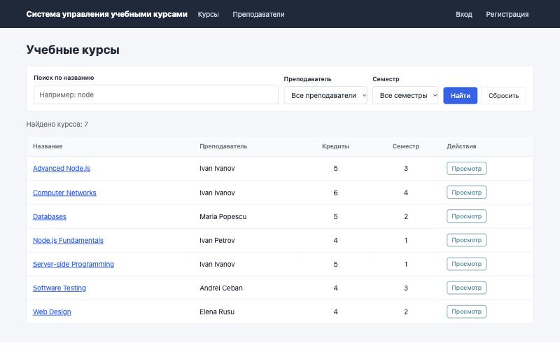

### Регистрация и вход

**Валидация регистрации**: короткое имя, неверный email, короткий пароль, пароли не совпадают. Поля паролей пустые.

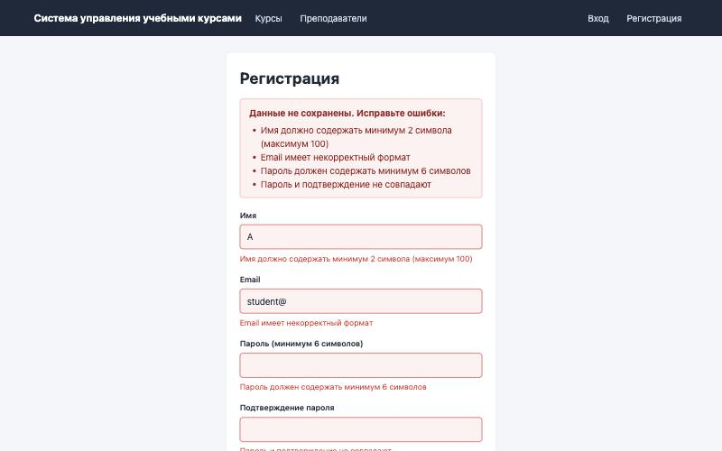

**Email уже зарегистрирован** (`USER@example.com` совпадает с `user@example.com`): 409

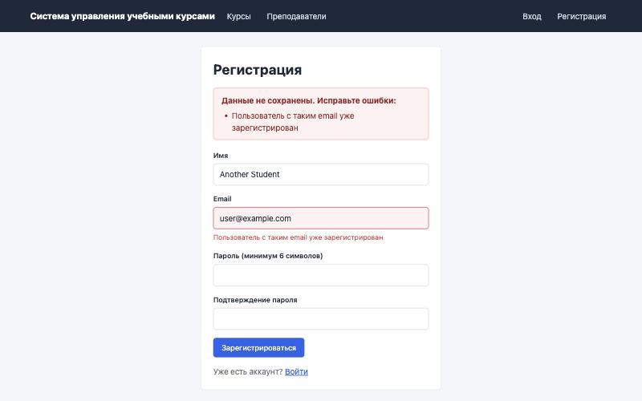

**Неверный пароль**: общее сообщение, 401

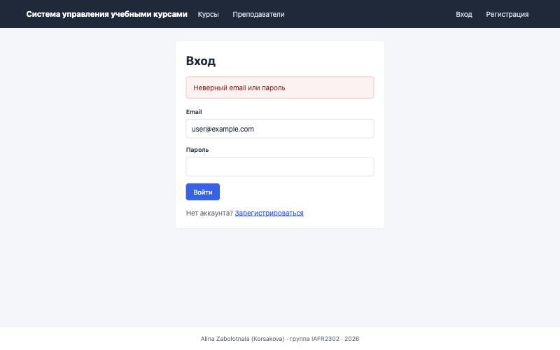

**Профиль пользователя user** после входа: дата регистрации, последний вход, данные в сессии без пароля

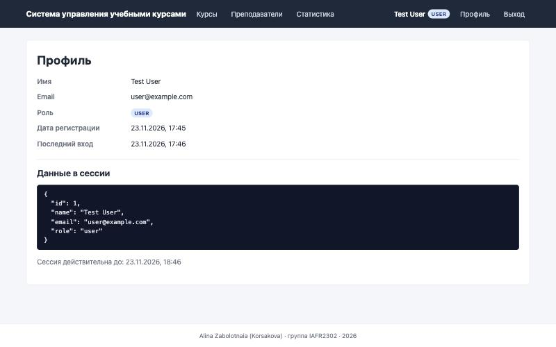

### Права user

**Список курсов для user**: появилась «Статистика», кнопок изменения нет

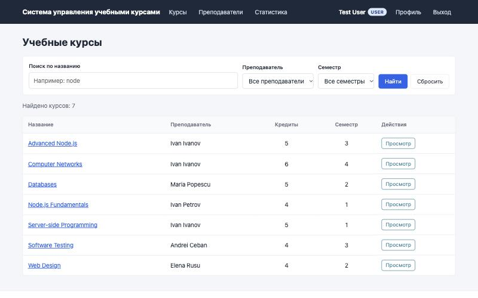

**User открывает `/courses/new`**: 403 Forbidden

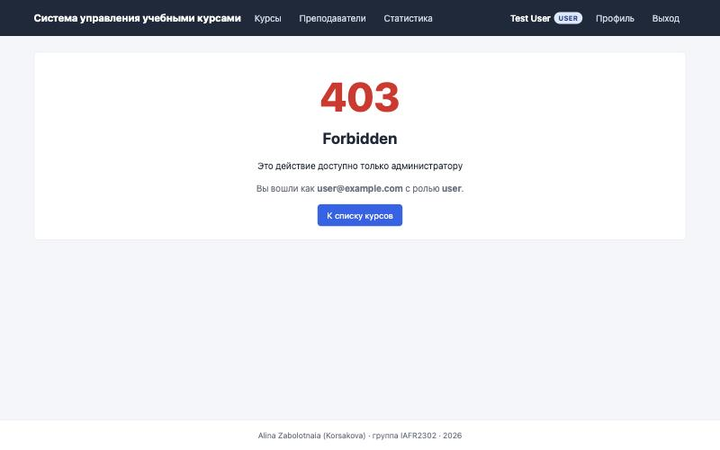

### Права admin

**Профиль администратора** (роль назначена через SQL, затем повторный вход)

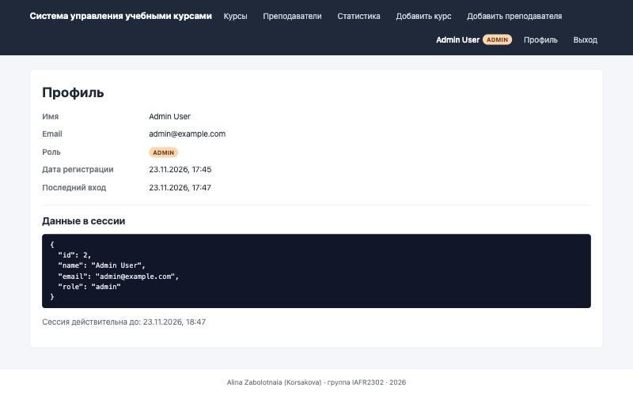

**Список курсов для admin**: кнопки «Добавить курс», «Редактировать», «Удалить» и пункты меню администратора

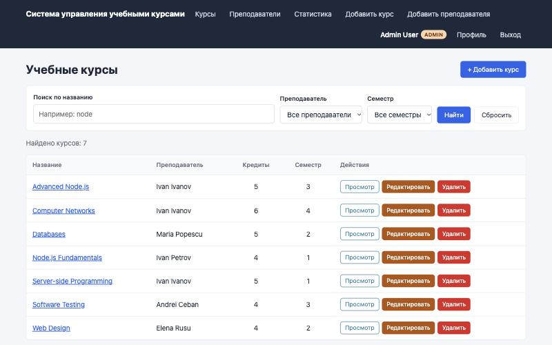

**Валидация курса**: подставленный несуществующий `teacherId=999`, кредиты -1, семестр 12, пустое описание

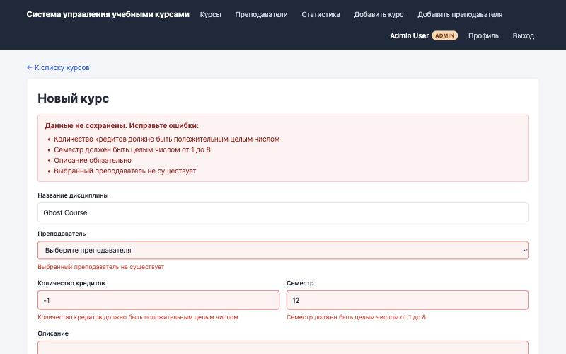

**WebSocket-уведомление.** Приложение открыто в двух вкладках. В первой администратор добавил курс «Mobile Development», во второй уведомление появилось без перезагрузки: в таблице по-прежнему 8 курсов, загруженных до добавления.

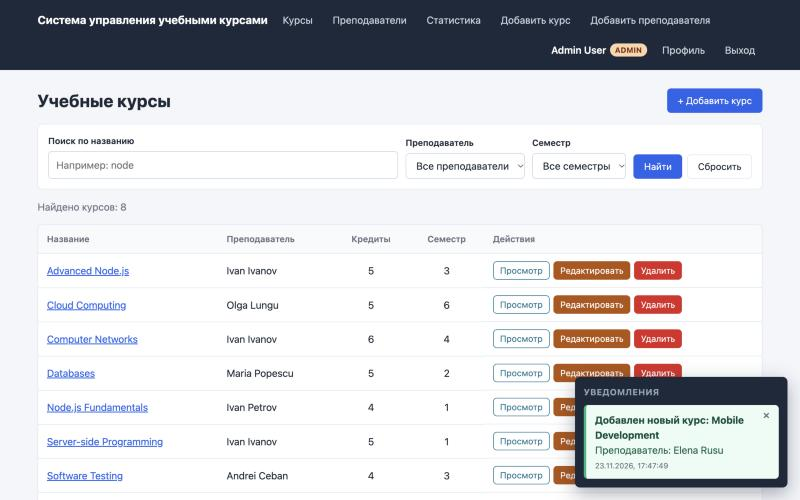

**Удаление преподавателя с курсами**: 409 с кнопкой «Назад» к преподавателю

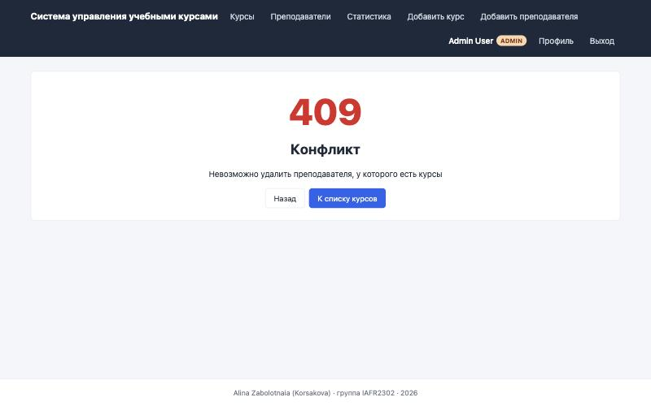

### Ошибки

**Курс не найден**: 404

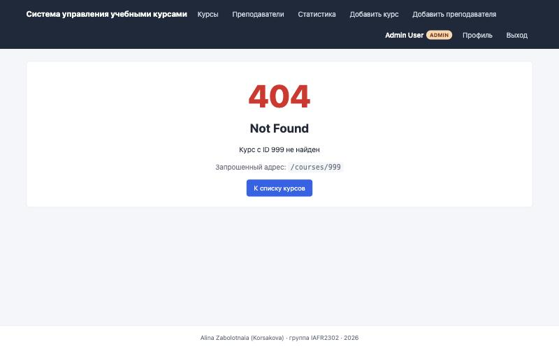

**Некорректный ID**: 400

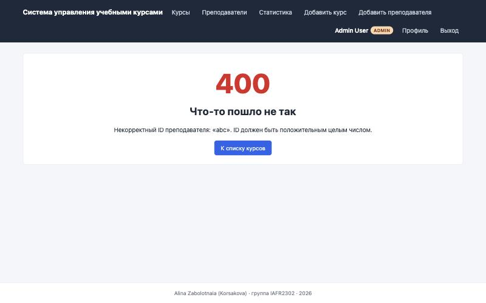

**База данных недоступна** (запуск с `DB_PORT=5999`): 503, без технических деталей

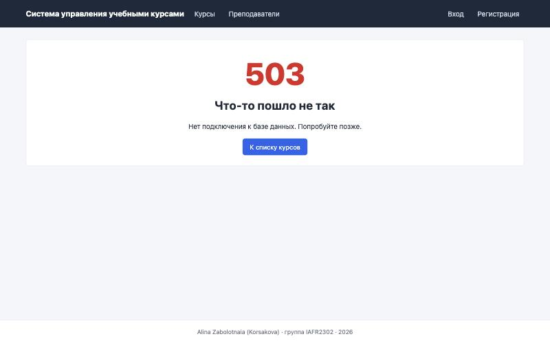

### Проверка защиты (пункт 27 задания)

Все сценарии проверены запросами `curl` с отдельными cookie-файлами для user и admin:

| Ситуация | Результат |
|---|---|
| Гость открывает `/profile` | 302 → `/login` |
| Гость отправляет `POST /courses` | 401 «Для этого действия необходимо выполнить вход» |
| User открывает `/courses/new` | 403 |
| User вручную отправляет `POST /courses` | 403, курс не создан |
| User отправляет `POST /courses/1/delete` | 403, курс не удалён |
| User отправляет `POST /teachers`, `POST /teachers/6/delete` | 403 |
| Неверный пароль | 401 «Неверный email или пароль» |
| Несуществующий email при входе | 401, то же сообщение |
| Регистрация с существующим email | 409 |
| Регистрация с полем `role=admin` | пользователь создан с ролью `user` |
| Несуществующий ID `/courses/999`, `/teachers/999/edit` | 404 |
| Некорректный ID `/courses/abc` | 400 |
| Admin добавляет курс с `teacherId=999` | 400 «Выбранный преподаватель не существует» |
| `GET /logout` | 404 (выход только через POST) |
| PostgreSQL недоступен | 503, сервер продолжает работать |

После каждого из этих запросов приложение продолжало работать.

### Терминал (morgan 'dev', предупреждения, журнал администратора)

Выдержка из терминала во время проверки в браузере: регистрация с занятым email, вход user, попытки действий без прав, выход, вход admin, добавление курсов, ошибки (запросы к CSS, JS и Socket.IO опущены):

```
POST /register 409 64.245 ms - 3375
GET /login 304 2.315 ms - -
POST /login 401 78.774 ms - 2466
POST /login 302 76.849 ms - 98
GET /profile 200 4.589 ms - 2658
GET /courses 200 9.327 ms - 8056
403 GET /courses/new: Это действие доступно только администратору
GET /courses/new 403 1.348 ms - 2272
GET /courses 304 10.819 ms - -
403 POST /courses/1/delete: Это действие доступно только администратору
POST /courses/1/delete 403 1.469 ms - 2272
403 POST /courses: Это действие доступно только администратору
POST /courses 403 1.561 ms - 2272
GET /statistics 200 5.061 ms - 6900
GET /teachers 200 7.116 ms - 5733
POST /logout 302 0.783 ms - 96
GET /login 200 1.788 ms - 2357
POST /login 302 626.211 ms - 98
GET /profile 200 3.998 ms - 2850
GET /courses 200 12.483 ms - 12001
GET /teachers 200 8.929 ms - 9305
GET /courses/new 200 7.486 ms - 4282
ADMIN ACTION | admin@example.com | CREATE COURSE | Course ID: 10 | 23.11.2026 17:47
POST /courses 302 6.587 ms - 98
GET /courses 200 3.657 ms - 13056
GET /courses 304 73.113 ms - -
GET /courses/new 304 2.854 ms - -
ADMIN ACTION | admin@example.com | CREATE COURSE | Course ID: 11 | 23.11.2026 17:47
POST /courses 302 5.427 ms - 98
GET /courses 200 2.702 ms - 14114
GET /courses/new 304 3.434 ms - -
POST /courses 400 3.220 ms - 5362
GET /teachers/1 200 6.369 ms - 4348
409 POST /teachers/1/delete: Невозможно удалить преподавателя, у которого есть курсы
POST /teachers/1/delete 409 3.208 ms - 2508
404 GET /courses/999: Курс с ID 999 не найден
GET /courses/999 404 2.536 ms - 2364
400 GET /teachers/abc: Некорректный ID преподавателя: «abc». ID должен быть положительным целым числом.
GET /teachers/abc 400 1.364 ms - 2480
```

При недоступной базе:

```
Unable to connect to the database "node_courses" at localhost:5999: ECONNREFUSED
Check that PostgreSQL is running and the settings in .env are correct.
Server is running at http://localhost:3001
Database connection error: ECONNREFUSED
GET /courses 503 20.124 ms - 1847
```

### Файл `logs/requests.log`

```
POST /login | 401 | 79 ms | 23.11.2026 17:46
POST /login | 302 | 77 ms | 23.11.2026 17:46
GET /profile | 200 | 5 ms | 23.11.2026 17:46
GET /courses | 200 | 9 ms | 23.11.2026 17:46
GET /courses/new | 403 | 1 ms | 23.11.2026 17:46
GET /courses | 304 | 11 ms | 23.11.2026 17:47
POST /courses/1/delete | 403 | 1 ms | 23.11.2026 17:47
POST /courses | 403 | 2 ms | 23.11.2026 17:47
GET /statistics | 200 | 5 ms | 23.11.2026 17:47
GET /teachers | 200 | 7 ms | 23.11.2026 17:47
POST /logout | 302 | 1 ms | 23.11.2026 17:47
GET /login | 200 | 2 ms | 23.11.2026 17:47
POST /login | 302 | 626 ms | 23.11.2026 17:47
GET /profile | 200 | 4 ms | 23.11.2026 17:47
GET /courses | 200 | 12 ms | 23.11.2026 17:47
GET /teachers | 200 | 9 ms | 23.11.2026 17:47
GET /courses/new | 200 | 7 ms | 23.11.2026 17:47
POST /courses | 302 | 7 ms | 23.11.2026 17:47
GET /courses | 200 | 4 ms | 23.11.2026 17:47
GET /courses | 304 | 73 ms | 23.11.2026 17:47
GET /courses/new | 304 | 3 ms | 23.11.2026 17:47
POST /courses | 302 | 5 ms | 23.11.2026 17:47
GET /courses | 200 | 3 ms | 23.11.2026 17:47
GET /courses/new | 304 | 3 ms | 23.11.2026 17:47
POST /courses | 400 | 3 ms | 23.11.2026 17:47
GET /teachers/1 | 200 | 6 ms | 23.11.2026 17:48
POST /teachers/1/delete | 409 | 3 ms | 23.11.2026 17:48
GET /courses/999 | 404 | 3 ms | 23.11.2026 17:48
GET /teachers/abc | 400 | 1 ms | 23.11.2026 17:48
GET /courses | 503 | 20 ms | 23.11.2026 17:48
```

## Код программы

### `app.js`

```javascript
// Лабораторная работа №5: аутентификация, авторизация и защита Express-приложения
// (продолжение лабораторной №4: система управления учебными курсами на PostgreSQL + Sequelize)
// Студент: Alina Zabolotnaia (Korsakova), группа IAFR2302

const path = require('path');
const http = require('http');
const express = require('express');
const session = require('express-session');
const { Server } = require('socket.io');

const { sequelize } = require('./models');          // также загружает .env через config/database.js
const { consoleLogger, fileLogger } = require('./middleware/logger');
const { setCurrentUser } = require('./middleware/auth');
const notFound = require('./middleware/notFound');
const { errorHandler, describeError } = require('./middleware/errorHandler');
const authRoutes = require('./routes/authRoutes');
const courseRoutes = require('./routes/courseRoutes');
const teacherRoutes = require('./routes/teacherRoutes');

const PORT = Number(process.env.PORT) || 3000;

// Без секрета сессии подписать cookie невозможно: останавливаем запуск с понятным сообщением
if (!process.env.SESSION_SECRET) {
    console.error('SESSION_SECRET is not set. Add it to the .env file (see .env.example).');
    process.exit(1);
}

const app = express();

app.set('view engine', 'ejs');
app.set('views', path.join(__dirname, 'views'));

// Логирование запросов: терминал (morgan 'dev') и файл logs/requests.log
app.use(consoleLogger);
app.use(fileLogger);

app.use(express.urlencoded({ extended: true }));
// Express 5 не создаёт req.body, если у запроса нет тела формы; дальше код рассчитывает на объект
app.use((req, res, next) => {
    req.body = req.body || {};
    next();
});

app.use(express.static(path.join(__dirname, 'public')));

app.use(session({
    secret: process.env.SESSION_SECRET,
    resave: false,                 // не сохранять сессию повторно, если она не менялась
    saveUninitialized: false,      // не создавать сессию (и cookie) для гостя, пока в неё ничего не записали
    cookie: {
        maxAge: 1000 * 60 * 60,    // 1 час
        httpOnly: true,            // cookie недоступна JavaScript на странице
        sameSite: 'lax'            // cookie не отправляется с POST-запросами с чужих сайтов (защита от CSRF)
    }
}));

// currentUser и isAdmin доступны во всех шаблонах
app.use(setCurrentUser);

app.use('/', authRoutes);
app.use('/', courseRoutes);
app.use('/', teacherRoutes);

app.use(notFound);        // после всех маршрутов
app.use(errorHandler);    // последним

// HTTP-сервер создаётся явно, чтобы к нему подключить Socket.IO
const server = http.createServer(app);
const io = new Server(server);
app.set('io', io);        // контроллеры получают io через req.app.get('io')

async function start() {
    try {
        await sequelize.authenticate();
        console.log('Database connection established');

        await sequelize.sync();   // создаёт отсутствующие таблицы (в том числе Users), данные не удаляет
        console.log('Database tables are synchronized');
    } catch (error) {
        console.error(`Unable to connect to the database "${process.env.DB_NAME}" `
            + `at ${process.env.DB_HOST}:${process.env.DB_PORT}: ${describeError(error)}`);
        console.error('Check that PostgreSQL is running and the settings in .env are correct.');
    }

    server.listen(PORT, () => {
        console.log(`Server is running at http://localhost:${PORT}`);
    });
}

start();
```

### `config/database.js`

```javascript
// Подключение Sequelize к PostgreSQL. Параметры берутся из файла .env

const path = require('path');
// quiet: true отключает служебное сообщение dotenv в терминале
require('dotenv').config({ path: path.join(__dirname, '..', '.env'), quiet: true });

const { Sequelize } = require('sequelize');

const sequelize = new Sequelize(
    process.env.DB_NAME,
    process.env.DB_USER,
    process.env.DB_PASSWORD,
    {
        host: process.env.DB_HOST,
        port: process.env.DB_PORT,
        dialect: 'postgres',
        logging: false
    }
);

module.exports = sequelize;
```

### `models/index.js`

```javascript
// Точка сборки моделей: создаёт модели и настраивает связи между ними

const sequelize = require('../config/database');
const Teacher = require('./Teacher')(sequelize);
const Course = require('./Course')(sequelize);
const User = require('./User')(sequelize);

// Teacher 1 → Many Courses
// onDelete: 'RESTRICT': база данных сама не даст удалить преподавателя, у которого есть курсы
Teacher.hasMany(Course, {
    foreignKey: 'teacherId',
    onDelete: 'RESTRICT'
});

Course.belongsTo(Teacher, {
    foreignKey: 'teacherId'
});

// Все преподаватели с количеством курсов, посчитанным в самой базе данных:
// SELECT "Teacher".*, COUNT("Courses".id) ... LEFT JOIN "Courses" ... GROUP BY "Teacher".id
Teacher.findAllWithCourseCount = function ({ order = [['name', 'ASC']] } = {}) {
    return Teacher.findAll({
        attributes: {
            include: [[sequelize.cast(sequelize.fn('COUNT', sequelize.col('Courses.id')), 'INTEGER'), 'coursesCount']]
        },
        include: [{ model: Course, attributes: [] }],
        group: ['Teacher.id'],
        order
    });
};

module.exports = { sequelize, Teacher, Course, User };
```

### `models/User.js`

```javascript
// Модель User → таблица "Users"
// В поле password хранится только bcrypt-hash. По умолчанию (defaultScope) hash вообще не загружается
// из базы; для проверки пароля при входе используется отдельный scope 'withPassword'.

const { DataTypes } = require('sequelize');

module.exports = (sequelize) => sequelize.define('User', {
    id: {
        type: DataTypes.INTEGER,
        primaryKey: true,
        autoIncrement: true
    },
    name: {
        type: DataTypes.STRING,
        allowNull: false,
        validate: {
            len: { args: [2, 100], msg: 'Имя должно содержать от 2 до 100 символов' }
        }
    },
    email: {
        type: DataTypes.STRING,
        allowNull: false,
        unique: { msg: 'Пользователь с таким email уже зарегистрирован' },
        validate: {
            isEmail: { msg: 'Email имеет некорректный формат' }
        }
    },
    password: {
        type: DataTypes.STRING,
        allowNull: false,
        validate: {
            notEmpty: { msg: 'Пароль обязателен' }
        }
    },
    role: {
        type: DataTypes.ENUM('user', 'admin'),
        allowNull: false,
        defaultValue: 'user'
    },
    lastLogin: {
        type: DataTypes.DATE,
        allowNull: true
    }
}, {
    defaultScope: {
        attributes: { exclude: ['password'] }
    },
    scopes: {
        withPassword: { attributes: { include: ['password'] } }
    }
});
```

### `models/Teacher.js`

```javascript
// Модель Teacher → таблица "Teachers"

const { DataTypes } = require('sequelize');

module.exports = (sequelize) => sequelize.define('Teacher', {
    id: {
        type: DataTypes.INTEGER,
        primaryKey: true,
        autoIncrement: true
    },
    name: {
        type: DataTypes.STRING,
        allowNull: false,
        validate: {
            notEmpty: { msg: 'Имя преподавателя обязательно' }
        }
    },
    email: {
        type: DataTypes.STRING,
        allowNull: false,
        unique: { msg: 'Этот email уже используется другим преподавателем' },
        validate: {
            notEmpty: { msg: 'Email обязателен' },
            isEmail: { msg: 'Email имеет некорректный формат' }
        }
    },
    department: {
        type: DataTypes.STRING,
        allowNull: false,
        validate: {
            notEmpty: { msg: 'Кафедра обязательна' }
        }
    },
    academicDegree: {
        type: DataTypes.STRING,
        allowNull: false,
        validate: {
            notEmpty: { msg: 'Учёная степень обязательна' }
        }
    }
});
```

### `models/Course.js`

```javascript
// Модель Course → таблица "Courses"

const { DataTypes } = require('sequelize');

module.exports = (sequelize) => sequelize.define('Course', {
    id: {
        type: DataTypes.INTEGER,
        primaryKey: true,
        autoIncrement: true
    },
    title: {
        type: DataTypes.STRING,
        allowNull: false,
        validate: {
            notEmpty: { msg: 'Название дисциплины обязательно' }
        }
    },
    credits: {
        type: DataTypes.INTEGER,
        allowNull: false,
        validate: {
            isInt: { msg: 'Количество кредитов должно быть целым числом' },
            min: { args: [1], msg: 'Количество кредитов должно быть положительным числом' }
        }
    },
    semester: {
        type: DataTypes.INTEGER,
        allowNull: false,
        validate: {
            isInt: { msg: 'Семестр должен быть целым числом' },
            min: { args: [1], msg: 'Семестр должен находиться в диапазоне от 1 до 8' },
            max: { args: [8], msg: 'Семестр должен находиться в диапазоне от 1 до 8' }
        }
    },
    description: {
        type: DataTypes.TEXT,
        allowNull: false,
        validate: {
            notEmpty: { msg: 'Описание обязательно' }
        }
    },
    // Внешний ключ на Teachers.id. Сама связь настраивается в models/index.js
    teacherId: {
        type: DataTypes.INTEGER,
        allowNull: false
    }
});
```

### `routes/authRoutes.js`

```javascript
// Маршруты аутентификации

const express = require('express');
const authController = require('../controllers/authController');
const { isAuthenticated, isGuest } = require('../middleware/auth');
const { registerRules, loginRules, validate, renderRegisterForm, renderLoginForm } = require('../middleware/validation');

const router = express.Router();

router.get('/register', isGuest, authController.showRegisterForm);
router.post('/register', isGuest, registerRules, validate(renderRegisterForm), authController.register);

router.get('/login', isGuest, authController.showLoginForm);
router.post('/login', isGuest, loginRules, validate(renderLoginForm), authController.login);

// Выход только методом POST: GET-ссылку мог бы открыть сторонний сайт или предзагрузка браузера
router.post('/logout', isAuthenticated, authController.logout);

router.get('/profile', isAuthenticated, authController.showProfile);

module.exports = router;
```

### `routes/courseRoutes.js`

```javascript
// Маршруты курсов и статистики.
// Порядок middleware важен: сначала проверка прав (isAdmin), затем загрузка записи, валидация и контроллер.
// Поэтому даже вручную отправленный POST-запрос без прав не дойдёт до базы данных.

const express = require('express');
const courseController = require('../controllers/courseController');
const { isAuthenticated, isAdmin } = require('../middleware/auth');
const { courseRules, validate, renderCourseForm } = require('../middleware/validation');

const router = express.Router();
const { loadCourse } = courseController;

router.get('/', courseController.redirectToCourses);
router.get('/statistics', isAuthenticated, courseController.showStatistics);

// Просмотр, поиск и фильтрация доступны всем, включая гостей
router.get('/courses', courseController.listCourses);

// /courses/new объявлен раньше /courses/:id, иначе "new" было бы принято за id
router.get('/courses/new', isAdmin, courseController.showCreateForm);
router.post('/courses', isAdmin, courseRules, validate(renderCourseForm), courseController.createCourse);

router.get('/courses/:id', loadCourse, courseController.showCourse);
router.get('/courses/:id/edit', isAdmin, loadCourse, courseController.showEditForm);
router.post('/courses/:id/edit', isAdmin, loadCourse, courseRules, validate(renderCourseForm), courseController.updateCourse);
router.post('/courses/:id/delete', isAdmin, loadCourse, courseController.deleteCourse);

module.exports = router;
```

### `routes/teacherRoutes.js`

```javascript
// Маршруты преподавателей. Просмотр доступен всем, изменения только администратору

const express = require('express');
const teacherController = require('../controllers/teacherController');
const { isAdmin } = require('../middleware/auth');
const { teacherRules, validate, renderTeacherForm } = require('../middleware/validation');

const router = express.Router();
const { loadTeacher } = teacherController;

router.get('/teachers', teacherController.listTeachers);
router.get('/teachers/new', isAdmin, teacherController.showCreateForm);
router.post('/teachers', isAdmin, teacherRules, validate(renderTeacherForm), teacherController.createTeacher);

router.get('/teachers/:id', loadTeacher, teacherController.showTeacher);
router.get('/teachers/:id/edit', isAdmin, loadTeacher, teacherController.showEditForm);
router.post('/teachers/:id/edit', isAdmin, loadTeacher, teacherRules, validate(renderTeacherForm), teacherController.updateTeacher);
router.post('/teachers/:id/delete', isAdmin, loadTeacher, teacherController.deleteTeacher);

module.exports = router;
```

### `controllers/authController.js`

```javascript
// Регистрация, вход, выход и профиль

const bcrypt = require('bcrypt');
const { UniqueConstraintError } = require('sequelize');
const { User } = require('../models');
const { renderRegisterForm, renderLoginForm } = require('../middleware/validation');

const BCRYPT_ROUNDS = Number(process.env.BCRYPT_ROUNDS) || 10;
const SESSION_COOKIE = 'connect.sid';   // имя cookie express-session по умолчанию
const INVALID_CREDENTIALS = 'Неверный email или пароль';
const EMAIL_TAKEN = 'Пользователь с таким email уже зарегистрирован';

// Hash для сравнения, когда пользователь не найден: bcrypt.compare выполняется в любом случае,
// поэтому по времени ответа нельзя понять, зарегистрирован ли email
const DUMMY_HASH = bcrypt.hashSync('dummy-password-for-timing', BCRYPT_ROUNDS);

// Методы сессии работают через callback; оборачиваем их в Promise для async/await
const regenerateSession = (req) => new Promise((resolve, reject) =>
    req.session.regenerate((error) => (error ? reject(error) : resolve())));
const saveSession = (req) => new Promise((resolve, reject) =>
    req.session.save((error) => (error ? reject(error) : resolve())));
const destroySession = (req) => new Promise((resolve, reject) =>
    req.session.destroy((error) => (error ? reject(error) : resolve())));

// GET /register
function showRegisterForm(req, res) {
    res.render('auth/register', { title: 'Регистрация', form: { name: '', email: '' }, errors: {} });
}

// POST /register (данные уже проверены registerRules)
async function register(req, res, next) {
    try {
        const { name, email, password } = req.body;

        if (await User.findOne({ where: { email } })) {
            res.status(409);
            return renderRegisterForm(req, res, { email: EMAIL_TAKEN });
        }

        const hashedPassword = await bcrypt.hash(password, BCRYPT_ROUNDS);

        // Явно перечисляем поля: даже если в запрос добавить role=admin, роль не сохранится
        await User.create(
            { name, email, password: hashedPassword },
            { fields: ['name', 'email', 'password'] }
        );

        res.redirect('/login?registered=1');
    } catch (error) {
        // Два одинаковых запроса одновременно: проверку выше прошли оба, сработало ограничение UNIQUE в базе
        if (error instanceof UniqueConstraintError) {
            res.status(409);
            return renderRegisterForm(req, res, { email: EMAIL_TAKEN });
        }
        next(error);
    }
}

// GET /login
function showLoginForm(req, res) {
    res.render('auth/login', {
        title: 'Вход',
        form: { email: '' },
        errors: {},
        error: null,
        notice: req.query.registered === '1' ? 'Регистрация прошла успешно. Теперь войдите в систему.' : null
    });
}

// POST /login
async function login(req, res, next) {
    try {
        const { email, password } = req.body;

        // scope 'withPassword': hash загружается только здесь, для проверки пароля
        const user = await User.scope('withPassword').findOne({ where: { email } });
        const passwordMatches = await bcrypt.compare(password, user ? user.password : DUMMY_HASH);

        if (!user || !passwordMatches) {
            res.status(401);
            return renderLoginForm(req, res, {}, INVALID_CREDENTIALS);
        }

        user.lastLogin = new Date();
        await user.save({ fields: ['lastLogin'] });

        // Новый ID сессии после входа защищает от фиксации сессии (session fixation)
        await regenerateSession(req);
        req.session.user = {
            id: user.id,
            name: user.name,
            email: user.email,
            role: user.role
        };
        await saveSession(req);

        res.redirect('/profile');
    } catch (error) {
        next(error);
    }
}

// POST /logout
async function logout(req, res, next) {
    try {
        await destroySession(req);
        res.clearCookie(SESSION_COOKIE);
        res.redirect('/login');
    } catch (error) {
        next(error);
    }
}

// GET /profile
async function showProfile(req, res, next) {
    try {
        // defaultScope модели не загружает поле password
        const user = await User.findByPk(req.session.user.id);
        if (!user) {
            // Пользователя удалили из базы, пока сессия была активна
            await destroySession(req);
            res.clearCookie(SESSION_COOKIE);
            return res.redirect('/login');
        }

        res.render('profile', {
            title: 'Профиль',
            user,
            sessionData: req.session.user,
            sessionExpires: req.session.cookie.expires
        });
    } catch (error) {
        next(error);
    }
}

module.exports = { showRegisterForm, register, showLoginForm, login, logout, showProfile };
```

### `controllers/courseController.js`

```javascript
// Контроллер курсов и страницы статистики.
// Все ошибки передаются через next(error) в централизованный errorHandler

const { Op } = require('sequelize');
const { sequelize, Teacher, Course } = require('../models');
const { HttpError } = require('../middleware/errorHandler');
const { logAdminAction } = require('../middleware/logger');

const SEMESTERS = [1, 2, 3, 4, 5, 6, 7, 8];
const MAX_INT = 2147483647;

const getTeachersForSelect = () => Teacher.findAll({ order: [['name', 'ASC']] });

// Строка → положительное целое число или null
function parseId(value) {
    if (!/^\d+$/.test(String(value ?? ''))) {
        return null;
    }
    const number = Number(value);
    return number > 0 && number <= MAX_INT ? number : null;
}

// Экранирование % и _ , чтобы они искались как обычные символы, а не как шаблоны LIKE
const escapeLike = (value) => value.replace(/[\\%_]/g, '\\$&');

// Только поля курса из формы, ничего лишнего (значения уже проверены и приведены к числам courseRules)
const pickCourseData = ({ title, credits, semester, description, teacherId }) =>
    ({ title, credits, semester, description, teacherId });

// Middleware для маршрутов /courses/:id: загружает курс вместе с преподавателем в req.course
async function loadCourse(req, res, next) {
    try {
        const id = parseId(req.params.id);
        if (id === null) {
            return next(new HttpError(400, `Некорректный ID курса: «${req.params.id}». ID должен быть положительным целым числом.`));
        }
        const course = await Course.findByPk(id, { include: Teacher });
        if (!course) {
            return next(new HttpError(404, `Курс с ID ${id} не найден`));
        }
        req.course = course;
        next();
    } catch (error) {
        next(error);
    }
}

// GET /
function redirectToCourses(req, res) {
    res.redirect('/courses');
}

// GET /courses?search=node&teacherId=2&semester=1 (фильтрацию выполняет PostgreSQL)
async function listCourses(req, res, next) {
    try {
        const search = typeof req.query.search === 'string' ? req.query.search.trim() : '';
        const teacherId = parseId(req.query.teacherId);
        const semesterNumber = parseId(req.query.semester);
        const semester = SEMESTERS.includes(semesterNumber) ? semesterNumber : null;

        const where = {};
        if (search !== '') {
            where.title = { [Op.iLike]: `%${escapeLike(search)}%` };
        }
        if (teacherId !== null) {
            where.teacherId = teacherId;
        }
        if (semester !== null) {
            where.semester = semester;
        }

        const [courses, teachers] = await Promise.all([
            Course.findAll({ where, include: Teacher, order: [['title', 'ASC']] }),
            getTeachersForSelect()
        ]);

        res.render('courses/index', {
            title: 'Курсы',
            courses,
            teachers,
            semesters: SEMESTERS,
            filters: { search, teacherId, semester }
        });
    } catch (error) {
        next(error);
    }
}

// GET /courses/new (admin)
async function showCreateForm(req, res, next) {
    try {
        res.render('courses/create', {
            title: 'Новый курс',
            course: { title: '', credits: '', semester: '', description: '', teacherId: '' },
            teachers: await getTeachersForSelect(),
            errors: {}
        });
    } catch (error) {
        next(error);
    }
}

// POST /courses (admin): сохраняет курс и рассылает WebSocket-уведомление всем открытым клиентам
async function createCourse(req, res, next) {
    try {
        const course = await Course.create(pickCourseData(req.body));
        const teacher = await Teacher.findByPk(course.teacherId);

        logAdminAction(req, 'CREATE', 'Course', course.id);

        req.app.get('io').emit('courseCreated', {
            id: course.id,
            title: course.title,
            teacherName: teacher ? teacher.name : '',
            createdAt: course.createdAt.toISOString()
        });

        res.redirect('/courses');
    } catch (error) {
        next(error);
    }
}

// GET /courses/:id
function showCourse(req, res) {
    res.render('courses/details', { title: req.course.title, course: req.course });
}

// GET /courses/:id/edit (admin)
async function showEditForm(req, res, next) {
    try {
        res.render('courses/edit', {
            title: 'Редактирование курса',
            course: req.course,
            teachers: await getTeachersForSelect(),
            errors: {}
        });
    } catch (error) {
        next(error);
    }
}

// POST /courses/:id/edit (admin)
async function updateCourse(req, res, next) {
    try {
        await req.course.update(pickCourseData(req.body));
        logAdminAction(req, 'UPDATE', 'Course', req.course.id);
        res.redirect(`/courses/${req.course.id}`);
    } catch (error) {
        next(error);
    }
}

// POST /courses/:id/delete (admin)
async function deleteCourse(req, res, next) {
    try {
        const { id } = req.course;
        await req.course.destroy();
        logAdminAction(req, 'DELETE', 'Course', id);
        res.redirect('/courses');
    } catch (error) {
        next(error);
    }
}

// GET /statistics (для авторизованных): все показатели считает PostgreSQL
async function showStatistics(req, res, next) {
    try {
        const [teachersCount, coursesCount, semesterRows, teachers] = await Promise.all([
            Teacher.count(),
            Course.count(),
            Course.findAll({
                attributes: ['semester', [sequelize.cast(sequelize.fn('COUNT', sequelize.col('id')), 'INTEGER'), 'count']],
                group: ['semester'],
                raw: true
            }),
            Teacher.findAllWithCourseCount({
                order: [[sequelize.literal('"coursesCount"'), 'DESC'], ['name', 'ASC']]
            })
        ]);

        const countBySemester = Object.fromEntries(semesterRows.map((row) => [row.semester, row.count]));
        const semesters = SEMESTERS.map((number) => ({ number, count: countBySemester[number] || 0 }));

        const maxCourses = teachers.length ? teachers[0].get('coursesCount') : 0;
        const topTeachers = maxCourses > 0 ? teachers.filter((t) => t.get('coursesCount') === maxCourses) : [];

        res.render('statistics', {
            title: 'Статистика',
            teachersCount,
            coursesCount,
            semesters,
            teachers,
            topTeachers,
            maxCourses
        });
    } catch (error) {
        next(error);
    }
}

module.exports = {
    parseId,
    loadCourse,
    redirectToCourses,
    listCourses,
    showCreateForm,
    createCourse,
    showCourse,
    showEditForm,
    updateCourse,
    deleteCourse,
    showStatistics
};
```

### `controllers/teacherController.js`

```javascript
// Контроллер преподавателей. Ошибки передаются в централизованный errorHandler через next(error)

const { UniqueConstraintError, ForeignKeyConstraintError } = require('sequelize');
const { Teacher } = require('../models');
const { HttpError } = require('../middleware/errorHandler');
const { logAdminAction } = require('../middleware/logger');
const { renderTeacherForm } = require('../middleware/validation');
const { parseId } = require('./courseController');

const HAS_COURSES_MESSAGE = 'Невозможно удалить преподавателя, у которого есть курсы';
const EMAIL_TAKEN = 'Этот email уже используется другим преподавателем';

const pickTeacherData = ({ name, email, department, academicDegree }) =>
    ({ name, email, department, academicDegree });

// Email должен быть уникальным; при редактировании свой email оставить можно
async function isEmailTaken(email, exceptId = null) {
    const owner = await Teacher.findOne({ where: { email } });
    return Boolean(owner) && owner.id !== exceptId;
}

// Повторный показ формы с ошибкой email и статусом 409 Conflict
function renderEmailConflict(req, res) {
    res.status(409);
    return renderTeacherForm(req, res, { email: EMAIL_TAKEN });
}

// Middleware для маршрутов /teachers/:id: загружает преподавателя в req.teacher
async function loadTeacher(req, res, next) {
    try {
        const id = parseId(req.params.id);
        if (id === null) {
            return next(new HttpError(400, `Некорректный ID преподавателя: «${req.params.id}». ID должен быть положительным целым числом.`));
        }
        const teacher = await Teacher.findByPk(id);
        if (!teacher) {
            return next(new HttpError(404, `Преподаватель с ID ${id} не найден`));
        }
        req.teacher = teacher;
        next();
    } catch (error) {
        next(error);
    }
}

// GET /teachers
async function listTeachers(req, res, next) {
    try {
        const teachers = await Teacher.findAllWithCourseCount();
        res.render('teachers/index', { title: 'Преподаватели', teachers });
    } catch (error) {
        next(error);
    }
}

// GET /teachers/new (admin)
function showCreateForm(req, res) {
    res.render('teachers/create', {
        title: 'Новый преподаватель',
        teacher: { name: '', email: '', department: '', academicDegree: '' },
        errors: {}
    });
}

// POST /teachers (admin)
async function createTeacher(req, res, next) {
    try {
        if (await isEmailTaken(req.body.email)) {
            return renderEmailConflict(req, res);
        }
        const teacher = await Teacher.create(pickTeacherData(req.body));
        logAdminAction(req, 'CREATE', 'Teacher', teacher.id);
        res.redirect('/teachers');
    } catch (error) {
        if (error instanceof UniqueConstraintError) {
            return renderEmailConflict(req, res);
        }
        next(error);
    }
}

// GET /teachers/:id: курсы получаем через связь Sequelize
async function showTeacher(req, res, next) {
    try {
        const courses = await req.teacher.getCourses({ order: [['semester', 'ASC'], ['title', 'ASC']] });
        res.render('teachers/details', { title: req.teacher.name, teacher: req.teacher, courses });
    } catch (error) {
        next(error);
    }
}

// GET /teachers/:id/edit (admin)
function showEditForm(req, res) {
    res.render('teachers/edit', { title: 'Редактирование преподавателя', teacher: req.teacher, errors: {} });
}

// POST /teachers/:id/edit (admin)
async function updateTeacher(req, res, next) {
    try {
        if (await isEmailTaken(req.body.email, req.teacher.id)) {
            return renderEmailConflict(req, res);
        }
        await req.teacher.update(pickTeacherData(req.body));
        logAdminAction(req, 'UPDATE', 'Teacher', req.teacher.id);
        res.redirect(`/teachers/${req.teacher.id}`);
    } catch (error) {
        if (error instanceof UniqueConstraintError) {
            return renderEmailConflict(req, res);
        }
        next(error);
    }
}

// POST /teachers/:id/delete (admin): преподавателя с курсами удалять нельзя
async function deleteTeacher(req, res, next) {
    const conflict = () => new HttpError(409, HAS_COURSES_MESSAGE, { backLink: `/teachers/${req.teacher.id}` });
    try {
        if (await req.teacher.countCourses() > 0) {
            return next(conflict());
        }
        const { id } = req.teacher;
        await req.teacher.destroy();
        logAdminAction(req, 'DELETE', 'Teacher', id);
        res.redirect('/teachers');
    } catch (error) {
        // Запасная защита: ограничение ON DELETE RESTRICT в базе данных
        next(error instanceof ForeignKeyConstraintError ? conflict() : error);
    }
}

module.exports = {
    loadTeacher,
    listTeachers,
    showCreateForm,
    createTeacher,
    showTeacher,
    showEditForm,
    updateTeacher,
    deleteTeacher
};
```

### `middleware/auth.js`

```javascript
// Аутентификация (кто вы?) и авторизация (что вам можно?)

const { HttpError } = require('./errorHandler');

// Делает данные текущего пользователя доступными во всех EJS-шаблонах как currentUser
function setCurrentUser(req, res, next) {
    res.locals.currentUser = req.session.user || null;
    res.locals.isAdmin = Boolean(req.session.user && req.session.user.role === 'admin');
    next();
}

// Пропускает только пользователя, который выполнил вход.
// GET-запрос гостя перенаправляется на /login; для POST и других методов перенаправление
// потеряло бы отправленные данные, поэтому отвечаем 401 Unauthorized.
function isAuthenticated(req, res, next) {
    if (req.session.user) {
        return next();
    }
    if (req.method === 'GET') {
        return res.redirect('/login');
    }
    next(new HttpError(401, 'Для этого действия необходимо выполнить вход'));
}

// Пропускает только администратора. Сначала проверяет вход, затем роль
function isAdmin(req, res, next) {
    isAuthenticated(req, res, (error) => {
        if (error) {
            return next(error);
        }
        if (req.session.user.role !== 'admin') {
            return next(new HttpError(403, 'Это действие доступно только администратору'));
        }
        next();
    });
}

// Страницы входа и регистрации не нужны пользователю, который уже вошёл
function isGuest(req, res, next) {
    if (req.session.user) {
        return res.redirect('/profile');
    }
    next();
}

module.exports = { setCurrentUser, isAuthenticated, isAdmin, isGuest };
```

### `middleware/validation.js`

```javascript
// Проверка входных данных через express-validator.
// Правила (rules) описывают каждое поле, validate(renderForm) собирает ошибки и при их наличии
// показывает ту же форму со статусом 400. Некорректные данные до контроллера не доходят.

const { body, validationResult } = require('express-validator');
const { Teacher } = require('../models');

const MAX_INT = 2147483647;            // максимум для INTEGER в PostgreSQL
const SEMESTER_RANGE = { min: 1, max: 8 };

// ---------- Правила ----------

const registerRules = [
    body('name').trim()
        .notEmpty().withMessage('Имя обязательно').bail()
        .isLength({ min: 2, max: 100 }).withMessage('Имя должно содержать минимум 2 символа (максимум 100)'),
    body('email').trim()
        .notEmpty().withMessage('Email обязателен').bail()
        .isEmail().withMessage('Email имеет некорректный формат').bail()
        .toLowerCase(),
    // Пароль не обрезаем: пробелы могут быть частью пароля.
    // bcrypt учитывает только первые 72 байта, поэтому длиннее не принимаем
    body('password')
        .notEmpty().withMessage('Пароль обязателен').bail()
        .isLength({ min: 6 }).withMessage('Пароль должен содержать минимум 6 символов').bail()
        .isLength({ max: 72 }).withMessage('Пароль должен содержать не более 72 символов'),
    body('passwordConfirm')
        .notEmpty().withMessage('Подтвердите пароль').bail()
        .custom((value, { req }) => value === req.body.password).withMessage('Пароль и подтверждение не совпадают')
];

const loginRules = [
    body('email').trim()
        .notEmpty().withMessage('Email обязателен').bail()
        .isEmail().withMessage('Email имеет некорректный формат').bail()
        .toLowerCase(),
    body('password')
        .notEmpty().withMessage('Пароль обязателен')
];

const teacherRules = [
    body('name').trim()
        .notEmpty().withMessage('Имя преподавателя обязательно').bail()
        .isLength({ max: 255 }).withMessage('Имя не должно превышать 255 символов'),
    body('email').trim()
        .notEmpty().withMessage('Email обязателен').bail()
        .isEmail().withMessage('Email имеет некорректный формат').bail()
        .toLowerCase(),
    body('department').trim()
        .notEmpty().withMessage('Кафедра обязательна').bail()
        .isLength({ max: 255 }).withMessage('Название кафедры не должно превышать 255 символов'),
    body('academicDegree').trim()
        .notEmpty().withMessage('Учёная степень обязательна').bail()
        .isLength({ max: 255 }).withMessage('Учёная степень не должна превышать 255 символов')
];

const courseRules = [
    body('title').trim()
        .notEmpty().withMessage('Название дисциплины обязательно').bail()
        .isLength({ max: 255 }).withMessage('Название не должно превышать 255 символов'),
    body('credits').trim()
        .isInt({ min: 1, max: MAX_INT }).withMessage('Количество кредитов должно быть положительным целым числом').bail()
        .toInt(),
    body('semester').trim()
        .isInt(SEMESTER_RANGE).withMessage('Семестр должен быть целым числом от 1 до 8').bail()
        .toInt(),
    body('description').trim()
        .notEmpty().withMessage('Описание обязательно'),
    body('teacherId').trim()
        .notEmpty().withMessage('Выберите преподавателя').bail()
        .isInt({ min: 1, max: MAX_INT }).withMessage('Выбранный преподаватель не существует').bail()
        .toInt()
        // Значение приходит из <select>, но запрос можно подделать, поэтому проверяем по базе.
        // Ошибку самой базы (например, нет соединения) не превращаем в сообщение у поля,
        // а сохраняем и передаём в errorHandler.
        .custom(async (teacherId, { req }) => {
            let teacher;
            try {
                teacher = await Teacher.findByPk(teacherId);
            } catch (error) {
                req.databaseError = error;
                return true;
            }
            if (!teacher) {
                throw new Error('Выбранный преподаватель не существует');
            }
            return true;
        })
];

// ---------- Обработка результата ----------

// Ошибки → { поле: первое сообщение }
function collectErrors(req) {
    return Object.fromEntries(
        Object.entries(validationResult(req).mapped()).map(([field, error]) => [field, error.msg])
    );
}

// renderForm(req, res, errors) показывает нужную форму; вызывается только если есть ошибки
function validate(renderForm) {
    return async (req, res, next) => {
        try {
            if (req.databaseError) {
                return next(req.databaseError);
            }
            const errors = collectErrors(req);
            if (Object.keys(errors).length === 0) {
                return next();
            }
            res.status(400);
            await renderForm(req, res, errors);
        } catch (error) {
            next(error);
        }
    };
}

// ---------- Формы для повторного показа ----------
// Пароли обратно в форму не передаются никогда

const renderRegisterForm = (req, res, errors) => res.render('auth/register', {
    title: 'Регистрация',
    form: { name: req.body.name || '', email: req.body.email || '' },
    errors
});

const renderLoginForm = (req, res, errors, error = null) => res.render('auth/login', {
    title: 'Вход',
    form: { email: req.body.email || '' },
    errors,
    error,
    notice: null
});

const teacherFormData = (req) => ({
    id: req.teacher ? req.teacher.id : undefined,
    name: req.body.name || '',
    email: req.body.email || '',
    department: req.body.department || '',
    academicDegree: req.body.academicDegree || ''
});

const renderTeacherForm = (req, res, errors) => res.render(req.teacher ? 'teachers/edit' : 'teachers/create', {
    title: req.teacher ? 'Редактирование преподавателя' : 'Новый преподаватель',
    teacher: teacherFormData(req),
    errors
});

async function renderCourseForm(req, res, errors) {
    const teachers = await Teacher.findAll({ order: [['name', 'ASC']] });
    res.render(req.course ? 'courses/edit' : 'courses/create', {
        title: req.course ? 'Редактирование курса' : 'Новый курс',
        course: {
            id: req.course ? req.course.id : undefined,
            title: req.body.title ?? '',
            credits: req.body.credits ?? '',
            semester: req.body.semester ?? '',
            description: req.body.description ?? '',
            teacherId: req.body.teacherId ?? ''
        },
        teachers,
        errors
    });
}

module.exports = {
    registerRules,
    loginRules,
    teacherRules,
    courseRules,
    validate,
    renderRegisterForm,
    renderLoginForm,
    renderTeacherForm,
    renderCourseForm
};
```

### `middleware/logger.js`

```javascript
// Логирование: HTTP-запросы через morgan (терминал + файл logs/requests.log) и журнал действий администратора

const fs = require('fs');
const path = require('path');
const morgan = require('morgan');

const LOG_DIR = path.join(__dirname, '..', 'logs');
const REQUEST_LOG = path.join(LOG_DIR, 'requests.log');

function formatDateTime(date) {
    const pad = (n) => String(n).padStart(2, '0');
    return `${pad(date.getDate())}.${pad(date.getMonth() + 1)}.${date.getFullYear()} `
         + `${pad(date.getHours())}:${pad(date.getMinutes())}`;
}

// Собственный токен morgan: дата и время запроса в формате DD.MM.YYYY HH:MM
morgan.token('date-local', () => formatDateTime(new Date()));

// Запись в файл: POST /login | 200 | 15 ms | 18.11.2026 14:35
const FILE_FORMAT = ':method :url | :status | :response-time[0] ms | :date-local';

fs.mkdirSync(LOG_DIR, { recursive: true });
const fileStream = fs.createWriteStream(REQUEST_LOG, { flags: 'a' });   // 'a': дописывать в конец

// Терминал: стандартный формат 'dev' (цветной статус)
const consoleLogger = morgan('dev');
// Файл
const fileLogger = morgan(FILE_FORMAT, { stream: fileStream });

// ADMIN ACTION | admin@example.com | DELETE COURSE | Course ID: 5 | 18.11.2026 14:35
function logAdminAction(req, action, entity, id) {
    const email = req.session.user ? req.session.user.email : 'unknown';
    console.log(`ADMIN ACTION | ${email} | ${action} ${entity.toUpperCase()} | ${entity} ID: ${id} | ${formatDateTime(new Date())}`);
}

module.exports = { consoleLogger, fileLogger, logAdminAction, formatDateTime };
```

### `middleware/notFound.js`

```javascript
// Подключается после всех маршрутов: если ни один не подошёл, передаём 404 в errorHandler

const { HttpError } = require('./errorHandler');

function notFound(req, res, next) {
    next(new HttpError(404, 'Страница не найдена'));
}

module.exports = notFound;
```

### `middleware/errorHandler.js`

```javascript
// Централизованная обработка ошибок. Подключается в app.js последним.
// Пользователь видит только код и понятное сообщение: без stack trace, SQL, параметров подключения и .env.
// Подробности пишутся в терминал.

const {
    BaseError,
    ConnectionError,
    ValidationError,
    UniqueConstraintError,
    ForeignKeyConstraintError
} = require('sequelize');

// Ошибка с HTTP-статусом и сообщением, которое безопасно показать пользователю
class HttpError extends Error {
    constructor(status, message, { backLink = null } = {}) {
        super(message);
        this.name = 'HttpError';
        this.status = status;
        this.backLink = backLink;
    }
}

const DEFAULT_MESSAGES = {
    400: 'Некорректные данные запроса.',
    401: 'Для этого действия необходимо выполнить вход.',
    403: 'Недостаточно прав для этого действия.',
    404: 'Страница не найдена.',
    409: 'Конфликт данных.',
    500: 'На сервере произошла внутренняя ошибка. Попробуйте позже.',
    503: 'Нет подключения к базе данных. Попробуйте позже.'
};

// Короткое описание ошибки для терминала (у ECONNREFUSED поле message пустое)
function describeError(error) {
    return error.message || error.parent?.code || error.original?.code || error.name;
}

// Ошибка любого типа → { status, message } для пользователя
function toHttpError(err) {
    if (err instanceof HttpError) {
        return { status: err.status, message: err.message };
    }
    if (err instanceof ConnectionError) {
        return { status: 503, message: DEFAULT_MESSAGES[503] };
    }
    // UniqueConstraintError наследуется от ValidationError, поэтому проверяется раньше
    if (err instanceof UniqueConstraintError) {
        return { status: 409, message: 'Запись с такими данными уже существует.' };
    }
    if (err instanceof ForeignKeyConstraintError) {
        return { status: 409, message: 'Операция нарушает связь между преподавателем и курсами.' };
    }
    if (err instanceof ValidationError) {
        return { status: 400, message: DEFAULT_MESSAGES[400] };
    }
    if (err.status >= 400 && err.status < 500) {   // например, некорректно закодированный URL
        return { status: err.status, message: DEFAULT_MESSAGES[err.status] || DEFAULT_MESSAGES[400] };
    }
    if (err instanceof BaseError) {
        return { status: 500, message: 'Ошибка при работе с базой данных. Попробуйте позже.' };
    }
    return { status: 500, message: DEFAULT_MESSAGES[500] };
}

function errorHandler(err, req, res, next) {
    if (res.headersSent) {
        return next(err);
    }

    const { status, message } = toHttpError(err);

    // Терминал: для 5xx полная ошибка, для ожидаемых 4xx одна строка
    if (err instanceof ConnectionError) {
        console.error(`Database connection error: ${describeError(err)}`);
    } else if (status >= 500) {
        console.error(err);
    } else {
        console.warn(`${status} ${req.method} ${req.originalUrl}: ${err.message}`);
    }

    res.status(status);

    if (status === 404) {
        return res.render('404', { title: '404 Not Found', message, url: req.originalUrl });
    }
    if (status === 403) {
        return res.render('403', { title: '403 Forbidden', message });
    }
    res.render('error', { title: 'Ошибка', status, message, backLink: err.backLink || null });
}

module.exports = { HttpError, describeError, errorHandler };
```

### `public/js/notifications.js`

```javascript
// Клиент WebSocket-уведомлений: слушает событие courseCreated и показывает сообщение без перезагрузки страницы

(function () {
    if (typeof io === 'undefined') {
        return;   // скрипт Socket.IO не загрузился: страница работает и без уведомлений
    }

    const HIDE_AFTER_MS = 10000;
    const panel = document.getElementById('notifications');
    const list = panel.querySelector('.notifications-list');
    const socket = io();

    function updatePanelVisibility() {
        panel.hidden = list.children.length === 0;
    }

    function removeNotification(item) {
        item.remove();
        updatePanelVisibility();
    }

    // Элементы создаются через textContent, а не innerHTML: название курса не может внедрить HTML/JS
    function addText(parent, tag, className, text) {
        const element = document.createElement(tag);
        element.className = className;
        element.textContent = text;
        parent.appendChild(element);
        return element;
    }

    socket.on('courseCreated', (data) => {
        const item = document.createElement('div');
        item.className = 'notification';

        const closeButton = addText(item, 'button', 'notification-close', '×');
        closeButton.type = 'button';
        closeButton.setAttribute('aria-label', 'Закрыть уведомление');
        closeButton.addEventListener('click', () => removeNotification(item));

        addText(item, 'p', 'notification-heading', `Добавлен новый курс: ${data.title}`);
        addText(item, 'p', 'notification-text', `Преподаватель: ${data.teacherName}`);
        addText(item, 'p', 'notification-time', new Date(data.createdAt).toLocaleString('ru-RU'));

        list.prepend(item);
        updatePanelVisibility();

        setTimeout(() => removeNotification(item), HIDE_AFTER_MS);
    });
})();
```

### `scripts/seed.js`

```javascript
// Начальное заполнение базы данных: npm run seed
// Создаёт таблицы (если их нет) и добавляет преподавателей и курсы, только если таблица преподавателей пуста.
// Существующие данные скрипт не удаляет и не перезаписывает.

const { sequelize, Teacher, Course } = require('../models');

const teachers = [
    { name: 'Ivan Ivanov', email: 'ivanov@example.com', department: 'Informatics', academicDegree: 'Doctor' },
    { name: 'Ivan Petrov', email: 'petrov@example.com', department: 'Informatics', academicDegree: 'Master' },
    { name: 'Maria Popescu', email: 'popescu@example.com', department: 'Information Technologies', academicDegree: 'Doctor' },
    { name: 'Elena Rusu', email: 'rusu@example.com', department: 'Applied Informatics', academicDegree: 'Master' },
    { name: 'Andrei Ceban', email: 'ceban@example.com', department: 'Software Engineering', academicDegree: 'PhD' },
    { name: 'Olga Lungu', email: 'lungu@example.com', department: 'Applied Informatics', academicDegree: 'Doctor habilitat' }
];

// teacherEmail связывает курс с преподавателем; при вставке заменяется на teacherId
const courses = [
    { title: 'Server-side Programming', credits: 5, semester: 1, teacherEmail: 'ivanov@example.com',
      description: 'Development of server-side applications using Node.js' },
    { title: 'Node.js Fundamentals', credits: 4, semester: 1, teacherEmail: 'petrov@example.com',
      description: 'Modules, npm, asynchronous programming and the event loop in Node.js' },
    { title: 'Databases', credits: 5, semester: 2, teacherEmail: 'popescu@example.com',
      description: 'Relational data modelling, SQL queries, indexes and transactions' },
    { title: 'Web Design', credits: 4, semester: 2, teacherEmail: 'rusu@example.com',
      description: 'HTML, CSS, responsive layouts and basic UX principles' },
    { title: 'Software Testing', credits: 4, semester: 3, teacherEmail: 'ceban@example.com',
      description: 'Test design techniques, unit and integration testing, bug reporting' },
    { title: 'Advanced Node.js', credits: 5, semester: 3, teacherEmail: 'ivanov@example.com',
      description: 'Streams, worker threads, performance and security of Node.js services' },
    { title: 'Computer Networks', credits: 6, semester: 4, teacherEmail: 'ivanov@example.com',
      description: 'OSI and TCP/IP models, HTTP, DNS and network troubleshooting' }
];

async function seed() {
    try {
        await sequelize.authenticate();
        await sequelize.sync();

        if (await Teacher.count() > 0) {
            console.log('The database already contains data, seeding skipped');
            return;
        }

        // Транзакция: либо добавятся все записи, либо ни одной
        await sequelize.transaction(async (transaction) => {
            const created = await Teacher.bulkCreate(teachers, { transaction });
            const idByEmail = Object.fromEntries(created.map((teacher) => [teacher.email, teacher.id]));

            await Course.bulkCreate(
                courses.map(({ teacherEmail, ...course }) => ({ ...course, teacherId: idByEmail[teacherEmail] })),
                { transaction, validate: true }
            );
        });

        console.log(`Seeded ${teachers.length} teachers and ${courses.length} courses`);
    } catch (error) {
        console.error('Seeding failed:', error.message);
        process.exitCode = 1;
    } finally {
        await sequelize.close();
    }
}

seed();
```

### `.env.example`

```bash
# Скопируйте этот файл в .env и укажите свои параметры подключения
DB_HOST=localhost
DB_PORT=5432
DB_NAME=node_courses
DB_USER=postgres
DB_PASSWORD=your_password
PORT=3000
# Длинная случайная строка, например: node -e "console.log(require('crypto').randomBytes(48).toString('hex'))"
SESSION_SECRET=your_long_secret_value
BCRYPT_ROUNDS=10
```

### `.gitignore`

```text
node_modules/
.env
logs/*.log
```

### `views/partials/header.ejs`

```ejs
<!DOCTYPE html>
<html lang="ru">
<head>
    <meta charset="UTF-8">
    <meta name="viewport" content="width=device-width, initial-scale=1.0">
    <title><%= title %> | Система управления курсами</title>
    <link rel="stylesheet" href="/css/style.css">
</head>
<body>
    <header class="site-header">
        <div class="container header-inner">
            <a href="/courses" class="logo">Система управления учебными курсами</a>
            <nav class="nav">
                <a href="/courses">Курсы</a>
                <a href="/teachers">Преподаватели</a>
                <% if (currentUser) { %>
                    <a href="/statistics">Статистика</a>
                <% } %>
                <% if (isAdmin) { %>
                    <a href="/courses/new">Добавить курс</a>
                    <a href="/teachers/new">Добавить преподавателя</a>
                <% } %>
            </nav>
            <div class="nav nav-user">
                <% if (currentUser) { %>
                    <span class="user-name">
                        <%= currentUser.name %>
                        <span class="role-badge role-<%= currentUser.role %>"><%= currentUser.role %></span>
                    </span>
                    <a href="/profile">Профиль</a>
                    <form action="/logout" method="POST" class="logout-form">
                        <button type="submit" class="link-button">Выход</button>
                    </form>
                <% } else { %>
                    <a href="/login">Вход</a>
                    <a href="/register">Регистрация</a>
                <% } %>
            </div>
        </div>
    </header>
    <main class="container">
```

### `views/partials/footer.ejs`

```ejs
    </main>

    <%# Блок уведомлений: скрыт, пока нет сообщений; заполняется скриптом /js/notifications.js %>
    <aside id="notifications" class="notifications" aria-live="polite" hidden>
        <h2 class="notifications-title">Уведомления</h2>
        <div class="notifications-list"></div>
    </aside>

    <footer class="site-footer">
        <div class="container">
            Alina Zabolotnaia (Korsakova) · группа IAFR2302 · <%= new Date().getFullYear() %>
        </div>
    </footer>

    <%# Клиент Socket.IO раздаёт сам сервер Socket.IO по этому адресу %>
    <script src="/socket.io/socket.io.js"></script>
    <script src="/js/notifications.js"></script>
</body>
</html>
```

### `views/auth/register.ejs`

```ejs
<%- include('../partials/header', { title }) %>

<div class="card auth-card">
    <h1>Регистрация</h1>
    <form action="/register" method="POST" novalidate>
        <%- include('../partials/formErrors', { errors }) %>

        <div class="form-group">
            <label for="name">Имя</label>
            <input type="text" id="name" name="name" value="<%= form.name %>" autocomplete="name"
                   class="<%= errors.name ? 'invalid' : '' %>">
            <% if (errors.name) { %><p class="field-error"><%= errors.name %></p><% } %>
        </div>

        <div class="form-group">
            <label for="email">Email</label>
            <input type="text" id="email" name="email" value="<%= form.email %>" inputmode="email" autocomplete="email"
                   class="<%= errors.email ? 'invalid' : '' %>">
            <% if (errors.email) { %><p class="field-error"><%= errors.email %></p><% } %>
        </div>

        <%# Поля паролей всегда пустые: введённый пароль обратно в форму не возвращается %>
        <div class="form-group">
            <label for="password">Пароль (минимум 6 символов)</label>
            <input type="password" id="password" name="password" autocomplete="new-password"
                   class="<%= errors.password ? 'invalid' : '' %>">
            <% if (errors.password) { %><p class="field-error"><%= errors.password %></p><% } %>
        </div>

        <div class="form-group">
            <label for="passwordConfirm">Подтверждение пароля</label>
            <input type="password" id="passwordConfirm" name="passwordConfirm" autocomplete="new-password"
                   class="<%= errors.passwordConfirm ? 'invalid' : '' %>">
            <% if (errors.passwordConfirm) { %><p class="field-error"><%= errors.passwordConfirm %></p><% } %>
        </div>

        <div class="form-actions">
            <button type="submit" class="btn btn-primary">Зарегистрироваться</button>
        </div>
        <p class="muted auth-switch">Уже есть аккаунт? <a href="/login">Войти</a></p>
    </form>
</div>

<%- include('../partials/footer') %>
```

### `views/auth/login.ejs`

```ejs
<%- include('../partials/header', { title }) %>

<div class="card auth-card">
    <h1>Вход</h1>

    <% if (notice) { %>
        <div class="alert alert-success"><%= notice %></div>
    <% } %>
    <% if (error) { %>
        <div class="alert alert-error"><%= error %></div>
    <% } %>

    <form action="/login" method="POST" novalidate>
        <%- include('../partials/formErrors', { errors }) %>

        <div class="form-group">
            <label for="email">Email</label>
            <input type="text" id="email" name="email" value="<%= form.email %>" inputmode="email" autocomplete="username"
                   class="<%= errors.email ? 'invalid' : '' %>">
            <% if (errors.email) { %><p class="field-error"><%= errors.email %></p><% } %>
        </div>

        <div class="form-group">
            <label for="password">Пароль</label>
            <input type="password" id="password" name="password" autocomplete="current-password"
                   class="<%= errors.password ? 'invalid' : '' %>">
            <% if (errors.password) { %><p class="field-error"><%= errors.password %></p><% } %>
        </div>

        <div class="form-actions">
            <button type="submit" class="btn btn-primary">Войти</button>
        </div>
        <p class="muted auth-switch">Нет аккаунта? <a href="/register">Зарегистрироваться</a></p>
    </form>
</div>

<%- include('../partials/footer') %>
```

### `views/profile.ejs`

```ejs
<%- include('partials/header', { title }) %>

<%
    const formatDate = (date) => date
        ? new Date(date).toLocaleString('ru-RU', { day: '2-digit', month: '2-digit', year: 'numeric', hour: '2-digit', minute: '2-digit' })
        : 'ещё не было';
%>

<article class="card">
    <h1>Профиль</h1>

    <dl class="details-list">
        <dt>Имя</dt>
        <dd><%= user.name %></dd>

        <dt>Email</dt>
        <dd><%= user.email %></dd>

        <dt>Роль</dt>
        <dd><span class="role-badge role-<%= user.role %>"><%= user.role %></span></dd>

        <dt>Дата регистрации</dt>
        <dd><%= formatDate(user.createdAt) %></dd>

        <dt>Последний вход</dt>
        <dd><%= formatDate(user.lastLogin) %></dd>
    </dl>

    <%# Для защиты лабораторной: что именно хранится в сессии (пароля здесь нет) %>
    <h2>Данные в сессии</h2>
    <pre class="session-data"><%= JSON.stringify(sessionData, null, 2) %></pre>
    <p class="muted">Сессия действительна до: <%= formatDate(sessionExpires) %></p>
</article>

<%- include('partials/footer') %>
```

### `views/403.ejs`

```ejs
<%- include('partials/header', { title }) %>

<div class="card error-page">
    <p class="error-code">403</p>
    <h1>Forbidden</h1>
    <p><%= message %></p>
    <% if (currentUser) { %>
        <p class="muted">Вы вошли как <strong><%= currentUser.email %></strong> с ролью <strong><%= currentUser.role %></strong>.</p>
    <% } %>
    <a href="/courses" class="btn btn-primary">К списку курсов</a>
</div>

<%- include('partials/footer') %>
```

### `views/404.ejs`

```ejs
<%- include('partials/header', { title }) %>

<div class="card error-page">
    <p class="error-code">404</p>
    <h1>Not Found</h1>
    <p><%= message %></p>
    <p class="muted">Запрошенный адрес: <code><%= url %></code></p>
    <a href="/courses" class="btn btn-primary">К списку курсов</a>
</div>

<%- include('partials/footer') %>
```

### `views/error.ejs`

```ejs
<%- include('partials/header', { title }) %>

<div class="card error-page">
    <p class="error-code"><%= status %></p>
    <h1><%= status === 401 ? 'Требуется вход' : status === 409 ? 'Конфликт' : 'Что-то пошло не так' %></h1>
    <p><%= message %></p>
    <div class="card-actions centered">
        <% if (status === 401) { %>
            <a href="/login" class="btn btn-primary">Войти</a>
        <% } %>
        <% if (backLink) { %>
            <a href="<%= backLink %>" class="btn btn-secondary">Назад</a>
        <% } %>
        <a href="/courses" class="btn <%= status === 401 ? 'btn-secondary' : 'btn-primary' %>">К списку курсов</a>
    </div>
</div>

<%- include('partials/footer') %>
```

### `views/courses/index.ejs`

```ejs
<%- include('../partials/header', { title }) %>

<div class="page-title">
    <h1>Учебные курсы</h1>
    <% if (isAdmin) { %>
        <a href="/courses/new" class="btn btn-primary">+ Добавить курс</a>
    <% } %>
</div>

<form action="/courses" method="GET" class="filters">
    <div class="form-group filter-search">
        <label for="search">Поиск по названию</label>
        <input type="text" id="search" name="search" value="<%= filters.search %>" placeholder="Например: node">
    </div>
    <div class="form-group">
        <label for="teacherId">Преподаватель</label>
        <select id="teacherId" name="teacherId">
            <option value="">Все преподаватели</option>
            <% teachers.forEach((teacher) => { %>
                <option value="<%= teacher.id %>" <%= filters.teacherId === teacher.id ? 'selected' : '' %>><%= teacher.name %></option>
            <% }) %>
        </select>
    </div>
    <div class="form-group">
        <label for="semester">Семестр</label>
        <select id="semester" name="semester">
            <option value="">Все семестры</option>
            <% semesters.forEach((number) => { %>
                <option value="<%= number %>" <%= filters.semester === number ? 'selected' : '' %>><%= number %></option>
            <% }) %>
        </select>
    </div>
    <div class="filters-actions">
        <button type="submit" class="btn btn-primary">Найти</button>
        <a href="/courses" class="btn btn-secondary">Сбросить</a>
    </div>
</form>

<% if (courses.length === 0) { %>
    <p class="empty">Курсы не найдены</p>
<% } else { %>
    <p class="muted">Найдено курсов: <%= courses.length %></p>
    <div class="table-wrapper">
        <table class="table">
            <thead>
                <tr>
                    <th>Название</th>
                    <th>Преподаватель</th>
                    <th class="num">Кредиты</th>
                    <th class="num">Семестр</th>
                    <th>Действия</th>
                </tr>
            </thead>
            <tbody>
                <% courses.forEach((course) => { %>
                    <tr>
                        <td><a href="/courses/<%= course.id %>"><%= course.title %></a></td>
                        <td><a href="/teachers/<%= course.Teacher.id %>" class="plain-link"><%= course.Teacher.name %></a></td>
                        <td class="num"><%= course.credits %></td>
                        <td class="num"><%= course.semester %></td>
                        <td class="actions">
                            <a href="/courses/<%= course.id %>" class="btn btn-sm btn-view">Просмотр</a>
                            <% if (isAdmin) { %>
                                <a href="/courses/<%= course.id %>/edit" class="btn btn-sm btn-edit">Редактировать</a>
                                <form action="/courses/<%= course.id %>/delete" method="POST"
                                      onsubmit="return confirm('Вы действительно хотите удалить этот курс?')">
                                    <button type="submit" class="btn btn-sm btn-delete">Удалить</button>
                                </form>
                            <% } %>
                        </td>
                    </tr>
                <% }) %>
            </tbody>
        </table>
    </div>
<% } %>

<%- include('../partials/footer') %>
```

### `views/courses/details.ejs`

```ejs
<%- include('../partials/header', { title }) %>

<a href="/courses" class="back-link">← К списку курсов</a>

<article class="card">
    <h1><%= course.title %></h1>

    <dl class="details-list">
        <dt>Количество кредитов</dt>
        <dd><%= course.credits %></dd>

        <dt>Семестр</dt>
        <dd><%= course.semester %></dd>

        <dt>Описание</dt>
        <dd><%= course.description %></dd>
    </dl>

    <h2>Преподаватель</h2>
    <dl class="details-list">
        <dt>Имя</dt>
        <dd><a href="/teachers/<%= course.Teacher.id %>"><%= course.Teacher.name %></a></dd>

        <dt>Email</dt>
        <dd><a href="mailto:<%= course.Teacher.email %>"><%= course.Teacher.email %></a></dd>

        <dt>Кафедра</dt>
        <dd><%= course.Teacher.department %></dd>
    </dl>

    <% if (isAdmin) { %>
        <div class="card-actions">
            <a href="/courses/<%= course.id %>/edit" class="btn btn-edit">Редактировать</a>
            <form action="/courses/<%= course.id %>/delete" method="POST"
                  onsubmit="return confirm('Вы действительно хотите удалить этот курс?')">
                <button type="submit" class="btn btn-delete">Удалить</button>
            </form>
        </div>
    <% } %>
</article>

<%- include('../partials/footer') %>
```

### `views/teachers/index.ejs`

```ejs
<%- include('../partials/header', { title }) %>

<div class="page-title">
    <h1>Преподаватели</h1>
    <% if (isAdmin) { %>
        <a href="/teachers/new" class="btn btn-primary">+ Добавить преподавателя</a>
    <% } %>
</div>

<% if (teachers.length === 0) { %>
    <p class="empty">Преподаватели не найдены</p>
<% } else { %>
    <p class="muted">Всего преподавателей: <%= teachers.length %></p>
    <div class="table-wrapper">
        <table class="table">
            <thead>
                <tr>
                    <th>Имя</th>
                    <th>Email</th>
                    <th>Кафедра</th>
                    <th>Учёная степень</th>
                    <th class="num">Курсы</th>
                    <th>Действия</th>
                </tr>
            </thead>
            <tbody>
                <% teachers.forEach((teacher) => { %>
                    <tr>
                        <td><a href="/teachers/<%= teacher.id %>"><%= teacher.name %></a></td>
                        <td><%= teacher.email %></td>
                        <td><%= teacher.department %></td>
                        <td><%= teacher.academicDegree %></td>
                        <td class="num"><%= teacher.get('coursesCount') %></td>
                        <td class="actions">
                            <a href="/teachers/<%= teacher.id %>" class="btn btn-sm btn-view">Просмотр</a>
                            <% if (isAdmin) { %>
                                <a href="/teachers/<%= teacher.id %>/edit" class="btn btn-sm btn-edit">Редактировать</a>
                                <form action="/teachers/<%= teacher.id %>/delete" method="POST"
                                      onsubmit="return confirm('Вы действительно хотите удалить этого преподавателя?')">
                                    <button type="submit" class="btn btn-sm btn-delete">Удалить</button>
                                </form>
                            <% } %>
                        </td>
                    </tr>
                <% }) %>
            </tbody>
        </table>
    </div>
<% } %>

<%- include('../partials/footer') %>
```

### `views/teachers/details.ejs`

```ejs
<%- include('../partials/header', { title }) %>

<a href="/teachers" class="back-link">← К списку преподавателей</a>

<article class="card">
    <h1><%= teacher.name %></h1>

    <dl class="details-list">
        <dt>Email</dt>
        <dd><a href="mailto:<%= teacher.email %>"><%= teacher.email %></a></dd>

        <dt>Кафедра</dt>
        <dd><%= teacher.department %></dd>

        <dt>Учёная степень</dt>
        <dd><%= teacher.academicDegree %></dd>

        <dt>Количество курсов</dt>
        <dd><%= courses.length %></dd>
    </dl>

    <% if (isAdmin) { %>
        <div class="card-actions">
            <a href="/teachers/<%= teacher.id %>/edit" class="btn btn-edit">Редактировать</a>
            <form action="/teachers/<%= teacher.id %>/delete" method="POST"
                  onsubmit="return confirm('Вы действительно хотите удалить этого преподавателя?')">
                <button type="submit" class="btn btn-delete">Удалить</button>
            </form>
        </div>
    <% } %>
</article>

<section class="section">
    <h2>Курсы преподавателя</h2>
    <% if (courses.length === 0) { %>
        <p class="empty">У преподавателя пока нет курсов</p>
    <% } else { %>
        <div class="table-wrapper">
            <table class="table">
                <thead>
                    <tr>
                        <th>Название</th>
                        <th class="num">Кредиты</th>
                        <th class="num">Семестр</th>
                    </tr>
                </thead>
                <tbody>
                    <% courses.forEach((course) => { %>
                        <tr>
                            <td><a href="/courses/<%= course.id %>"><%= course.title %></a></td>
                            <td class="num"><%= course.credits %></td>
                            <td class="num"><%= course.semester %></td>
                        </tr>
                    <% }) %>
                </tbody>
            </table>
        </div>
    <% } %>
</section>

<%- include('../partials/footer') %>
```

Остальные шаблоны (`courses/create.ejs`, `courses/edit.ejs`, `teachers/create.ejs`, `teachers/edit.ejs`, `statistics.ejs`, `partials/courseForm.ejs`, `partials/teacherForm.ejs`, `partials/formErrors.ejs`) не изменились по сравнению с [лабораторной №4](../lab4_alina_zabolotnaia/README.md#код-программы).

### `public/css/style.css`

<details>
<summary>Показать CSS</summary>

```css
/* Лабораторные работы №4-5: оформление приложения */

:root {
    --color-bg: #f4f6fa;
    --color-surface: #ffffff;
    --color-text: #1f2937;
    --color-muted: #6b7280;
    --color-border: #e2e8f0;
    --color-primary: #2563eb;
    --color-primary-dark: #1d4ed8;
    --color-view: #0e7490;
    --color-edit: #b45309;
    --color-delete: #dc2626;
    --color-error-bg: #fef2f2;
    --color-error-border: #fca5a5;
    --radius: 8px;
}

* {
    box-sizing: border-box;
}

/* Страница */
body {
    margin: 0;
    min-height: 100vh;
    display: flex;
    flex-direction: column;
    font-family: -apple-system, BlinkMacSystemFont, "Segoe UI", Roboto, Arial, sans-serif;
    font-size: 16px;
    line-height: 1.5;
    color: var(--color-text);
    background: var(--color-bg);
}

.container {
    width: 100%;
    max-width: 1000px;
    margin: 0 auto;
    padding: 0 20px;
}

/* main.container: селектор специфичнее .container, поэтому вертикальные отступы не перезаписываются */
main.container {
    flex: 1;
    padding-top: 28px;
    padding-bottom: 40px;
}

h1 {
    margin: 0 0 16px;
    font-size: 28px;
}

a {
    color: var(--color-primary);
}

.muted {
    color: var(--color-muted);
}

code {
    padding: 2px 6px;
    background: var(--color-bg);
    border-radius: 4px;
}

/* Шапка и навигация */
.site-header {
    background: #1e293b;
    color: #fff;
}

.header-inner {
    display: flex;
    flex-wrap: wrap;
    align-items: center;
    justify-content: space-between;
    gap: 12px;
    padding-top: 14px;
    padding-bottom: 14px;
}

.logo {
    color: #fff;
    font-size: 18px;
    font-weight: 700;
    text-decoration: none;
}

.nav {
    display: flex;
    gap: 8px;
}

.nav a {
    padding: 6px 12px;
    color: #cbd5e1;
    text-decoration: none;
    border-radius: 6px;
}

.nav a:hover {
    color: #fff;
    background: rgba(255, 255, 255, 0.1);
}

/* Подвал */
.site-footer {
    padding: 16px 0;
    color: var(--color-muted);
    font-size: 14px;
    text-align: center;
    border-top: 1px solid var(--color-border);
    background: var(--color-surface);
}

/* Кнопки */
.btn {
    display: inline-block;
    padding: 8px 16px;
    font: inherit;
    font-size: 15px;
    line-height: 1.4;
    text-decoration: none;
    white-space: nowrap;
    border: 1px solid transparent;
    border-radius: 6px;
    cursor: pointer;
    transition: background 0.15s, color 0.15s;
}

.btn-sm {
    padding: 4px 10px;
    font-size: 14px;
}

.btn-primary {
    color: #fff;
    background: var(--color-primary);
}

.btn-primary:hover {
    background: var(--color-primary-dark);
}

.btn-secondary {
    color: var(--color-text);
    background: var(--color-surface);
    border-color: var(--color-border);
}

.btn-secondary:hover {
    background: var(--color-bg);
}

/* Просмотр: контурная бирюзовая */
.btn-view {
    color: var(--color-view);
    background: transparent;
    border-color: var(--color-view);
}

.btn-view:hover {
    color: #fff;
    background: var(--color-view);
}

/* Редактирование: янтарная */
.btn-edit {
    color: #fff;
    background: var(--color-edit);
}

.btn-edit:hover {
    background: #92400e;
}

/* Удаление: красная */
.btn-delete {
    color: #fff;
    background: var(--color-delete);
}

.btn-delete:hover {
    background: #b91c1c;
}

/* Заголовок страницы */
.page-title {
    display: flex;
    flex-wrap: wrap;
    align-items: center;
    justify-content: space-between;
    gap: 12px;
    margin-bottom: 16px;
}

.page-title h1 {
    margin: 0;
}

/* Поиск и фильтр */
.filters {
    display: flex;
    flex-wrap: wrap;
    align-items: flex-end;
    gap: 12px;
    padding: 16px;
    margin-bottom: 16px;
    background: var(--color-surface);
    border: 1px solid var(--color-border);
    border-radius: var(--radius);
}

.filters .form-group {
    margin: 0;
}

.filters .form-group:first-child {
    flex: 1 1 260px;
}

.filters-actions {
    display: flex;
    gap: 8px;
}

/* Таблица */
.table-wrapper {
    overflow-x: auto;
    background: var(--color-surface);
    border: 1px solid var(--color-border);
    border-radius: var(--radius);
}

.table {
    width: 100%;
    border-collapse: collapse;
}

.table th,
.table td {
    padding: 12px 14px;
    text-align: left;
    border-bottom: 1px solid var(--color-border);
}

.table th {
    font-size: 14px;
    font-weight: 600;
    color: var(--color-muted);
    background: #f8fafc;
}

.table tbody tr:last-child td {
    border-bottom: none;
}

.table tbody tr:hover {
    background: #f8fafc;
}

.table .num {
    text-align: center;
}

.actions {
    display: flex;
    flex-wrap: wrap;
    gap: 6px;
}

.actions form,
.card-actions form {
    margin: 0;
}

.empty {
    padding: 32px;
    font-size: 18px;
    text-align: center;
    color: var(--color-muted);
    background: var(--color-surface);
    border: 1px dashed var(--color-border);
    border-radius: var(--radius);
}

/* Карточки (просмотр курса, формы, ошибки) */
.card {
    padding: 24px;
    background: var(--color-surface);
    border: 1px solid var(--color-border);
    border-radius: var(--radius);
}

.back-link {
    display: inline-block;
    margin-bottom: 12px;
    text-decoration: none;
}

.details-list {
    display: grid;
    grid-template-columns: 200px 1fr;
    gap: 12px 16px;
    margin: 0 0 24px;
}

.details-list dt {
    font-weight: 600;
    color: var(--color-muted);
}

.details-list dd {
    margin: 0;
}

.card-actions,
.form-actions {
    display: flex;
    flex-wrap: wrap;
    gap: 8px;
}

/* Формы и текстовые поля */
.form-group {
    display: flex;
    flex-direction: column;
    gap: 6px;
    margin-bottom: 16px;
}

.form-row {
    display: grid;
    grid-template-columns: 1fr 1fr;
    gap: 16px;
}

label {
    font-size: 14px;
    font-weight: 600;
}

input[type="text"],
select,
textarea {
    width: 100%;
    padding: 9px 12px;
    font: inherit;
    color: var(--color-text);
    background: #fff;
    border: 1px solid #cbd5e1;
    border-radius: 6px;
}

textarea {
    resize: vertical;
}

input:focus,
select:focus,
textarea:focus {
    outline: none;
    border-color: var(--color-primary);
    box-shadow: 0 0 0 3px rgba(37, 99, 235, 0.15);
}

/* Сообщения об ошибках */
.alert {
    padding: 12px 16px;
    margin-bottom: 20px;
    border-radius: 6px;
}

.alert-error {
    color: #991b1b;
    background: var(--color-error-bg);
    border: 1px solid var(--color-error-border);
}

.alert ul {
    margin: 6px 0 0;
    padding-left: 20px;
}

input.invalid,
textarea.invalid {
    border-color: var(--color-delete);
    background: var(--color-error-bg);
}

.field-error {
    margin: 0;
    font-size: 14px;
    color: var(--color-delete);
}

/* Страницы ошибок */
.error-page {
    text-align: center;
}

.error-code {
    margin: 0;
    font-size: 72px;
    font-weight: 800;
    color: var(--color-delete);
}

/* Узкие экраны */
@media (max-width: 600px) {
    .form-row,
    .details-list {
        grid-template-columns: 1fr;
    }

    .details-list dd {
        margin-bottom: 8px;
    }
}

/* ===== Лабораторная работа №4 ===== */

h2 {
    margin: 0 0 12px;
    font-size: 20px;
}

.card h2 {
    padding-top: 16px;
    border-top: 1px solid var(--color-border);
}

.section {
    margin-top: 28px;
}

.nav {
    flex-wrap: wrap;
}

/* Ссылка без подчёркивания (имя преподавателя в таблице) */
.plain-link {
    color: inherit;
    text-decoration: none;
}

.plain-link:hover {
    color: var(--color-primary);
    text-decoration: underline;
}

select.invalid {
    border-color: var(--color-delete);
    background: var(--color-error-bg);
}

/* Статистика */
.stats-grid {
    display: grid;
    grid-template-columns: repeat(auto-fit, minmax(180px, 1fr));
    gap: 16px;
    margin-bottom: 28px;
}

.stat-card {
    padding: 20px;
    background: var(--color-surface);
    border: 1px solid var(--color-border);
    border-radius: var(--radius);
}

.stat-card-wide {
    grid-column: span 2;
}

.stat-value {
    margin: 0;
    font-size: 40px;
    font-weight: 800;
    line-height: 1.1;
    color: var(--color-primary);
}

.stat-label {
    margin: 4px 0 0;
    color: var(--color-muted);
}

.stat-text {
    margin: 8px 0 0;
    font-size: 20px;
    font-weight: 600;
}

.stats-columns {
    display: grid;
    grid-template-columns: 1fr 1fr;
    gap: 24px;
}

.row-muted td {
    color: var(--color-muted);
}

@media (max-width: 700px) {
    .stats-columns {
        grid-template-columns: 1fr;
    }

    .stat-card-wide {
        grid-column: auto;
    }
}

/* Таблица преподавателей шире, чем таблица курсов: даём больше места и не переносим кнопки */
.container {
    max-width: 1200px;
}

.actions {
    flex-wrap: nowrap;
}

/* ===== Лабораторная работа №5 ===== */

/* Шапка: меню слева, блок пользователя справа */
.header-inner {
    justify-content: flex-start;
}

.nav-user {
    align-items: center;
    margin-left: auto;
}

.user-name {
    display: inline-flex;
    align-items: center;
    gap: 6px;
    padding: 6px 4px;
    color: #fff;
    font-weight: 600;
}

.logout-form {
    margin: 0;
}

/* Кнопка выхода выглядит как ссылка меню, но отправляет POST */
.link-button {
    padding: 6px 12px;
    font: inherit;
    color: #cbd5e1;
    background: none;
    border: none;
    border-radius: 6px;
    cursor: pointer;
}

.link-button:hover {
    color: #fff;
    background: rgba(255, 255, 255, 0.1);
}

/* Роль пользователя */
.role-badge {
    display: inline-block;
    padding: 1px 8px;
    font-size: 12px;
    font-weight: 700;
    line-height: 1.6;
    text-transform: uppercase;
    letter-spacing: 0.03em;
    border-radius: 999px;
}

.role-user {
    color: #1e3a8a;
    background: #dbeafe;
}

.role-admin {
    color: #7c2d12;
    background: #fed7aa;
}

/* Вход и регистрация */
.auth-card {
    max-width: 480px;
    margin: 0 auto;
}

.auth-switch {
    margin: 16px 0 0;
}

.alert-success {
    color: #14532d;
    background: #f0fdf4;
    border: 1px solid #86efac;
}

input[type="password"] {
    width: 100%;
    padding: 9px 12px;
    font: inherit;
    color: var(--color-text);
    background: #fff;
    border: 1px solid #cbd5e1;
    border-radius: 6px;
}

input[type="password"].invalid {
    border-color: var(--color-delete);
    background: var(--color-error-bg);
}

/* Профиль: данные сессии */
.session-data {
    margin: 0 0 8px;
    padding: 12px 16px;
    font-size: 14px;
    overflow-x: auto;
    background: #0f172a;
    color: #e2e8f0;
    border-radius: 6px;
}

.card-actions.centered {
    justify-content: center;
}

/* Уведомления Socket.IO: фиксированный блок в правом нижнем углу поверх страницы */
.notifications {
    position: fixed;
    right: 20px;
    bottom: 20px;
    z-index: 100;
    width: 340px;
    max-width: calc(100vw - 40px);
    padding: 14px;
    background: #1e293b;
    border-radius: var(--radius);
    box-shadow: 0 10px 30px rgba(15, 23, 42, 0.35);
}

.notifications[hidden] {
    display: none;
}

.notifications-title {
    margin: 0 0 10px;
    padding: 0;
    font-size: 14px;
    color: #94a3b8;
    text-transform: uppercase;
    letter-spacing: 0.05em;
    border: none;
}

.notifications-list {
    display: flex;
    flex-direction: column;
    gap: 8px;
}

.notification {
    position: relative;
    padding: 12px 36px 12px 14px;
    background: #ecfdf5;
    border-left: 4px solid #10b981;
    border-radius: 6px;
    animation: notification-in 0.25s ease-out;
}

.notification p {
    margin: 0;
}

.notification-heading {
    font-weight: 700;
    color: #064e3b;
}

.notification-text {
    color: #065f46;
}

.notification-time {
    margin-top: 4px !important;
    font-size: 12px;
    color: #6b7280;
}

.notification-close {
    position: absolute;
    top: 6px;
    right: 8px;
    font-size: 20px;
    line-height: 1;
    color: #6b7280;
    background: none;
    border: none;
    cursor: pointer;
}

.notification-close:hover {
    color: var(--color-text);
}

@keyframes notification-in {
    from { opacity: 0; transform: translateY(10px); }
    to { opacity: 1; transform: translateY(0); }
}
```

</details>

## Выводы

В ходе работы я добавила в приложение управления курсами пользователей, вход и разграничение прав. Пароли хранятся только в виде bcrypt-hash с солью, а при входе сравниваются через `bcrypt.compare()`; сообщение об ошибке входа одинаковое для неверного пароля и несуществующего email. Сессии express-session хранят на сервере только id, имя, email и роль, а браузер получает подписанную httpOnly-cookie с ограниченным сроком действия; гостю cookie не выдаётся. Аутентификация (`isAuthenticated`) и авторизация (`isAdmin`) реализованы как middleware и стоят в маршрутах раньше загрузки данных, поэтому скрытые в интерфейсе действия нельзя выполнить и прямым запросом: проверено ручными POST-запросами от имени пользователя с ролью user. Все формы проверяются express-validator, а ошибки собираются в одном обработчике, который возвращает понятные страницы 400, 401, 403, 404, 409, 500 и 503 без технических деталей. Morgan пишет запросы в терминал и в файл, отдельно ведётся журнал действий администратора. Socket.IO, подключённый к HTTP-серверу, мгновенно сообщает всем открытым вкладкам о новом курсе без перезагрузки страницы. При этом весь CRUD, поиск, фильтры и статистика из лабораторной №4 продолжают работать.
